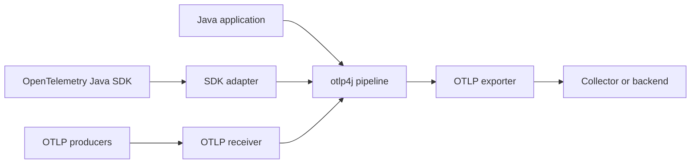

# otlp4j

otlp4j is a Java 25 library for receiving, processing, and exporting [OpenTelemetry Protocol (OTLP)](https://opentelemetry.io/docs/specs/otlp/) telemetry inside a JVM. Use it to embed telemetry policy in an application, build a custom gateway, or exercise telemetry flows in tests.

Applications work with typed, immutable batches of traces, metrics, logs, and profiles. You can filter and transform batches in Java, add bounded buffering, forward to several destinations, or connect pipelines to derive another signal. The bundled transport receives and exports OTLP over gRPC and HTTP with binary protobuf.



Choose `Pipeline<T>` for one signal submitted in process. Choose `Gateway.builder()` for network receivers, named components, several pipelines, or signal-to-signal connectors. Both use the same graph runtime.

The project is experimental (`0.1.0-SNAPSHOT`). See [project scope and limits](docs/project.md) before adopting it.

## Start here

[Build your first pipeline](docs/getting-started.md) with a complete example that needs no external collector. To exercise real OTLP traffic immediately, run the self-contained sample from the repository root:

```sh
./mvnw -B -pl otlp4j-samples -am test \
  -Dtest=OtlpE2eDemoTest \
  -Dsurefire.failIfNoSpecifiedTests=false
```

The sample redacts a user identifier, enriches resource attributes, filters spans, batches the result, and exports traces and a derived metric. See [sample scenarios](otlp4j-samples/README.md) for the expected output.

## Find the guide you need

| Task | Guide |
| --- | --- |
| Decide whether to embed otlp4j | [Project scope](docs/project.md) and [SDK and Collector comparison](docs/comparison.md) |
| Install dependencies and run a first example | [Getting started](docs/getting-started.md) |
| Filter, transform, buffer, or export one signal | [Typed pipelines](docs/pipelines.md) |
| Receive OTLP, share components, or connect signals | [Gateway graphs](docs/gateways.md) |
| Configure batching, memory limiting, or routing | [Built-in components](docs/components.md) |
| Configure endpoints, TLS, headers, compression, or retries | [OTLP transport](docs/transport.md) |
| Interpret acceptance, flush reports, and shutdown | [Delivery and lifecycle](docs/delivery.md) |
| Connect OpenTelemetry Java instrumentation | [SDK integration](docs/sdk-integration.md) |
| Construct or inspect telemetry batches | [Domain model](docs/model.md) |
| Find public types or extend the library | [Public API](docs/public-api.md) |
| Understand module dependencies and wire boundaries | [Architecture](docs/architecture.md) |
| Build, test, or measure changes | [Development](docs/development.md) |
