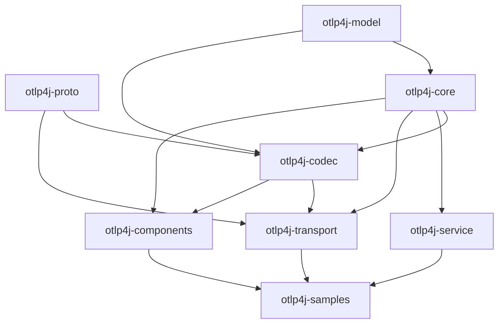

# Architecture

otlp4j is an in-process OTLP gateway. Telemetry arrives as OTLP over gRPC or HTTP, flows through a graph of components, and leaves as OTLP. The design follows the OpenTelemetry Collector's component model (receivers, processors, exporters, connectors assembled into pipelines and run by a service graph), translated into typed Java with immutable records and strict JPMS module boundaries. This document describes the modules, the component model, the payload design, the graph lifecycle, the delivery and policy vocabulary, the transport, and the self-observability surface.

## Modules and dependency direction

Dependencies run one way, from the domain up to the transport and the built-ins, and JPMS enforces the direction: no generated proto or gRPC type is exported past the codec and transport boundary.

| Layer | Module | Responsibility |
| --- | --- | --- |
| Domain | `otlp4j-model` | Immutable OTLP records for the four signals, their builders, and the attribute model. Proto-free, depends only on jspecify. |
| Contracts | `otlp4j-core` | The component SPI (four kinds plus factories), signal descriptors and batch algebra, the opaque `TelemetryPayload` and its view system, delivery results, the neutral policy vocabulary, and the `GatewayMetrics` SPI. Proto-free. |
| Wire boundary | `otlp4j-proto`, `otlp4j-codec` | Generated protobuf and gRPC stubs (qualified-exported only to codec and transport), and the model-to-proto mappers behind the two payload implementations, reached through the `Payloads` facade. |
| Orchestration | `otlp4j-service` | The declarative `GatewayConfig`, the JGraphT service graph, the validation diagnostics, and the `Gateway` builder and `GatewayRuntime`. |
| Transport | `otlp4j-transport` | The one Armeria implementation of both OTLP/gRPC and OTLP/HTTP: two graph factories, two standalone entry points, admission control, and retry. |
| Built-ins | `otlp4j-components` | The batch, memory-limiter, filter, and routing processors, and the span-count connector. |
| Verification | `otlp4j-testing`, `otlp4j-conformance`, `otlp4j-coverage`, `otlp4j-benchmarks` | Reusable conformance and policy suites, their Armeria instantiations, coverage aggregation, and JMH benchmarks. |

The payload design is what keeps the direction clean past the domain: `otlp4j-service`, `otlp4j-transport`, and `otlp4j-components` import zero `dev.nthings.otlp4j.model` types on their hot paths, so a same-protocol relay never materializes the domain (see the no-materialization guarantee below).

## The component model

A component is an `AutoCloseable` with a deadline-bounded lifecycle: `start`, an optional `forceFlush`, and `shutdown`, each returning a `CompletionStage`. `close()` is the try-with-resources idiom, a synchronous drain within a ten-second grace period that rethrows a failure wrapped in an `IllegalStateException` rather than logging (the contracts module carries no logging dependency).

There are four component kinds, each with its own factory contract in `otlp4j-core`:

| Kind | Factory | What it does |
| --- | --- | --- |
| Receiver | `ReceiverFactory` | Accepts OTLP off the wire and hands each signal to its downstream consumer. |
| Processor | `ProcessorFactory` | Transforms, filters, or buffers a batch and forwards what survives. |
| Exporter | `ExporterFactory` | Terminates a pipeline by sending or sinking a batch, returning a delivery result. |
| Connector | `ConnectorFactory` | Bridges one pipeline's output into another pipeline's input, deriving one signal from another. A connector is the only way pipelines compose. |

A factory declares its component `type()` (for example `otlp`, `otlphttp`, `batch`), its `defaultConfig()`, and a `create(...)` seam the graph calls with a typed configuration. A connector additionally declares the `Set<SignalPair<?, ?>>` it supports (the span-count connector supports `(TRACES, METRICS)`). Configuration is a `ComponentConfig`; a component that needs none returns the shared `ComponentConfig.NONE` singleton.

Two static seams collapse the boilerplate a trivial component would otherwise cost, and both keep their factory in `otlp4j-core`:

- `ProcessorFactory.of(type, signal, transform, payloads)` builds a non-mutating processor from a single batch transform (`UnaryOperator<@Nullable M>`, returning `null` to drop the batch). The `payloads` argument is the emit seam, `Payloads.DOMAIN` from the codec, so the factory needs no codec dependency of its own.
- `ExporterFactory.of(type, terminal)` builds a terminal exporter from one lambda that consumes a payload and completes with a delivery result stamped with the facet's provenance.

## Payloads and views

The unit that flows between components is a `TelemetryPayload`: an opaque, signal-tagged carrier that hides whether the batch is currently proto bytes or domain records. A component reads what it needs through a `PayloadView` rather than by forcing a representation. The load-bearing view is `DOMAIN_IMMUTABLE` (the typed `TracesData`/`MetricsData`/`LogsData`/`ProfilesData` records, materialized lazily on first request), alongside lighter views for routing metadata and item counts that answer without materializing anything.

There are two payload implementations behind the codec's `Payloads` facade: a proto-backed one built from a wire request, and a domain-backed one built from a domain batch (`Payloads.domain(signal, batch)`). Each caches the other representation lazily and only when a consumer actually asks for it.

**The no-materialization guarantee.** A payload that arrives as proto and leaves as proto (a same-protocol relay, or a routing decision made on metadata) is never turned into domain records. Only a component that reads the domain, an inline `ProcessorFactory.of` transform or an exporter that inspects the batch, triggers the lazy materialization, and only for the signal it touches. This is what lets the service, transport, and components modules stay free of `otlp4j-model` imports on the hot path, and it is parity-tested (a proto payload and a domain payload agree on item counts and routing metadata without either being materialized).

## The service graph and its lifecycle

`otlp4j-service` turns a declarative `GatewayConfig` (components keyed by `ComponentId`, pipelines keyed by `PipelineId`, and service options) into a running `GatewayRuntime`. There are two ways to produce the config:

- `Gateway.builder()` returns a fluent `GatewayBuilder` whose `receiver`/`processor`/`exporter`/`connector` registrations each return a typed handle (`ReceiverHandle`, `ProcessorHandle`, `ExporterHandle`, `ConnectorHandle`). Pipelines are wired from handles (`p -> p.from(in).via(enrich, batch).to(out, spanCount)`), so referencing an unregistered or wrong-kind component is a compile error rather than one of the runtime `UNKNOWN_*` diagnostics.
- `Gateway.compile(config)` takes a `GatewayConfig` constructed directly, the path a future declarative loader would target. It runs the same validation and materialization (the package-private `GatewayCompiler`).

Both paths build one JGraphT DAG. Validation emits diagnostics with codes such as `UNKNOWN_RECEIVER_REF`, `UNKNOWN_EXPORTER_REF`, `PIPELINE_WITHOUT_RECEIVERS`, and `PIPELINE_WITHOUT_EXPORTERS`; a `GraphValidationException` collects every diagnostic rather than failing on the first. Fan-out is inserted where one producer feeds several consumers.

Start and shutdown order both derive from the one DAG:

- **Start** walks the graph in reverse-topological order, so an exporter is live before the receiver that feeds it. If a component's start fails or times out, the runtime rolls back by shutting down every component it had already started, then throws a `GatewayStartException` naming the offending component.
- **Shutdown** walks the data path in forward-topological order, so receivers stop first (in-flight requests drain through the still-live pipeline), then processors and connectors, then exporters. Shutdown is best-effort: a failing component does not abort the rest, and the first failure is rethrown at the end. `GatewayRuntime.close()` swallows that failure as a warning for the try-with-resources idiom.

`GatewayRuntime.boundPort(id)` returns the `OptionalInt` port a network-bound receiver actually bound (resolving the component and narrowing it to `NetworkBound` internally), which is how a caller reads an ephemeral receiver's port.

## Delivery results and policies

Every consume completes with a `DeliveryResult`, one of three shapes:

- `Accepted` (the downstream took every item),
- `Partial(rejectedItems, message)` (some items rejected), or
- `Rejected(disposition, reason, retryAfter, downstream)` (the whole payload rejected).

A rejection's `Disposition` is the retry axis: `RETRYABLE` maps to gRPC `UNAVAILABLE` / HTTP `503` and may carry a `retryAfter` backpressure hint, while `PERMANENT` tells the sender not to retry. The `reason` and the `downstream` marker are orthogonal diagnostics. On the wire these map to OTLP partial-success responses and the corresponding status.

The neutral policy vocabulary in `core.policy` is what components and the transport configure behavior with, so the same knobs read the same way everywhere:

| Policy | Governs |
| --- | --- |
| `BatchPolicy` | Batch size and byte triggers, flush timeout, and per-signal splitting. |
| `DeliveryQueuePolicy` | Bounded-queue capacity, concurrency, and the `OverflowPolicy` on a full queue. |
| `OverflowPolicy` | What a full bounded queue does (block or drop). |
| `RetryPolicy` / `BackoffPolicy` | Maximum attempts, exponential backoff, and whether to respect a server `Retry-After`. |
| `TimeoutPolicy` | The single expression of per-attempt and total timeouts. |

## Transport

`otlp4j-transport` is one module on one Armeria (plus Netty) runtime, serving and speaking both OTLP/gRPC and OTLP/HTTP. The Armeria, Netty, and proto types stay inside the unexported `internal` package; the exported surface is four types plus their config records:

- `OtlpReceiverFactory` and `OtlpExporterFactory` are the graph component factories, each protocol-parameterized through `grpc()` and `http()` statics. The protocol derives the component `type()` (`otlp` for gRPC, `otlphttp` for HTTP) and the `defaultPort()` (`4317` / `4318`); the per-protocol branching lives once in the internal Armeria client and server, so the factories carry none of it.
- `OtlpReceiver` and `OtlpExporter` are standalone entry points with fluent builders (`grpcBuilder()` / `httpBuilder()`), for using the transport outside a graph.

There is one config family, not two: the graph-facing `OtlpReceiverConfig` and `OtlpExporterConfig` records are the single source of truth, consumed directly by the Armeria client and server. They express TLS, headers, compression, timeouts (as the core `TimeoutPolicy`), and the receiver-hardening limits, and each factory supplies its own default port through `defaults(int)`.

Two pieces of machinery sit on the wire boundary:

- **Admission control** on the receiver caps in-flight requests and in-flight bytes; a request over the cap is rejected retryably with a throttling `Retry-After`, and the in-flight counts are exposed as gauges.
- **Retry and pushback** on the exporter: the client retries on the retryable OTLP and transport statuses per `RetryPolicy`, decoding a server's `grpc-status-details-bin` `RetryInfo` trailer or HTTP `Retry-After` to honor server-driven backoff, and encoding the same when it rejects retryably.

## Self-observability

Components report their own health through the `GatewayMetrics` SPI: a registry of monotone counters and sampled gauges, namespaced `otlp4j.*`, reached through the component context at start and through the transport builders' `telemetry(...)`. The default is a shared no-op that costs a method call and no allocation. The samples module ships a slf4j `LoggingGatewayMetrics`, and `otlp4j-testing` ships a `RecordingGatewayMetrics` for assertions.

| Instrument | Kind | Meaning |
| --- | --- | --- |
| `otlp4j.exporter.export.success` | counter | Exports the downstream acknowledged. |
| `otlp4j.exporter.export.failure` | counter | Exports rejected or failed with an exception. |
| `otlp4j.exporter.export.items` | counter | Items sent. |
| `otlp4j.exporter.export.bytes` | counter | Serialized bytes sent. |
| `otlp4j.exporter.export.duration.nanos` | counter | Accumulated export latency in nanoseconds. |
| `otlp4j.exporter.export.retries` | counter | Retry attempts made. |
| `otlp4j.receiver.admission.in_flight.requests` | gauge | Requests currently admitted and in flight. |
| `otlp4j.receiver.admission.in_flight.bytes` | gauge | Bytes currently admitted and in flight. |
| `otlp4j.receiver.admission.rejected` | counter | Requests rejected by admission control. |
| `otlp4j.receiver.tap.dropped` | counter | Batches a slow observation tap dropped. |

The span-count connector additionally emits a derived data metric named `otlp4j.connector.span.count` into its downstream metrics pipeline; that is telemetry the connector produces, not a self-observability instrument.
