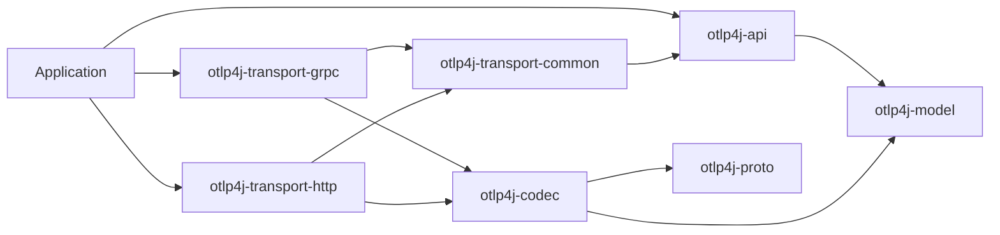
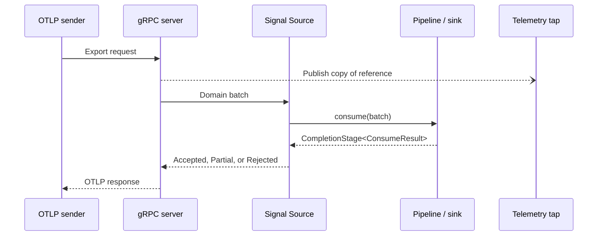

# Architecture

otlp4j isolates the wire protocol from its public Java API. Applications exchange immutable domain records with signal-specific sinks; only the transport maps those records to generated OTLP messages.

## Module boundaries

The dependency graph is deliberately one-way:

`otlp4j-api` re-exports the model module but does not read the codec, transport, or proto modules. `otlp4j-proto` qualified-exports its generated packages only to `otlp4j-codec` and the two transports. `otlp4j-transport-common` exports `dev.nthings.otlp4j.transport.common` and qualified-exports its `internal` package only to the two transports, and each transport exports just its public `transport.grpc`/`transport.http` package.

There is no provider-discovery step. An application picks a transport by instantiating the concrete entry point — `OtlpGrpcExporter`/`OtlpGrpcReceiver` (gRPC + Netty) or `OtlpHttpExporter`/`OtlpHttpReceiver` (JDK `java.net.http`/`jdk.httpserver`). Each is built directly on an `OtlpClient`/`OtlpServer` implementation of the contracts in the api's `dev.nthings.otlp4j.spi` package and shares the `otlp4j-codec` proto↔domain mappers. The wrapping that turns wire implementations into the user-facing surface lives in `otlp4j-transport-common`: `ClientExporter` adapts any `OtlpClient` into an `OtlpExporter` (facet fan-out, reference counting, leak warning), `ServerReceiver` adapts any `OtlpServer` into a `Receiver` (per-signal sources, tap mirroring, dispatch), `AdmissionControl` gates in-flight work, and the `AbstractExporterBuilder`/`AbstractReceiverBuilder` bases carry the shared fluent configuration surface. The two transport modules are independent, so an HTTP-only deployment never pulls in gRPC or Netty, and a gRPC-only one never pulls in the HTTP server.

## Request path

Each signal follows the same asynchronous request and acknowledgement path:

The transport converts a completed `ConsumeResult` into the signal's OTLP partial-success response. A thrown exception or exceptionally completed stage becomes a gRPC failure. The tap is unconditionally outside this acknowledgement path: every tap overflow strategy resolves immediately on the publishing thread.

Before decode-and-dispatch, each transport checks the receiver's global `AdmissionControl` (from `ServerConfig.maxInFlightRequests`/`maxInFlightBytes`, both off by default): at capacity the request is rejected retryably — gRPC `UNAVAILABLE` "receiver at capacity", HTTP `429` — carrying the configured `throttleRetryAfter` hint when set. The permit spans the whole asynchronous dispatch, so slow pipelines bound in-flight work rather than just connection counts.

An unattached source returns a retryable `Rejected` so missing or late wiring is visible to the sender. A source has one attachment slot; fan-out must therefore be part of the attached consumer graph. If accept-and-drop is intentional for a signal, attach it with `Source.discard()`.

## Pipeline semantics

`Pipeline.from(source)` composes batch operations before attaching one terminal consumer:

- `transform` rewrites one batch synchronously without changing its signal type. Transforms are 1-to-1 and must return non-null; a null return is a contract violation rejected permanently. Dropping a batch is `filter`'s job.
- `process` adds an asynchronous 1-to-1 stage (`Processor<T>`, completing a `CompletionStage`); the pipeline delivers downstream only when the stage completes, so the transport acknowledgement covers it. Fully synchronous pipelines keep a plain-function fast path with no per-batch future allocation.
- `filter` acknowledges a batch as accepted without forwarding it when the predicate returns false.
- `owns` registers an `AutoCloseable` reachable only behind a bare lambda terminal, or an exporter fronted by a `BatchingProcessor` (which drains its own queue but does not close its downstream), for the subscription to drain on shutdown and flush on `forceFlush`.
- `to` attaches one terminal consumer; pass `FanOut.of(...)` to send the same batch to several peers concurrently. A single peer collapses to the peer itself; an empty peer set is a no-op sink that accepts and discards.

Fan-out sends the same immutable batch reference to every peer. If any peer rejects the batch, the merged result is rejected (a retryable merge carries the longest peer retry-after hint). Otherwise, partial rejection uses the largest rejected-item count rather than a sum because all peers saw the same input.

Pipeline subscriptions drain any terminal or fan-out peer that implements `AutoCloseable` — including exporter facets (which carry their exporter's lifecycle), a directly attached `BatchingProcessor`, closeable processors, and connectors (which cascade shutdown to the downstream they wrap) — plus any resource registered with `Stage.owns(...)` for the case the pipeline can't see, such as an exporter behind a bare lambda terminal or fronted by a batching processor. Collected resources are deduplicated by reference identity, so a resource reachable twice is retained once and shut down once. A multi-signal exporter is reference-counted (`SharedLifecycle`), so a channel shared by facets in two subscriptions closes only once both have shut down. All drain within one shared deadline. An exporter collected without a `shutdown()`/`close()` logs a warning, so a leaked channel surfaces in the logs rather than silently.

`Wiring` aggregates a whole gateway's lifecycle into one handle: receivers stop first (in-flight requests finish through the live pipeline), then pipeline subscriptions drain, then directly-owned resources close — one shared deadline, best-effort with first-error rethrow, idempotent, deduplicated across phases.

There is deliberately no internal wiring graph. A graph cannot see resources hidden behind lambdas (the reason `owns` exists), cross-pipeline sharing is already handled by `SharedLifecycle` reference counting, and within one pipeline the topology is a known linear chain with fan-out leaves whose collection walk is already topological. The linear DSL plus `Wiring` covers the real ordering problems without a graph dependency.

## Processing and routing

Built-in stateless transforms filter spans or log records and add resource attributes to any signal. Empty resource and scope groups are removed by the record-level filters.

`BatchingProcessor<T>` buffers complete domain batches, then merges their top-level resource groups per signal. It flushes when the queue reaches the `flushThreshold`, on a periodic one-second timer (one JVM-wide platform daemon drives every batcher's timer), or through `forceFlush`/`shutdown`. Enqueueing acknowledges immediately, so a failed timer/threshold drain is logged and its batches lost by default; the opt-in `reflectDownstreamFailures` mode instead reflects a failed drain back at ingress as retryable rejections with a one-flush-interval retry-after hint until a drain succeeds or the window admits a probe. Profiles batching is available only through the experimental `forProfilesUnsafe()` factory.

`Connector<I, O>` is the general signal-changing bridge: subclasses implement one synchronous `derive(I)` method mapping an input batch to zero or one downstream batch, and the base class owns delivery, failure normalization, the `FailurePolicy` contract, and the lifecycle cascade (with `onShutdown`/`onForceFlush` hooks for connector-local state, run before the downstream cascade). `Connectors.spanCount` (emitting `otlp4j.connector.span.count`) and `Connectors.logRecordCount` (`otlp4j.connector.log.record.count`) are the built-in instances. These count sinks consume their input signal and send the derived `MetricsData` to a supplied `MetricsSink`; they do not forward the original batch. As a `Lifecycle`, a connector cascades `shutdown`/`forceFlush` to its downstream and propagates the pipeline's ownership to it, so attaching the connector drains its downstream automatically. Each count flush carries a real per-series delta window — `[previous flush, now)`, monotonic even under concurrent calls or a backward wall-clock step. A `FailurePolicy` (default `BEST_EFFORT`) decides how a derived-delivery failure maps back onto the input: `BEST_EFFORT` accepts the input and logs the failure, while `FAIL` propagates a downstream `Partial`/`Rejected` as a `Rejected` on the input result, preserving the retry intent and any retry-after hint.

## Receiver tap

`TelemetryTap` exposes one JDK `Flow.Publisher` per signal. Every subscriber has its own bounded queue and virtual-thread dispatcher. Each publisher has a no-arg form using `TapOptions.defaults()` and a `TapOptions`-taking overload that binds the buffer size and overflow policy to that publisher's next subscription, so options travel with the subscription instead of shared mutable tap state.

The default buffer holds 256 batches and drops the oldest on overflow. The other strategies drop the newest or terminate the overflowing subscription with an error; every strategy is non-blocking, so a slow tap subscriber can never delay the OTLP acknowledgement. `droppedCount()` is shared across the receiver's tap publishers.

## Transport implementation

The two transport modules — `otlp4j-transport-grpc` and `otlp4j-transport-http` — each implement the `OtlpClient`/`OtlpServer` SPI and share the `otlp4j-codec` proto↔domain mappers and the same `ConsumeResult`→response encoding (`SignalResponses`). Both map a whole-batch `Rejected` to a delivery error rather than `rejected_*=0`, by explicit retry intent: retryable is gRPC `UNAVAILABLE` / HTTP `503`, permanent is gRPC `INTERNAL` / HTTP `500`. A retryable rejection's optional retry-after hint is emitted on the wire — the gRPC `grpc-retry-pushback-ms` trailer (which the bundled client folds into its retry intervals; emitting `google.rpc.RetryInfo` status details is deliberately deferred, as `proto-google-common-protos` ships no stable module name for this strict-JPMS build) and the HTTP `Retry-After` header, rounded up to whole seconds.

**gRPC.** The client uses blocking gRPC stubs on a virtual-thread-per-task executor and bounds each export stage with the configured timeout. The server exposes trace, metric, log, and experimental profile collector services. The client selects channel credentials from `Tls` — plaintext, JVM default trust, a custom certificate bundle (PEM file paths or in-memory bytes), or a caller-built `SSLContext` (whose `X509TrustManager` gRPC uses for server verification; gRPC has no `SSLContext` door, so a client certificate inside the context is not presented) — attaches the configured headers to every call (re-evaluating a header supplier per call when one is set), requests gzip compression when configured, and executes retry through the shared Resilience4j retry adapter. The adapter uses the caller's `RetryConfig`, applies the OTLP/gRPC retryable status set, and folds `grpc-retry-pushback-ms` into the retry interval. The server, built on `NettyServerBuilder`, selects its credentials from `Tls` (`Disabled` for plaintext, `Custom`/`Inline` for a server certificate and key from paths or bytes; `SystemTrust` and `SslContext` are rejected, having no server certificate) and binds the configured `bindHost`: a wildcard host (empty, `0.0.0.0`, or `::`) binds every interface, while any other host binds that specific interface, so `127.0.0.1` yields a loopback-only receiver. It also applies the receiver-hardening limits from `ServerConfig` — a decoded-request size cap, an optional per-connection concurrency cap, optional global in-flight request/byte caps (enforced by the shared `AdmissionControl` around each dispatch, sizing requests via `getSerializedSize`), a handshake deadline, and an optional bounded executor. Compression is decode-only on the server: gzip request bodies decode via gRPC's default decoder and there is no server compression knob.

**HTTP.** The client (`java.net.http.HttpClient`) POSTs each signal's serialized `Export*ServiceRequest` to its standard path (`/v1/traces`, `/v1/metrics`, `/v1/logs`, `/v1development/profiles`) as `application/x-protobuf`, on a virtual-thread-per-task executor with the export stage bounded by the configured timeout. The scheme follows `Tls` (`http`/`https`), with a JDK `SSLContext` built from the same PEM material the gRPC transport consumes (`PemSsl`, from file paths or in-memory bytes) or supplied directly through `Tls.sslContext(...)`; headers attach to every request (re-evaluating a header supplier per request when set), `Compression.GZIP` gzips the body with `Content-Encoding: gzip`, a configured `connectTimeout` bounds connection setup (falling back to the request timeout), and the same shared Resilience4j retry adapter handles retryable statuses (408/429/502/503/504), I/O failures, and `Retry-After`. The server (`com.sun.net.httpserver`) registers a handler per signal path, transparently inflates gzip request bodies, enforces the decoded-size cap (→ `413`) and the optional global in-flight caps (→ `429` with an optional `Retry-After`), and rejects a bad method (`405`) or malformed body (`400`); without a configured executor it runs handlers on a virtual-thread-per-task executor. `Tls.Custom`/`Tls.Inline` serves over `HttpsServer`; `Tls.SystemTrust` and `Tls.SslContext` are rejected as for gRPC. `maxConcurrentCallsPerConnection` has no HTTP equivalent and is not applied.

An alternate transport can vary any of this without changing the application API.

## Model fidelity

Traces, logs, and the metric aggregations round-trip between domain and proto representations, including metric exemplars: each number, histogram, and exponential-histogram point carries a `List<Exemplar>` mapped in both directions. A `Metric` whose wire `data` was unset round-trips as the non-null `Metric.NoData` form rather than `null`, so callers switch over `Metric.data()` and handle `NoData` instead of null-checking. Profiles round-trip losslessly through opaque passthrough rather than a fully modeled payload — each `Profile` carries the serialized proto `Profile` bytes and the batch carries the serialized `ProfilesDictionary`, so samples, locations, mappings, string tables, and the original payload re-emits byte-for-byte while only the resource/scope wrapper is modeled. The remaining gap is stable profiles support, because the bundled schema is OpenTelemetry `v1development`.

Trace and span IDs are hex strings in the domain model. Encoding malformed hex fails at the transport boundary. Span flags use a Java `long`; OTLP encoding keeps the wire-format unsigned 32-bit value.
