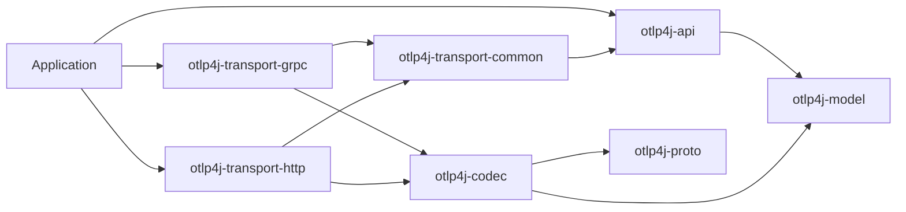
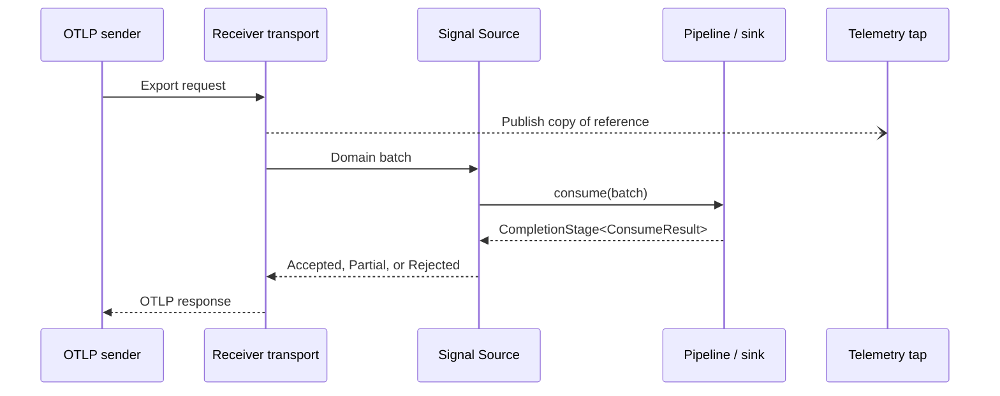

# Architecture

otlp4j isolates the wire protocol from its public Java API. Applications exchange immutable domain records with signal-specific sinks; only the transport maps those records to generated OTLP messages.

## Module boundaries

The dependency graph is deliberately one-way:

`otlp4j-api` re-exports `otlp4j-model` (so API signatures expose model types with no extra `requires`) but never reads the codec, transport, or proto modules. `otlp4j-proto` qualified-exports its generated packages only to `otlp4j-codec` and the two transports, keeping proto and gRPC types out of the user-facing surface. `otlp4j-transport-common` exports `dev.nthings.otlp4j.transport.common` and qualified-exports its `internal` package only to the two transports; each transport exports just its `transport.grpc` / `transport.http` entry-point package.

There is no provider discovery. An application picks a transport by instantiating a concrete entry point: `OtlpGrpcExporter`/`OtlpGrpcReceiver` (gRPC on Netty) or `OtlpHttpExporter`/`OtlpHttpReceiver` (JDK `java.net.http` / `jdk.httpserver`). Each is built on an `OtlpClient`/`OtlpServer` implementation of the `dev.nthings.otlp4j.spi` contracts and shares the `otlp4j-codec` proto/domain mappers. `otlp4j-transport-common` turns those wire implementations into the user-facing surface: `ClientExporter` adapts an `OtlpClient` into an `OtlpExporter` (facet fan-out, reference-counted channel, GC leak warning), `ServerReceiver` adapts an `OtlpServer` into a `Receiver` (per-signal sources, tap mirroring, dispatch), `AdmissionControl` gates in-flight work, and `AbstractExporterBuilder`/`AbstractReceiverBuilder` carry the shared fluent configuration. The two transport modules are independent, so an HTTP-only deployment never pulls in gRPC or Netty, and a gRPC-only one never pulls in the HTTP server.

## Request path

Each signal follows the same asynchronous request and acknowledgement path:

The transport converts a completed `ConsumeResult` into the signal's OTLP partial-success response. A thrown exception or exceptionally completed stage becomes a transport failure. The tap sits outside this acknowledgement path unconditionally: every tap overflow strategy resolves immediately on the publishing thread.

Before decode-and-dispatch, each transport checks the receiver's global `AdmissionControl` (from `ServerConfig.maxInFlightRequests`/`maxInFlightBytes`, both off by default): at capacity the request is rejected retryably (gRPC `UNAVAILABLE` "receiver at capacity", HTTP `429`), carrying the configured `throttleRetryAfter` hint when set. The permit spans the whole asynchronous dispatch, so slow pipelines bound in-flight work rather than just connection counts.

An unattached source returns a retryable `Rejected`, so missing or late wiring is visible to the sender. A source has one attachment slot, so fan-out must be part of the attached consumer graph; attach `Source.discard()` when accept-and-drop is intentional.

## Pipeline semantics

`Pipeline.from(source)` composes batch operations before attaching one terminal consumer:

- `transform` rewrites one batch synchronously without changing its signal type. Transforms are 1-to-1 and must return non-null; a null return is a contract violation rejected permanently. Dropping a batch is `filter`'s job.
- `transformAsync` adds an asynchronous 1-to-1 stage (`AsyncTransform<T>` completing a `CompletionStage`); the pipeline delivers downstream only when the stage completes, so the transport acknowledgement covers it. A fully synchronous pipeline keeps a plain-function fast path with no per-stage future allocation ahead of the terminal.
- `filter` acknowledges a batch as accepted without forwarding it when the predicate returns false.
- `via` inserts a same-signal `Processor<T>` mid-chain: it receives the batch plus `next` (the rest of the chain) and controls delivery itself — drop, forward, coalesce, or split, 1-to-N where `transform` is strictly 1-to-1. A stateful processor implementing `Lifecycle`/`AutoCloseable` is auto-collected and drained before the downstream it feeds, the same auto-collection `transformAsync` already gets. `Batcher<T>` is itself rebuilt on `Processor`, so `.via(Batcher.forTraces().buildProcessor())` batches mid-chain, capturing `next` from the pipeline rather than a builder-bound downstream.
- `owns` registers an `AutoCloseable` the pipeline cannot otherwise reach (behind a bare lambda terminal, or an exporter fronted by a `Batcher` bound via `.downstream(...)`, which drains its own queue but not its downstream), so the subscription drains it on shutdown and flushes it on `forceFlush`. A stateful `.via` processor needs no such declaration; it is auto-collected structurally.
- `to` attaches one terminal consumer; pass `FanOut.of(...)` to send the same batch to several peers concurrently. A single peer collapses to the peer itself; an empty peer set is a no-op sink that accepts and discards.

Fan-out sends the same immutable batch reference to every peer. If any peer rejects, the merged result is rejected (a retryable merge carries the longest peer retry-after hint); otherwise a partial result uses the largest rejected-item count rather than a sum, because all peers saw the same input.

A subscription drains every terminal or fan-out peer that implements `AutoCloseable`: exporter facets carrying their exporter's lifecycle, a directly attached `Batcher`, closeable async transforms, closeable/`Lifecycle` mid-chain processors attached via `.via`, and connectors that cascade to the downstream they wrap, plus any `owns(...)` resource, all within one shared deadline. Collected resources are deduplicated by reference identity, so a resource reachable twice is retained and shut down once. A multi-signal exporter is reference-counted (`SharedLifecycle`), so a channel shared by facets in two subscriptions closes only once both have shut down. The drain itself logs nothing; the leak backstop lives on the exporter, whose GC cleaner warns if the exporter is collected having never been shut down.

`Wiring` aggregates a whole gateway's lifecycle into one handle: receivers stop first (in-flight requests finish through the live pipeline), then pipeline subscriptions drain, then directly-owned resources close, on one shared deadline, best-effort with first-error rethrow, idempotent and deduplicated across phases.

There is deliberately no internal wiring graph. A graph cannot see resources hidden behind lambdas (the reason `owns` exists), cross-pipeline sharing is already handled by `SharedLifecycle` reference counting, and within one pipeline the topology is a known linear chain with fan-out leaves whose collection walk is already topological. The linear DSL plus `Wiring` covers the real ordering problems without a graph dependency.

## Processing and routing

Built-in stateless transforms filter or rewrite spans and log records and set resource attributes on any signal; the record-level filters prune empty resource and scope groups.

`Processor<T>` is the extensible, same-signal mid-chain component: a pure SAM, `process(T batch, Sink<? super T> next)`, mirroring `AsyncTransform`'s "pure SAM, lifecycle opt-in" shape rather than baking `Lifecycle` into the contract, so a stateless processor stays a plain lambda. `Processors.pruning`/`Processors.of` name stateless processors; `pipeline.ops.AbstractProcessor<T>` is the base for a stateful one, owning a captured-`next` accessor and an idempotent shutdown so a buffering subclass can flush into the chain continuation from its `onShutdown`/`onForceFlush` hooks. A plain-`Lifecycle` `AbstractProcessor` is single-attachment by design (one instance, one pipeline chain); genuine cross-pipeline sharing requires the stage to implement `SharedLifecycle` itself, exactly as `Connector`/`ClientExporter.Facet` do. Outside the DSL, `Processor#asSink(downstream)` binds a fixed downstream into a terminal `Sink`, cascading lifecycle to both sides like `Connector`.

`Batcher<T>` is rebuilt on `Processor`: it still `implements Sink<T>, Lifecycle` for the bound/terminal form (`.downstream(...).build()`, unchanged), and now additionally `implements Processor<T>` for a mid-chain form (`.via(Batcher.forTraces().buildProcessor())`) that captures its drain target from the pipeline's own chain continuation instead of a builder-bound sink. Either way it merges buffered batches by concatenating their top-level resource groups per signal (it does not coalesce identical resources), flushing when the queue reaches `flushThreshold`, on a periodic one-second timer (one JVM-wide platform daemon drives every batcher's timer), or through `forceFlush`/`shutdown`. Enqueueing acknowledges immediately, so a failed timer or threshold drain is logged and its batches lost by default; the opt-in `reflectDownstreamFailures` mode instead reflects a failed drain back at ingress as retryable rejections with a one-flush-interval retry-after hint until a drain succeeds or the window admits a probe. Profiles batching is available only through the experimental `forProfilesUnsafe()` factory. `shutdown` still drains only the batcher's own queue and never cascades to its downstream in either form — the bound form's downstream needs `owns(...)`, the mid-chain form's downstream is the pipeline's own tracked continuation.

`Connector<I, O>` is the general signal-changing bridge: subclasses implement one synchronous `derive(I)` method mapping an input batch to zero or one downstream batch, and the base class owns delivery, failure normalization, the `FailurePolicy` contract, and the lifecycle cascade (with `onShutdown`/`onForceFlush` hooks for connector-local state, run before the downstream cascade). `Connectors.spanCount` (emitting `otlp4j.connector.span.count`) and `Connectors.logRecordCount` (`otlp4j.connector.log.record.count`) are the built-in instances: they consume their input signal and send a derived `MetricsData` to a supplied `MetricsSink` without forwarding the original batch. Each count flush carries a real delta window from the previous flush to now, monotonic even under concurrent calls or a backward wall-clock step. As a `Lifecycle`, a connector cascades `shutdown`/`forceFlush` to its downstream and takes on the pipeline's ownership of it, so attaching the connector drains its downstream automatically. A `FailurePolicy` (default `BEST_EFFORT`) decides how a derived-delivery failure maps back onto the input: `BEST_EFFORT` accepts the input and logs the failure, while `FAIL` propagates a downstream `Partial`/`Rejected` (or a `derive` throw) as a `Rejected` on the input result, preserving the retry intent and any retry-after hint. An `Error` is always rethrown, never absorbed.

## Receiver tap

`TelemetryTap` exposes one JDK `Flow.Publisher` per signal. Every subscriber gets its own bounded queue and virtual-thread dispatcher. Each publisher has a no-arg form using `TapOptions.defaults()` and a `TapOptions`-taking overload that binds the buffer size and overflow policy to that publisher's next subscription, so options travel with the subscription instead of shared mutable tap state.

The default buffer holds 256 batches and drops the oldest on overflow; the other strategies drop the newest or terminate the overflowing subscription with an error. Every strategy is non-blocking, so a slow tap subscriber can never delay the OTLP acknowledgement. `droppedCount()` is shared across the receiver's tap publishers.

## Transport implementation

The two transport modules each implement the `OtlpClient`/`OtlpServer` SPI and share the `otlp4j-codec` mappers and the same `ConsumeResult`-to-response encoding (`SignalResponses`). Both map a whole-batch `Rejected` to a delivery error rather than `rejected_*=0`, by explicit retry intent: retryable is gRPC `UNAVAILABLE` / HTTP `503`, permanent is gRPC `INTERNAL` / HTTP `500`. A retryable rejection's optional retry-after hint is emitted on the wire, as the gRPC `grpc-retry-pushback-ms` trailer (which the bundled client folds into its retry intervals; emitting `google.rpc.RetryInfo` status details is deferred, since `proto-google-common-protos` ships no stable module name for this strict-JPMS build) and the HTTP `Retry-After` header rounded up to whole seconds.

**gRPC.** The client uses blocking gRPC stubs on a virtual-thread-per-task executor and bounds each export with the configured timeout. The server exposes trace, metric, log, and experimental profile collector services. The client selects channel credentials from `Tls`: plaintext, JVM default trust, a custom certificate bundle (PEM file paths or in-memory bytes), or a caller-built `SSLContext` whose `X509TrustManager` gRPC uses for server verification (gRPC has no `SSLContext` door, so a client certificate inside the context is not presented). It attaches the configured headers to every call (re-evaluating a header supplier per call), requests gzip when configured, and runs retry through the shared Resilience4j adapter, which uses the caller's `RetryConfig`, applies the OTLP/gRPC retryable status set, and folds `grpc-retry-pushback-ms` into the retry interval. The server, on `NettyServerBuilder`, selects credentials from `Tls` (`Disabled` for plaintext, `Custom`/`Inline` for a server certificate and key from paths or bytes; `SystemTrust` and `SslContext` are rejected, having no server certificate) and binds `bindHost`: a wildcard host (empty, `0.0.0.0`, or `::`) binds every interface, and any other host binds that specific interface, so `127.0.0.1` yields a loopback-only receiver. It applies the receiver-hardening limits from `ServerConfig`: a decoded-request size cap, an optional per-connection concurrency cap, optional global in-flight request/byte caps (enforced by the shared `AdmissionControl` around each dispatch, sizing requests via `getSerializedSize`), a handshake deadline, and an optional bounded executor. Compression is decode-only: gzip request bodies decode via gRPC's default decoder and there is no server compression knob.

**HTTP.** The client (`java.net.http.HttpClient`) POSTs each signal's serialized `Export*ServiceRequest` to its standard path (`/v1/traces`, `/v1/metrics`, `/v1/logs`, `/v1development/profiles`) as `application/x-protobuf`, on a virtual-thread-per-task executor with the export bounded by the configured timeout. The scheme follows `Tls` (`http`/`https`), with a JDK `SSLContext` built from the same PEM material the gRPC transport consumes (`PemSsl`, from file paths or in-memory bytes) or supplied directly through `Tls.sslContext(...)`; headers attach to every request (re-evaluating a supplier per request), `Compression.GZIP` gzips the body with `Content-Encoding: gzip`, a configured `connectTimeout` bounds connection setup (falling back to the request timeout), and the same Resilience4j adapter handles retryable statuses (408/429/502/503/504), I/O failures, and `Retry-After`. The server (`com.sun.net.httpserver`) registers a handler per signal path, transparently inflates gzip request bodies, enforces the decoded-size cap (`413`) and the optional global in-flight caps (`429` with an optional `Retry-After`, sizing by decoded body length), and rejects a bad method (`405`) or malformed body (`400`); without a configured executor it runs handlers on a virtual-thread-per-task executor. `Tls.Custom`/`Tls.Inline` serves over `HttpsServer`; `Tls.SystemTrust` and `Tls.SslContext` are rejected as for gRPC. `maxConcurrentCallsPerConnection` has no HTTP equivalent and is not applied.

An alternate transport can vary any of this without changing the application API.

## Model fidelity

Traces, logs, and the metric aggregations round-trip between domain and proto, including metric exemplars: each number, histogram, and exponential-histogram point carries a `List<Exemplar>` mapped in both directions. A `Metric` whose wire `data` was unset round-trips as the non-null `Metric.NoData` form rather than `null`, so callers switch over `Metric.data()` and handle `NoData` instead of null-checking. Profiles round-trip losslessly through opaque passthrough rather than a fully modeled payload: each `Profile` carries the serialized proto `Profile` bytes and the batch carries the serialized `ProfilesDictionary`, so samples, locations, mappings, string tables, and the original payload re-emit byte-for-byte while only the resource/scope wrapper is modeled. The remaining gap is stable profiles support, because the bundled schema is OpenTelemetry `v1development`.

Trace and span IDs are hex strings in the domain model, and malformed hex fails at the transport boundary. Span flags use a Java `long`; OTLP encoding keeps the wire-format unsigned 32-bit value.
