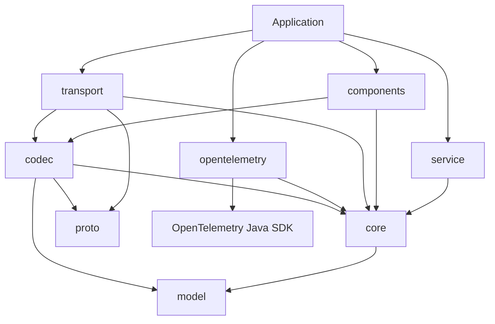

# Architecture

otlp4j combines a protocol-neutral processing runtime with bundled OTLP transport and codecs. Applications assemble the components they need; receiving network traffic is optional.

## Modules

Public library modules use the JPMS name `dev.nthings.otlp4j.<suffix>`, where the suffix is the artifact name without `otlp4j-`.

| Module | Responsibility | Application use |
| --- | --- | --- |
| `otlp4j-model` | Immutable telemetry records and common values | Construct and inspect batches |
| `otlp4j-core` | Typed signals, payloads, contexts, results, policies, and component contracts | Implement processing and extensions |
| `otlp4j-service` | Pipeline builder, gateway compiler, graph validation, and lifecycle | Assemble and own processing runtimes |
| `otlp4j-transport` | Armeria OTLP receivers and exporters | Exchange telemetry over gRPC or HTTP |
| `otlp4j-components` | Built-in processors and span-count connector | Add configured processing stages |
| `otlp4j-opentelemetry` | Official Java SDK exporter adapters | Feed local inputs from instrumentation |
| `otlp4j-codec` | Domain/protobuf conversion and wire-payload reuse | Internal implementation dependency |
| `otlp4j-proto` | Generated protobuf messages and gRPC services | Internal implementation dependency |
| `otlp4j-samples` | Runnable examples and integration canaries | Learn and exercise complete flows |
| `otlp4j-testing` | Fixtures and reusable wire/policy suites | Repository test support |
| `otlp4j-conformance` | Bundled transport's black-box suite runners | Verify wire behavior |
| `otlp4j-coverage` | Aggregate JaCoCo reporting | Inspect test coverage |
| `otlp4j-benchmarks` | JMH marshalling and network-flow measurements | Optional `bench` profile |

## Dependency direction

This diagram shows the main library dependencies. An arrow means "depends on"; the application chooses and wires factories rather than the service module depending on each implementation.

The model and core have no protobuf, network, service, or official SDK dependency. The service depends on core and uses JGraphT internally to represent and order the graph. JGraphT types do not appear in public signatures.

Transport uses Armeria and Netty for network machinery. Virtual threads support lifecycle waits and delivery workers. These implementation dependencies are outside the public configuration and consumer contracts.

## Composition and execution

`Pipeline<T>` creates a typed application input and an ordered processor chain terminating in one or more exporters. It builds a gateway graph and owns that graph's runtime.

`Gateway.builder()` adds named components and multiple pipelines. A receiver can feed several paths, exporters can be shared, and a connector can carry data from one signal pipeline to another. The compiled graph is acyclic. Validation happens before component construction.

Factory registrations create signal-specific consumers. A processor receives its downstream consumer at creation; a receiver is attached to its downstream route. Shared transports can expose several signal facets backed by one wire owner.

For wiring examples, use [Pipelines](pipelines.md) and [Gateways](gateways.md). For ordering, rollback, and ownership, use [Delivery and lifecycle](delivery.md).

## Payloads and wire fidelity

`Payload<T>` is the consumer boundary. It exposes a descriptor, domain data, item count, and routing metadata. Applications work with that contract and the [immutable model](model.md), without generated messages.

Received payloads can retain a parsed protobuf request. Metadata routing and forwarding reuse that request without constructing the domain batch. This is protobuf-object reuse, not a promise of zero-copy networking or identical complete request bytes.

A transform that returns a different batch replaces the domain data and causes encoding of that replacement. A transform that returns the batch it received leaves the payload and its parsed request in place; the model's [item operations](model.md#select-and-replace-items) do so when they change nothing. Batching also requests the domain view to merge and split items. Domain conversion preserves modeled fields; it does not expose arbitrary unknown protobuf fields. Forwarding an unchanged protobuf-backed payload retains fields present in that parsed request.

Profiles have a narrower modeling contract: raw profile bodies and shared dictionary bytes are preserved opaquely. See [Profiles](model.md#profiles) for the rules governing transformations and merging.

## JPMS encapsulation

The codec package is qualified-exported to the bundled components and transport. Generated message packages are qualified-exported to codec and transport, with collector-service packages also available to Armeria's gRPC module. These are implementation permissions, not an application-facing protobuf API.

The optional SDK bridge exports the official SDK interfaces that appear in its public adapter signatures. Applications that do not use the bridge do not need those SDK dependencies.

Some implementation dependencies are automatic modules, including dependencies beneath the graph library and the SDK bridge. JPMS encapsulation therefore does not imply that a complete runtime image can be built with `jlink`. The sample's GraalVM native-image profile is a separate packaging path; see [Development](development.md#optional-builds).

## Extension and visibility boundaries

New receiver, processor, exporter, and connector factories implement the core contracts. The service compiler assembles them without requiring a transport-specific implementation. Configuration belongs to the component and uses `ComponentConfig`; delivery outcomes use core result types.

`GatewayMetrics` supplies optional counters and gauge registrations without choosing a monitoring backend. It defaults to a no-op implementation. See [Public API](public-api.md#self-observability) for installation and thread-safety requirements.
