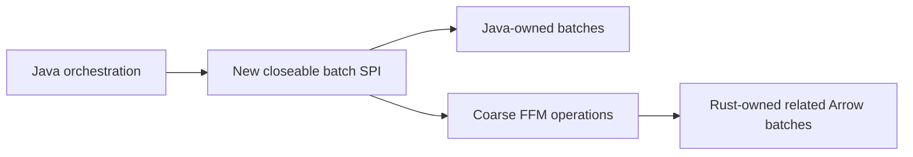
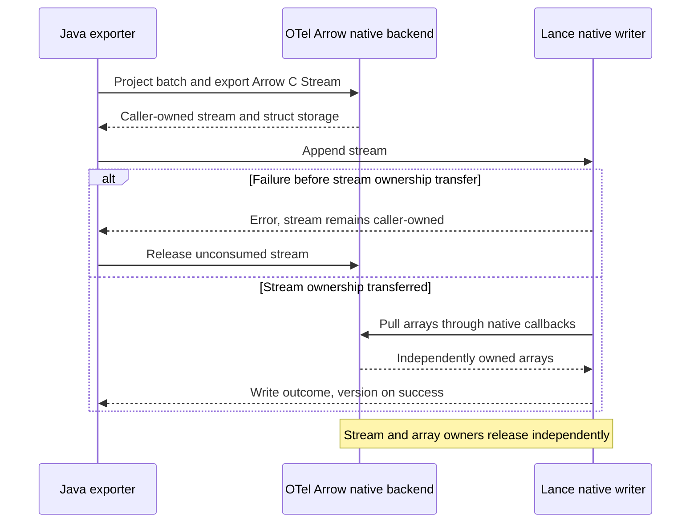

# Otlp4j greenfield Arrow viability

**No fatal structural blocker was found. It is worth trying a bounded retained native-batch processing backend, not committing to a complete provider yet.** With breaking changes allowed, SPI creation, high-level API redesign, module boundaries, and the old payload lifetime are not blockers. No compatibility shims, legacy snapshots, or automatic provider fallback are needed. Rust OTel-Arrow supplies real native operations, not merely conversion APIs, and lance4j establishes a practical C ABI/FFM pattern. The investment needs substantial work retained natively, a concrete OTAP interoperability requirement, or a [direct columnar storage use case](#direct-export-to-lance). **Adding Arrow conversion to cheap OTLP passthrough or JVM row callbacks is not, by itself, worth it.**

## Native operations make the idea worth testing

Public synchronous `pdata` APIs convert OTLP and encode output without launching the collector engine/controller or a runtime. Public operations include concatenate/reindex/schema unification, split/rebatch, `filter_otap_batch` with child propagation, log/metric filters, and `apply_attribute_transform` with rename/delete/insert/upsert/update. This supports useful processing while batches remain Rust-owned; general query acceleration and full expression semantics are not established. A custom C wrapper still needs implementation. ([payload.rs](https://github.com/open-telemetry/otel-arrow/blob/ddf1675fe65543594ce8149a34eadec5e17d40e8/rust/otap-dataflow/crates/pdata/src/payload.rs), [concatenate.rs](https://github.com/open-telemetry/otel-arrow/blob/ddf1675fe65543594ce8149a34eadec5e17d40e8/rust/otap-dataflow/crates/pdata/src/otap/transform/concatenate.rs), [filter.rs](https://github.com/open-telemetry/otel-arrow/blob/ddf1675fe65543594ce8149a34eadec5e17d40e8/rust/otap-dataflow/crates/pdata/src/otap/filter.rs), [transform.rs](https://github.com/open-telemetry/otel-arrow/blob/ddf1675fe65543594ce8149a34eadec5e17d40e8/rust/otap-dataflow/crates/pdata/src/otap/transform.rs))

**Proposed contract:** closeable provider-owned batches, explicit capabilities, coarse decode/operation/encode calls, and independently owned output buffers. Both providers implement it directly: Java owns its representation, Rust owns Arrow buffers, and Java orchestrates scheduling and delivery. Give retained users/branches separate leases; consuming operations take ownership, and queues release on delivery, rejection, or eviction. Publish immutable batches or consume exclusively owned inputs. Serialize mutable sessions, protect close against active calls, and account for native allocations. These are greenfield contract choices, not migration obstacles.

Lance4j supplies concrete downcalls and close-race protection; copying its full Lance/Tokio runtime is unnecessary. Breaking ABI changes are acceptable, but same-release Java/Rust artifacts must agree on symbols, layouts, and ownership. Arrow Java/C Data is optional, not needed first. Its JNI bridge is not disqualifying because JNI is not forbidden; Rust-owned batches can avoid that layer altogether. ([LanceAbi.java](https://github.com/thiagogcm/lance4j/blob/4db50b8544e89782e1deb7630da2bca40adc2609/lance-abi-ffm/src/main/java/dev/nthings/lance4j/lanceabi/ffm/LanceAbi.java), [GatedHandle.java](https://github.com/thiagogcm/lance4j/blob/4db50b8544e89782e1deb7630da2bca40adc2609/lance-abi-ffm/src/main/java/dev/nthings/lance4j/lanceabi/ffm/GatedHandle.java))

## Missing features and operation limits need explicit decisions

Logs, traces, and standard metric kinds are supported. **Profiles and nonempty multivariate metrics are missing:** a profile-complete native provider needs new Rust representation/conversion implementation, not just bindings. Exclude unsupported capabilities explicitly rather than silently routing them elsewhere. ([SignalType](https://github.com/open-telemetry/otel-arrow/blob/ddf1675fe65543594ce8149a34eadec5e17d40e8/rust/otap-dataflow/crates/config/src/lib.rs), [multivariate schema](https://github.com/open-telemetry/otel-arrow/blob/ddf1675fe65543594ce8149a34eadec5e17d40e8/rust/otap-dataflow/crates/pdata/src/schema/payloads.rs))

| Actual limitation | Consequence for the new backend |
| --- | --- |
| Checked u16 counters allow 65,535 trace spans, metric **objects**, and relevant resource/scope groups | Partition before building. This is not a universal 65K datapoint/log limit. [Builders](https://github.com/open-telemetry/otel-arrow/blob/ddf1675fe65543594ce8149a34eadec5e17d40e8/rust/otap-dataflow/crates/pdata/src/encode/mod.rs) |
| Attributed-log u16 increment and log-resource index cast are unchecked | Source-visible wrap/alias risks, not executed reproductions. Fix natively or enforce preconstruction domain limits. [Log builders](https://github.com/open-telemetry/otel-arrow/blob/ddf1675fe65543594ce8149a34eadec5e17d40e8/rust/otap-dataflow/crates/pdata/src/encode/mod.rs) |
| Attribute insertion/upsert can allocate missing root IDs using an unchecked row-count cast | A decoded attribute-free logs batch with 65,536 rows and no ID column reaches a mismatched-length ID array and an `expect` panic. Fix the path or partition before attribute creation; successful decoding does not establish operation safety. This is source-backed, not an executed reproduction. [Attribute transforms](https://github.com/open-telemetry/otel-arrow/blob/ddf1675fe65543594ce8149a34eadec5e17d40e8/rust/otap-dataflow/crates/pdata/src/otap/transform.rs) |
| Standard OTLP output is capped at 256 MiB or a lower configured limit | Exceeding it returns an error, not successful truncation. Split output or reject indivisible oversized data. [ProtoBuffer](https://github.com/open-telemetry/otel-arrow/blob/ddf1675fe65543594ce8149a34eadec5e17d40e8/rust/otap-dataflow/crates/pdata/src/otlp/common.rs) |
| Existing splitters retain one giant metric intact; byte batchers are best-effort | Implement datapoint partitioning or rejection for hard bounds. Post-decode splitting cannot repair construction overflow. [split.rs](https://github.com/open-telemetry/otel-arrow/blob/ddf1675fe65543594ce8149a34eadec5e17d40e8/rust/otap-dataflow/crates/pdata/src/otap/transform/split.rs), [byte batching](https://github.com/open-telemetry/otel-arrow/blob/ddf1675fe65543594ce8149a34eadec5e17d40e8/rust/otap-dataflow/crates/pdata/src/otlp/batching.rs) |

The codec service's default best-effort decoder validates outer protobuf framing but may omit malformed nested content. Select strict decoding through the public policy or use public Prost decoding plus builders when malformed content must reject the batch. Strict parsing is not full semantic validation: wrong-length/all-zero IDs can normalize to missing and then zero. Validate the intended ingress contract separately. ([decoder policy](https://github.com/open-telemetry/otel-arrow/blob/ddf1675fe65543594ce8149a34eadec5e17d40e8/rust/otap-dataflow/crates/pdata-codec/src/decoder.rs), [OTLP decoders](https://github.com/open-telemetry/otel-arrow/blob/ddf1675fe65543594ce8149a34eadec5e17d40e8/rust/otap-dataflow/crates/pdata-codec/src/codecs/otlp.rs), [ID parsing](https://github.com/open-telemetry/otel-arrow/blob/ddf1675fe65543594ce8149a34eadec5e17d40e8/rust/otap-dataflow/crates/pdata/src/views/otlp/proto/common.rs))

Strict decoding first materializes the complete Rust Prost request, then constructs Arrow arrays. Enforce encoded/decompressed ingress bounds before decoding, decoded-cardinality limits before construction, and budgets for concurrent native work. Allocations can accumulate before an Arrow builder rejects a counter overflow. The 256 MiB output bound is neither an ingress limit nor a total-memory limit; strict validation alone does not provide resource-bounded admission.

Canonical equivalence tests normalize defaults, sort, and deduplicate. That is insufficient proof of valid telemetry multiplicity, not evidence of a production loss bug. Test actual values and relationships under the new semantics. Arrow conversion does not automatically retain unknown fields; this matters only if lossless forwarding of future fields is mandatory. ([canonical.rs](https://github.com/open-telemetry/otel-arrow/blob/ddf1675fe65543594ce8149a34eadec5e17d40e8/rust/otap-dataflow/crates/pdata/src/testing/equiv/canonical.rs))

## Workload economics and unsafe topologies determine rejection

| Intended workload | Judgment |
| --- | --- |
| Retained native batching, filters, attribute operations | Worth testing: amortize conversion over useful native work |
| Actual OTAP peer interoperability | Feature-driven justification, with stream/session testing |
| Native Lance ingestion | Feature-driven justification, with accepted storage types, ownership, and publication semantics |
| Pure OTLP relay or cheap metadata routing | Poor reason to invest: existing lazy protobuf relay already avoids domain decoding |
| Predominantly JVM SDK objects or arbitrary Java row callbacks | Weak default: conversion remains; bulk cursors/columns can help but do not turn lambdas into native vector kernels |

The break-even condition is **boundary handling + conversion + native operations + encoding < equivalent optimized Java**. Native batching/filtering can justify OTLP output; network savings require actual OTAP wire. Protobuf-to-Arrow necessarily constructs a different layout. No speedup or crossover is measured. ([ProtoRequestPayload.java](../otlp4j-codec/src/main/java/dev/nthings/otlp4j/codec/ProtoRequestPayload.java), [SdkDataMapper.java](../otlp4j-opentelemetry/src/main/java/dev/nthings/otlp4j/opentelemetry/SdkDataMapper.java))

Avoid fresh consumers for incremental OTAP, concurrent mutation of one session/batch, treating producer encoding as immutable, preserving colliding IDs during concatenation, one C Stream for the multischema batch, and long-lived pointers into reusable encoder scratch. Use ordered sessions, exclusive/consuming operations, reindexing for unrelated inputs, and independently owned outputs. These contracts must cover failure as well as success. ([producer.rs](https://github.com/open-telemetry/otel-arrow/blob/ddf1675fe65543594ce8149a34eadec5e17d40e8/rust/otap-dataflow/crates/pdata/src/encode/producer.rs), [consumer state](https://github.com/open-telemetry/otel-arrow/blob/ddf1675fe65543594ce8149a34eadec5e17d40e8/rust/otap-dataflow/crates/pdata/src/decode/decoder.rs), [encoder output](https://github.com/open-telemetry/otel-arrow/blob/ddf1675fe65543594ce8149a34eadec5e17d40e8/rust/otap-dataflow/crates/pdata-codec/src/encoder.rs))

### Plain IDs for retained processing

Maintain a plain-ID invariant before filtering, splitting, or performing analytical joins. `Consumer::consume_bar` imports OTAP batches without normalizing transport-optimized IDs, and producer encoding can introduce those encodings into a retained batch. Public `decode_transport_optimized_ids` removes them without the collector. Default concatenation is not a universal normalization guarantee: its single-input fast path returns the input unchanged. Sorting or comparing delta/quasi-delta IDs as ordinary IDs can corrupt relationships. Keep transport optimization at the encoding edge, separate from retained processing state. ([Batch normalization](https://github.com/open-telemetry/otel-arrow/blob/ddf1675fe65543594ce8149a34eadec5e17d40e8/rust/otap-dataflow/crates/pdata/src/otap.rs), [concatenation](https://github.com/open-telemetry/otel-arrow/blob/ddf1675fe65543594ce8149a34eadec5e17d40e8/rust/otap-dataflow/crates/pdata/src/otap/transform/concatenate.rs), [reindexing constraints](https://github.com/open-telemetry/otel-arrow/blob/ddf1675fe65543594ce8149a34eadec5e17d40e8/rust/otap-dataflow/crates/pdata/src/otap/transform/reindex.rs))

### Native deployment

Dependency weight remains substantial: DataFusion, Tokio/Tonic, and build helpers, even without the collector. Binary/build costs are unknown; Nix is not a proven Windows blocker, and upstream has Windows CI. Native artifacts, loading/access settings, and same-process faults are unavoidable. Native crashes can kill the JVM. These disqualify the approach only if deployment or fault-isolation requirements demand the opposite. ([pdata/Cargo.toml](https://github.com/open-telemetry/otel-arrow/blob/ddf1675fe65543594ce8149a34eadec5e17d40e8/rust/otap-dataflow/crates/pdata/Cargo.toml), [Rust CI](https://github.com/open-telemetry/otel-arrow/blob/ddf1675fe65543594ce8149a34eadec5e17d40e8/.github/workflows/rust-ci.yml))

## Evaluate complete paths for the intended workloads

Use one signal: **OTLP → strict native decode → retained native batches → representative native operation chain → OTLP encode → release**. Start with a single operation to prove integration, then evaluate the chain the product actually needs. No Java Arrow, Java callbacks, or full Rust collector is necessary for this processing experiment. Compare identical new semantics against straightforward and optimized Java. For network measurements, include presized Java HTTP serialization as a control, not a shim. ([ArmeriaOtlpClient.java](../otlp4j-transport/src/main/java/dev/nthings/otlp4j/transport/internal/ArmeriaOtlpClient.java), [fixed-buffer benchmark](../otlp4j-benchmarks/src/main/java/dev/nthings/otlp4j/bench/CodecMarshallingBenchmark.java))

Check values, multiplicity, related children, malformed failures, ingress budgets, operation-specific counter limits, plain-ID invariants, and leaked allocations. Measure complete-path time/throughput, heap allocation, native memory, and RSS across tiny and representative large batches. Include no-op and single-operation controls, then vary operation count, filter selectivity, and rebatching behavior. Evaluate the [Lance ingest path](#recommended-experiment) separately when storage integration is the justification.

**Make go/no-go decisions per target workload.** Stop pursuing a path whose representative complete pipeline loses and offers neither useful memory benefits nor required features. A losing single-operation path does not rule out a longer retained-processing chain, and a winning kernel-only benchmark does not establish an integration win. Expand only for processing or storage paths that the product genuinely needs.

## Direct export to Lance

**The native backend would enable a direct columnar export path to Lance, but an exporter and a storage projection are still required.** This is a stronger feature-driven justification than accelerating OTLP passthrough: telemetry can remain native and columnar through ingestion into persistent storage.

### Native handoff

The existing `lance-abi` creation and append functions accept an `ArrowArrayStream`. The OTel-Arrow wrapper could project native telemetry into a storage schema and export a stream that the Lance writer consumes directly, with Java orchestrating the calls and ownership. This stream export is proposed integration work, not an existing OTel-Arrow foreign interface. ([Lance native writes](https://github.com/thiagogcm/lance4j/blob/4db50b8544e89782e1deb7630da2bca40adc2609/lance-abi/src/write.rs), [native stream import](https://github.com/thiagogcm/lance4j/blob/4db50b8544e89782e1deb7630da2bca40adc2609/lance-abi/src/stream.rs))

This path avoids Java telemetry-object reconstruction, protobuf re-encoding, and Arrow IPC serialization between the libraries. Persistence is not zero-copy. The inspected lance4j writer sets `keep_original_array` to false; Lance deep-copies arrays accumulated within its writer-buffer threshold, while immediately flushed arrays can proceed without that accumulation copy. Projection, normalization, and file encoding add their own costs. ([Write parameters](https://github.com/thiagogcm/lance4j/blob/4db50b8544e89782e1deb7630da2bca40adc2609/lance-abi/src/write.rs), [Lance accumulation](https://github.com/lance-format/lance/blob/db684d1f0726c00b6defb7963a604a7719e82b5a/rust/lance-encoding/src/utils/accumulation.rs))

Pre-take validation failures leave the live stream caller-owned. After the take, Lance owns the moved stream state on success or failure; the caller separately owns the allocation containing the stream struct. Each emitted `ArrowArray` must independently retain its buffers and release callback code until its own release, even after the stream is released. Keep both native libraries loaded while their callbacks are live. ([Stream ownership](https://github.com/thiagogcm/lance4j/blob/4db50b8544e89782e1deb7630da2bca40adc2609/lance-abi/src/stream.rs), [Arrow array ownership](https://github.com/apache/arrow-rs/blob/58.4.0/arrow-array/src/ffi.rs))

Reader advancement runs on Lance blocking-pool threads and can migrate between workers. Callback state must support that execution; it cannot depend on the originating Java thread or retain call-scoped Java arena pointers after the call. ([Lance background iterator](https://github.com/lance-format/lance/blob/db684d1f0726c00b6defb7963a604a7719e82b5a/rust/lance-datafusion/src/utils/background_iterator.rs))

The current lance4j public write API accepts `ArrowReader` or `VectorSchemaRoot`, and `ArrowStreams.importReader` can adopt a native stream. For the cleanest greenfield integration, expose native-stream writes directly rather than importing into Java Arrow and exporting again. The C Stream is a standard interoperability boundary, not a compatibility shim. ([Dataset writes](https://github.com/thiagogcm/lance4j/blob/4db50b8544e89782e1deb7630da2bca40adc2609/lance4j/src/main/java/dev/nthings/lance4j/Dataset.java), [ArrowStreams](https://github.com/thiagogcm/lance4j/blob/4db50b8544e89782e1deb7630da2bca40adc2609/lance4j/src/main/java/dev/nthings/lance4j/ArrowStreams.java))

### Storage model

OTAP contains related tables rather than one ready-to-store telemetry table. Choose the persistent layout explicitly:

| Storage approach | Implications |
| --- | --- |
| Analytics-oriented tables, such as logs, spans, and metric points | Project into stable schemas, incorporating resource/scope attributes and related data. Best starting point for ordinary querying. |
| Preserve OTAP's related tables | Write multiple Lance datasets, namespace relationships by unique related-batch identity and entity domain, and coordinate publication. Preserves the relational structure but introduces more operational complexity. |

Arrow C Stream acceptance does not imply Lance storage-type acceptance. OTAP log builders can dictionary-encode fixed-size-binary trace/span IDs, and the OTAP span schema permits dictionary-encoded durations. The inspected Lance logical-type conversion rejects those dictionary value types. Project them into supported physical types before writing; this requirement applies to the first batch, not just later schema drift. ([OTAP log builder](https://github.com/open-telemetry/otel-arrow/blob/ddf1675fe65543594ce8149a34eadec5e17d40e8/rust/otap-dataflow/crates/pdata/src/encode/record/logs.rs), [OTAP payload schemas](https://github.com/open-telemetry/otel-arrow/blob/ddf1675fe65543594ce8149a34eadec5e17d40e8/rust/otap-dataflow/crates/pdata/src/schema/payloads.rs), [Lance logical types](https://github.com/lance-format/lance/blob/db684d1f0726c00b6defb7963a604a7719e82b5a/rust/lance-core/src/datatypes.rs))

A blind append of successive OTAP batches is insufficient. The exporter must address these storage-specific issues, in addition to the backend limits already described:

- **Join, row, and retry identity:** namespace relationship IDs by globally unique related-batch identity and entity domain, with the domain implicit in separate payload datasets. Preserve null join IDs, which are valid for attribute-free logs. Neither OTAP IDs nor a producer's stream-local batch counter identify every persistent row; define row and retry identity separately where required.
- **Adaptive schemas:** satisfy the chosen storage-type contract or implement deliberate evolution. Current Lance append validation accepts omitted nullable fields and field reordering, and current V2 formats do not require globally identical dictionary values. These allowances do not make unsupported dictionary value types or arbitrary physical-type changes acceptable.
- **Transport encodings:** enforce the [plain-ID invariant](#plain-ids-for-retained-processing) before analytical joins.
- **Publication and retries:** multiple dataset writes need a consistency protocol. An ambiguous append outcome may already have committed, so blindly replaying the consumed input can duplicate telemetry. Transaction properties alone are not idempotency keys.

These are storage-design requirements, not reasons the native handoff cannot work. Lance4j's uncommitted-write and reconciliation facilities are potential building blocks for resolving publication outcomes, not automatic application-level idempotency or multi-dataset atomicity. ([OTAP specification](https://github.com/open-telemetry/otel-arrow/blob/ddf1675fe65543594ce8149a34eadec5e17d40e8/docs/otap-spec.md), [Lance append validation](https://github.com/lance-format/lance/blob/db684d1f0726c00b6defb7963a604a7719e82b5a/rust/lance/src/dataset/write/insert.rs), [Lance version-specific schema checks](https://github.com/lance-format/lance/blob/db684d1f0726c00b6defb7963a604a7719e82b5a/rust/lance/src/dataset/versions/mod.rs), [Lance4j write semantics](https://github.com/thiagogcm/lance4j/blob/4db50b8544e89782e1deb7630da2bca40adc2609/docs/guide/writing.md))

### Recommended experiment

Start with **logs into one Lance table with an explicit supported storage schema**, using Rust-side projection and native-stream handoff. Include dictionary-encoded trace/span IDs, absent nullable columns, reordered fields, changing dictionary values, resource/scope and record attributes, and attribute-free logs. Test pre-take rejection, post-take errors, array lifetime beyond stream release, multiplicity, and retry behavior before expanding to more signals or related datasets.

Measure the full ingest path against a Java exporter that builds Arrow directly. Vary batch size and writer buffering, and account for the concrete persistence copies described in [native handoff](#native-handoff). Storage integration can justify the backend independently of an OTLP-to-OTLP processing speedup, but its own complete path still needs validation.

A native backend is not required to write Lance. Its specific advantage is avoiding Java reconstruction and OTLP re-encoding when telemetry is already native and columnar. That is a concrete integration hypothesis worth testing, not a measured speedup or a completed exporter.

## Evidence and verification scope

The assessment inspected these source snapshots: otlp4j `2ec6a258c83eb4a85d306729f2e4ca1c99b3d906`, OTel-Arrow `ddf1675fe65543594ce8149a34eadec5e17d40e8`, lance4j `4db50b8544e89782e1deb7630da2bca40adc2609`.

Findings are source-backed; no FFM/shared-library or native performance tests ran. One offline, locked `cargo check` targeting pdata/pdata-codec **failed before compilation** because the workspace benchmarks needed an uncached Weaver Git dependency. That is not a proven pdata compile failure.

## Conclusion

**Worth a bounded native-batch experiment, with no evidence to reject outright.** Operation-specific limits, plain-ID processing, and explicit storage projections are prerequisites for the paths that use them. Decide value per actual processing or storage workload, not from old APIs or isolated kernels. A relay-only goal does not justify an Arrow backend.
