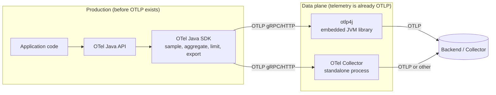

# otlp4j versus the OpenTelemetry Java SDK and Collector

otlp4j is compared here against the two upstream OpenTelemetry projects it is most often confused with. The short version: the **OpenTelemetry Java SDK** produces telemetry, while otlp4j and the **OpenTelemetry Collector** both move and process telemetry that already exists as OTLP. So otlp4j is complementary to the SDK and an in-process alternative to the Collector.

Assessed against opentelemetry-java `1.64.0-SNAPSHOT` (latest release `1.63.0`) and opentelemetry-collector core `v1.61.0` / `v0.155.0`, with otlp4j at `0.1.0-SNAPSHOT`.

## Where each sits on the telemetry path

There are two zones between an application and a backend. **Production** is everything before telemetry exists as OTLP: creating spans, recording measurements, sampling, aggregating, and limiting. The **data plane** is everything after: receiving OTLP batches, processing them, routing them, and forwarding them. The SDK owns production. otlp4j and the Collector are both data planes; they differ in form factor, not role.

| Dimension | OpenTelemetry Java SDK | otlp4j | OpenTelemetry Collector (core) |
| --- | --- | --- | --- |
| Path position | Produces telemetry (before OTLP) | Processes OTLP (after) | Processes OTLP (after) |
| Form factor | JVM library, in process | JVM library, in process | Standalone OS process |
| Runtime | Java, automatic module names | Java 25, full JPMS module descriptors | Go binary |
| Input | `Tracer` / `Meter` / `Logger` calls | OTLP gRPC and HTTP receivers | OTLP plus many formats (contrib) |
| Output | OTLP, Zipkin, Prometheus, logging | OTLP gRPC and HTTP | OTLP plus many formats (contrib) |
| Configuration | Code, plus env/SPI autoconfigure | Fluent Java builders | YAML (confmap) |
| Assembly | Maven dependency | Maven dependency | `ocb`-built custom binary |
| Maturity | `1.63.0` stable, profiles alpha | `0.1.0-SNAPSHOT`, experimental | `v1.61.0` stable core |

## otlp4j and the SDK are complementary

Because they sit in different zones they are not substitutes. The SDK has no OTLP receiver (its only listening socket is the alpha Prometheus scrape endpoint), and otlp4j has no instrumentation API, sampler, or aggregation engine. Each does what the other cannot.

| The SDK owns (before OTLP) | otlp4j owns (after OTLP) |
| --- | --- |
| `Tracer` / `Meter` / `Logger` instrumentation API and span lifecycle | OTLP gRPC and HTTP **receivers**, which the SDK lacks entirely |
| `Context` propagation (W3C, B3, Jaeger, OT Trace) | Declarative **pipeline DSL** with transform, filter, and fan-out |
| Sampling (`ParentBased`, `TraceIdRatioBased`, Jaeger remote, custom) | Live **`TelemetryTap`** `Flow.Publisher` streams off the acknowledgement path |
| `SpanProcessor` / `LogRecordProcessor` (batch, simple) | Receive-side **partial success** (`ConsumeResult`) mapped to OTLP responses |
| Metrics **aggregation engine**: temporality, `View`, cardinality limits, exemplar filter (all GA) | **Signal-to-signal connectors** at batch granularity (`spanCount`, `logRecordCount`) |
| `SpanLimits` / `LogLimits` and other production guardrails | Global receiver **admission control** (in-flight request and byte caps) |
| Autoconfigure env/SPI and resource detection (rich detectors live in contrib) | **Proto-free immutable** domain model with JPMS-isolated protobuf |
| Non-OTLP exporters (Zipkin, Prometheus, logging, OTLP-JSON) | Dual OTLP transports under one contract (Netty gRPC, JDK-only HTTP) |

The intended integration follows from this split: instrument the application with the SDK, then point its OTLP exporter at an embedded otlp4j receiver in the same JVM (or a sidecar) rather than straight at the network. otlp4j can then buffer, enrich, redact, duplicate, or route the stream locally before it leaves the process, shielding the app from backend latency or downtime. Use the SDK to make telemetry, use otlp4j to control it once it is OTLP.

## otlp4j and the Collector fill the same role

This is the closer comparison. Both receive OTLP, process it through a pipeline of stages, fan it out, forward it, and map the same OTLP partial-success and retry semantics. otlp4j deliberately mirrors the Collector's component vocabulary, so concepts translate almost one for one:

| OpenTelemetry Collector | otlp4j |
| --- | --- |
| `otlpreceiver` (gRPC + HTTP) | `OtlpGrpcReceiver` / `OtlpHttpReceiver` |
| `consumer.Traces` (`ConsumeTraces(ctx, td) error`) | `TracesSink` (`Sink<TracesData>` returning `CompletionStage<ConsumeResult>`) |
| `processor` (`batch`, `memory_limiter`) | `Transform` / `AsyncTransform`, `Processor` (`Processors`, `AbstractProcessor`), `Batcher`, `AdmissionControl` |
| `connector` (`forward`, traces-to-metrics) | `Connector<I, O>` (`spanCount`, `logRecordCount`) |
| `otlpexporter` / `otlphttpexporter` | `OtlpGrpcExporter` / `OtlpHttpExporter` |
| `pdata` (mutable OTLP wrapper) | proto-free **immutable** model records |
| `Capabilities{MutatesData}` plus clone-on-fan-out | immutable records, so fan-out shares with no copy |
| service graph DAG built from YAML | `Pipeline` DSL plus `Wiring`, built in code |
| `confmap` YAML with `${env:...}` expansion | fluent builders plus `fromEnvironment()` |
| `exporterhelper` sending queue (memory or persistent) | `Batcher` (in-memory only) |
| `configretry` exponential backoff | Resilience4j `RetryConfig` |
| `ExportPartialSuccess` response | `ConsumeResult` (`Accepted` / `Partial` / `Rejected`) |
| `ocb` builder produces a custom binary | Maven dependency, no build or codegen step |

The differences are all form factor.

**The Collector adds, at the cost of being a separate process:** a large component ecosystem (the core repo ships only `otlpreceiver`, the OTLP and `debug` exporters, `batch`, `memory_limiter`, `forward`, and the `zpages` and `memory_limiter` extensions, while dozens of non-OTLP receivers, exporters, processors, and scrapers live in contrib), YAML-driven config with hot reload, a persistent on-disk sending queue that survives restarts, an extension and auth host, and the profiles signal wired through every pipeline stage (alpha). It is production-proven and independently scalable.

**otlp4j adds, by being a library instead of a process:** in-process embedding, so a JVM application or tool gets a gateway sharing its heap and lifecycle with no extra network hop, process, or YAML to operate; a typed, compile-checked Java API in place of stringly-typed config; an immutable proto-free model that never leaks protobuf into user code; and full JPMS modularity. There is no `ocb`-style build step, only a Maven dependency and a pipeline written in Java.

What otlp4j does not attempt: non-OTLP formats (OTLP binary protobuf only, no JSON), persistent queuing, a config file format, an extension or auth subsystem, or scraping. Profiles are opaque passthrough on the experimental `v1development` schema rather than a fully modeled signal.

## Choosing

- **Instrument an app.** Always the SDK. Neither otlp4j nor the Collector creates telemetry.
- **Control OTLP inside a JVM process or library** without operating a separate deployment: otlp4j. Embedded gateways, in-JVM routers, test receivers, and tools that receive or forward OTLP with typed Java and no extra process.
- **Run standalone data-plane infrastructure** with the full ecosystem, non-OTLP formats, persistent queuing, and independent scaling: the Collector.

These compose end to end: an SDK-instrumented app exports OTLP to an embedded otlp4j gateway for local buffering and fan-out, which forwards to a central Collector, which lands the data in a backend. Each stage does the job it is shaped for.
