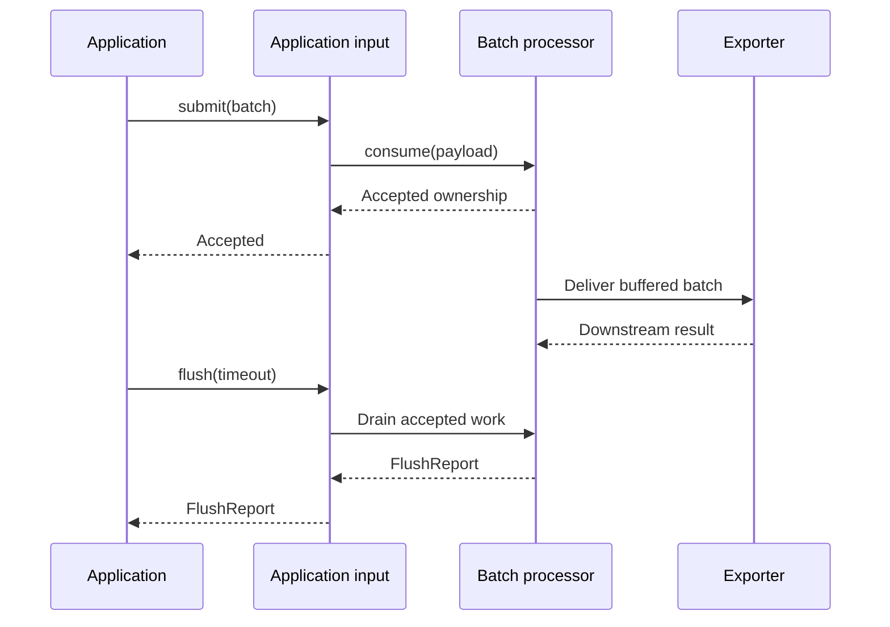
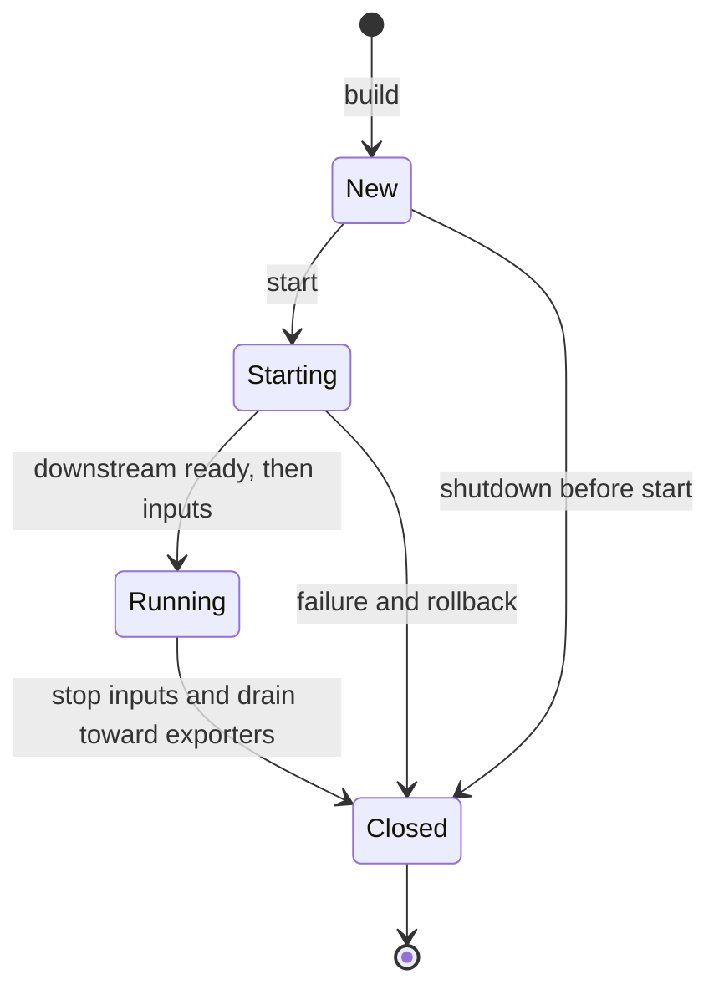

# Delivery and lifecycle

Treat submission, buffered ownership, downstream delivery, and shutdown as separate events. The result of a call describes the boundary that completed it, not a durable-storage guarantee.

## Submission results

Consumers return `CompletionStage<DeliveryResult>`. Results include `Provenance`, which identifies the component, kind, and signal responsible for the outcome.

| Result | Meaning | Caller action |
| --- | --- | --- |
| `Accepted` | The processing boundary handled the payload or accepted ownership | Continue; flush if a buffer owns subsequent delivery |
| `Partial` | A terminal response reports some rejected items or a partial-success message | Record the rejection; do not retry the whole payload |
| `Rejected` with `RETRYABLE` | The whole payload was refused and retry may succeed | Apply the retry policy and any wait hint |
| `Rejected` with `PERMANENT` | The whole payload was refused without a retry recommendation | Report or discard according to application policy |

`Rejected` also carries a reason, message, optional cause, optional retry-after hint, and a downstream marker. Intentional filtering returns `Accepted` even though no data is forwarded.

`submit` completes at the first boundary that takes ownership. A batch processor or an [exporter queue](#exporter-queues-and-redelivery) takes ownership on admission, and flush reports the later delivery result. The bundled OTLP exporter queues by default. On a path with neither, `submit` completes with the direct downstream outcome. A successful admission is not a promise that every backend has stored the data.

A submission may throw or complete exceptionally for lifecycle misuse, cancellation, or a fatal failure, so handle exceptional completion alongside delivery results. Graph boundaries normalize every other component failure into a rejection:

| Failure                   | Rejection                                |
| ------------------------- | ---------------------------------------- |
| Undecodable payload       | Permanent, reason `PROTOCOL_TRANSLATION` |
| `TimeoutException`        | Retryable, reason `TIMEOUT`              |
| Any other exception       | Retryable, reason `LOCAL_FAILURE`        |
| Null result or null stage | Permanent: the component has a defect    |

A fatal `Error` stays exceptional. An unclassified failure is retryable, as in the OpenTelemetry Collector, because a permanent rejection tells the upstream sender to drop the data. A component that knows retrying cannot help returns a permanent rejection itself.

## Request context and ownership

`ConsumeContext` carries client headers, a deadline, and cancellation. Receivers capture request-scoped context so processors can route and enforce admission rules.

Before accepting a submission, the batch processor and an exporter queue check cancellation and the incoming deadline. After acceptance they keep immutable client metadata and detach delivery from the original request's cancellation and deadline. Downstream export then uses its own configured budget. Cancelling the original request does not reclaim work whose ownership has transferred.

## Flush reports

`flush(timeout)` waits for accepted work and returns a bounded summary of losses after buffered acceptance:

| Field | Counts or records |
| --- | --- |
| `rejectedItems` | Rejected items observed during draining |
| `droppedItems` | Items lost through queue overflow policies |
| `failedBatches` | Whole batches that failed downstream |
| `firstFailure` | The first available failure cause |
| `isSuccess()` | True only when all counters are zero and no failure is recorded |

A completed flush may return an unsuccessful report without throwing. Flush does not repeat direct submission outcomes, which include a refusal a queue returned to the submitter: the sender owns that retry, and a payload it delivers on the retry is not a loss. The counters overlap, because a whole-batch failure counts its rejected items, so do not add them as disjoint categories.

At the start of a flush, the runtime captures application inputs' in-progress deliveries. It then visits components toward the exporters; each downstream buffer takes its snapshot when reached. Submissions concurrent with those later snapshots may be included. Flush is not a graph-wide transaction boundary that excludes all later submissions.

For a quiescent drain, stop the producer, wait for its submission calls, and then flush. Exact exclusion during concurrent submission would require barriers propagated through every buffering component.

If a caller's flush deadline expires, the runtime retains the outstanding component result. A later flush can collect the late outcome. Shutdown can surface losses that have not already been reported by a completed flush.

## Batch delivery

The batch processor acknowledges a submission once it is buffered. Its pending-work [admission limits](components.md#batching-defaults) are the only bound on accepted work, and they refuse directly to the caller, so a flush is never refused after its submissions were acknowledged.

The processor attempts every batch once and does not retry, like the OpenTelemetry Collector's batch processor: a retry here would resend data to the healthy peers of a fan-out. A failed batch does not affect the batches behind it. It is lost, logged at WARN, counted in `otlp4j.batch.lost.items`, and recorded in the flush report.

Retries belong to the [exporter queue](#exporter-queues-and-redelivery) behind the processor. A batch handed to a queue is redelivered through a destination outage, within the redelivery budget, and a destination that never answers does not stall a healthy one. A full exporter queue counts as a downstream failure: behind a batch processor nobody is left to retry the refusal, so the batch is a counted loss, as in the Collector. Size the exporter queue for the outages it must ride out.

## Exporter queues and redelivery

Every OTLP exporter in a graph has one queue per signal, following the OTLP specification's per-destination queuing, acknowledgement, and retry. A destination that is down or slow holds back only its own queues, and all queues reference one immutable payload. A payload is acknowledged once queued, and workers export it.

| Policy | Default |
| --- | --- |
| `DeliveryQueuePolicy` | 1,000 entries, 10 consumers, `FAIL` |
| `RedeliveryPolicy` | 5 seconds initial delay, `1.5` multiplier, `0.5` jitter, 30 seconds cap, 5 minutes in total |

These are the Collector's defaults. Set them on the [exporter config](transport.md#queue-and-redelivery), where `noQueue()` makes the exporter synchronous.

### Redelivery

| Outcome of an attempt | Redelivery |
| --- | --- |
| `Accepted` | Done |
| `Partial` | Done: redelivering would send the accepted items twice |
| `Rejected` with `PERMANENT` | Lost at once |
| `Rejected` with `RETRYABLE` | Wait for the larger of the jittered backoff and the retry-after hint, then try again |

The queue gives up an entry as soon as the next wait would pass the budget, so a hint longer than the remaining budget gives up immediately. A redelivering entry occupies its worker, which keeps concurrency within the consumer count. A flush waits for a redelivering entry, up to the flush deadline.

### Overflow

A refusal belongs to the caller it is returned to, so it is not a loss.

| Overflow policy | A full queue | Accounting |
| --- | --- | --- |
| `FAIL` | Returns a retryable refusal with a retry-after hint; the sender sees `503` or `UNAVAILABLE` | Counted in `otlp4j.exporter.queue.refused.items`; not in the flush report |
| `DROP_NEWEST` | Discards the arriving entry and acknowledges it | A loss |
| `DROP_OLDEST` | Evicts the oldest waiting entry and acknowledges the arriving one | A loss |

A queue that has stopped accepting returns a retryable shutdown refusal and records nothing.

### Losses

An entry given up, evicted, discarded, or abandoned is lost after it was acknowledged. The exporter logs the loss at WARN with the component id, item count, and reason, adds the items to `otlp4j.exporter.queue.lost.items` before the flush returns, and includes them in the flush report.

### Memory and durability

The queues are in memory. Process termination loses retained work; acceptance is not durable. An exporter queue is bounded in entries, not bytes, and a receiver's admission limits cover a payload only until it is acknowledged. Put a [memory limiter](components.md#memory-limiting) in front of a queue that can hold many large requests.

### Shutdown

Shutdown ends redelivery: a running wait ends and its entry gets one last attempt, and each queued entry gets one attempt. The exporter then shuts down its wire client with the remaining budget, even when the drain ran out of time. An entry that does not make it is a loss, and shutdown completes exceptionally to report it. A destination that never answers cannot hold shutdown past its deadline.

## Fan-out results

Fan-out invokes all peers and waits for their stages. Peers share an immutable payload, so replacing a batch in one branch does not change a sibling's view.

| Peer outcomes | Combined result |
| --- | --- |
| All accepted | `Accepted` |
| Partial outcomes with no whole-payload rejection | `Partial`, using the maximum rejected-item count across peers |
| Any retryable rejection, no permanent rejection | Retryable `Rejected`, using the largest available retry-after hint |
| Any permanent rejection | Permanent `Rejected` |

The maximum partial count avoids summing repeated reports about the same payload, but does not identify the union of rejected items across destinations. The merged result cannot express an atomic multi-destination commit.

One peer may accept while another refuses. Retrying the whole path can duplicate data at successful peers, and neither fan-out nor the built-in span-count connector provides deduplication. [Exporter queues](#exporter-queues-and-redelivery) contain this: each peer acknowledges and redelivers on its own, so an unavailable destination causes no sender retry. A full queue under `FAIL` does cause one, because its refusal reaches the sender through the merged result.

## Receiver responses

These are the bundled receiver's mappings. HTTP admission refusal refers to refusal by the receiver itself; a component's retryable rejection follows the whole-payload rejection mapping.

| Outcome | HTTP | gRPC |
| --- | --- | --- |
| Accepted | `200`, OTLP response | `OK`, OTLP response |
| Partial | `200`, OTLP partial-success response | `OK`, OTLP partial-success response |
| Retryable whole-payload rejection | `503` | `UNAVAILABLE` |
| Request content a component cannot decode | `400` | `INVALID_ARGUMENT` |
| Other permanent whole-payload rejection | `500` | `INTERNAL` |
| Dispatcher failure no component classified | `503` | `UNAVAILABLE` |
| Receiver at capacity | `429` | `UNAVAILABLE` |
| Request exceeds decoded-message cap | `413` | `RESOURCE_EXHAUSTED` |

What an upstream sender sees of a downstream failure depends on the exporter:

| Exporter | Downstream failure | Sender sees |
| --- | --- | --- |
| Queued (default) | Any; the queue redelivers and reports losses | `200` / `OK` once queued |
| Queued (default) | Queue full or stopping | `503` / `UNAVAILABLE` |
| `noQueue()` | Retryable status, refused connection, or expired deadline | `503` / `UNAVAILABLE` with the wait hint |
| `noQueue()` | Permanent rejection | `500` / `INTERNAL` |

The exact downstream status is not forwarded. When available, rejection wait hints become HTTP `Retry-After` or gRPC retry trailers. Wire retry decisions and hint precedence are specified in [Transport](transport.md#retries-and-time-budgets).

## Lifecycle and deadlines

`Pipeline` and `GatewayRuntime` own component lifecycle. Their default `ServiceOptions` give the whole graph 30 seconds to start and 30 seconds to shut down. `flush(timeout)` and `shutdown(timeout)` supply their own call budgets.

Startup walks reverse topological order so downstream components are ready first. Failure rolls back every created component, including the failed component and components not yet started. Rollback uses the configured shutdown budget in addition to the startup budget. Shutdown walks forward topological order so input stops before downstream resources are released, and cleanup continues after a component failure.

`close()` uses the configured shutdown budget and exposes shutdown failure. Shutdown requests are idempotent and retain their result; the runtime cannot restart after closing.

Lifecycle operations on the same component are serialized. Deadlines bound the caller's wait, but Java cannot forcibly stop code that ignores interruption or cancellation. Cleanup may continue after timeout when an outstanding operation yields. Choose components that cooperate with these budgets, and close SDK providers before their [borrowed inputs](sdk-integration.md#ownership-and-results).
