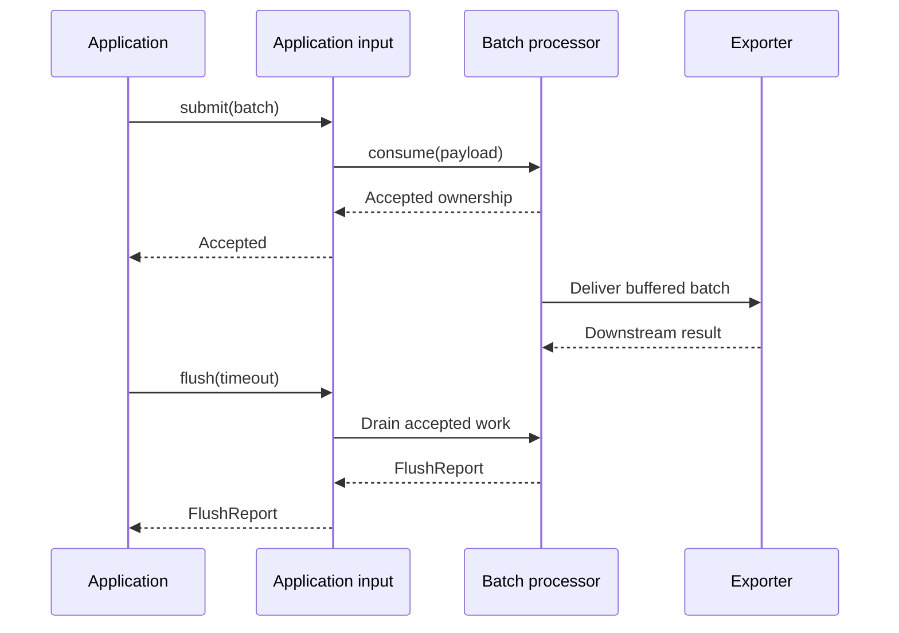
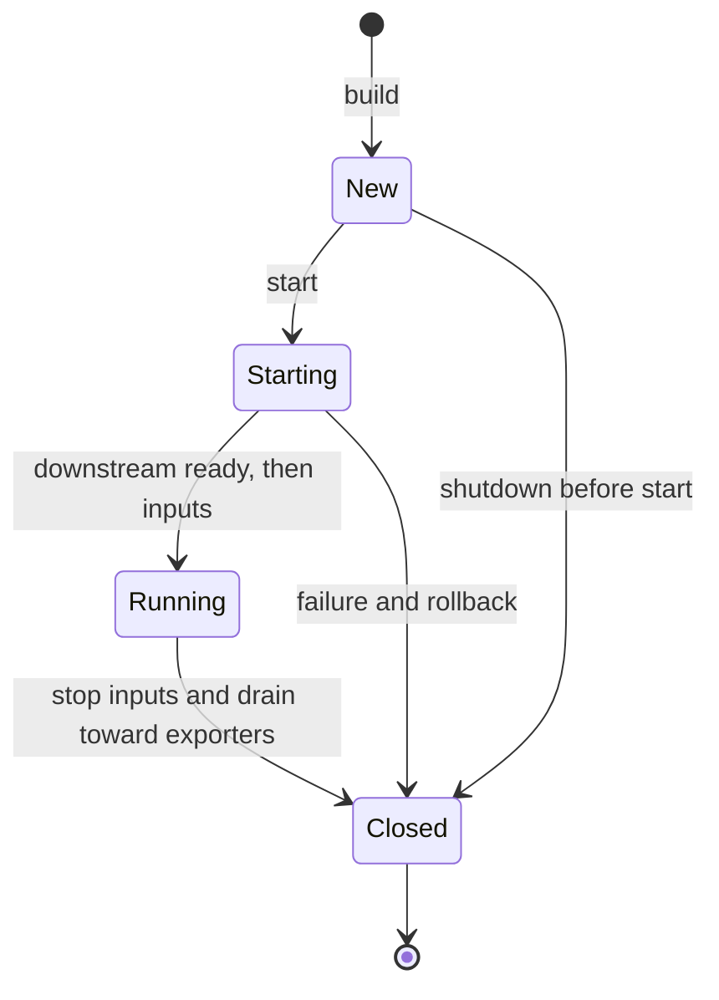

# Delivery and lifecycle

Treat submission, buffered ownership, downstream delivery, and shutdown as separate events. The result of a call describes the boundary that completed it, not a durable-storage guarantee.

## Submission results

Consumers return `CompletionStage<DeliveryResult>`. Results include `Provenance`, which identifies the component, kind, and signal responsible for the outcome.

| Result | Meaning | Caller action |
| --- | --- | --- |
| `Accepted` | The processing boundary handled the payload or accepted ownership | Continue; flush if a buffer owns subsequent delivery |
| `Partial` | A terminal response reports some rejected items or a partial-success message | Record the rejection; do not retry the whole payload |
| `Rejected` with `RETRYABLE` | The whole payload was refused and retry may succeed | Apply the retry policy and any wait hint |
| `Rejected` with `PERMANENT` | The whole payload was refused without a retry recommendation | Report or discard according to application policy |

`Rejected` also carries a reason, message, optional cause, optional retry-after hint, and a downstream marker. Intentional filtering returns `Accepted` even though no data is forwarded.

Without a buffer, `submit` can complete with the direct downstream outcome. Once a buffer accepts ownership, its later delivery result is reported through flush. A successful admission is not a promise that every backend has stored the data.

A submission may throw or complete exceptionally for lifecycle misuse, cancellation, or a fatal failure. Graph boundaries normalize ordinary component exceptions and invalid null results into permanent rejections. Fatal `Error` values remain exceptional. Handle exceptional completion as well as ordinary delivery results.

## Request context and ownership

`ConsumeContext` carries client headers, a deadline, and cancellation. Receivers capture request-scoped context so processors can route and enforce admission rules.

Before accepting a submission, the batch processor checks cancellation and the incoming deadline. After acceptance it keeps immutable client metadata and detaches delivery from the original request's cancellation and deadline. Downstream export then uses its own configured budget. Cancelling the original request does not reclaim work whose ownership has transferred.

## Flush reports

`flush(timeout)` waits for accepted work and returns a bounded summary of losses after buffered acceptance:

| Field | Counts or records |
| --- | --- |
| `rejectedItems` | Rejected items observed during draining |
| `droppedItems` | Items lost through queue overflow policies |
| `failedBatches` | Whole batches that failed downstream |
| `firstFailure` | The first available failure cause |
| `isSuccess()` | True only when all counters are zero and no failure is recorded |

A completed flush may return an unsuccessful report without throwing. Direct submission outcomes are not reported again by flush. Whole-batch failure accounting can also count rejected items, so do not add these counters as if they represented disjoint categories.

At the start of a flush, the runtime captures application inputs' in-progress deliveries. It then visits components toward the exporters; each downstream buffer takes its snapshot when reached. Submissions concurrent with those later snapshots may be included. Flush is not a graph-wide transaction boundary that excludes all later submissions.

For a quiescent drain, stop the producer, wait for its submission calls, and then flush. Exact exclusion during concurrent submission would require barriers propagated through every buffering component.

If a caller's flush deadline expires, the runtime retains the outstanding component result. A later flush can collect the late outcome. Shutdown can surface losses that have not already been reported by a completed flush.

## Queue overflow

The built-in delivery queue supports these policies:

| Policy        | Full-queue behavior                   |
| ------------- | ------------------------------------- |
| `FAIL`        | Refuse new queued work retryably      |
| `DROP_OLDEST` | Evict buffered work to admit new work |
| `DROP_NEWEST` | Discard arriving queued work          |

The batch processor may already have accepted the originating submission before queue admission occurs. Its subsequent queue refusal or drop therefore belongs in a flush report. In contrast, refusal by the processor's pending-work admission limits returns directly to the caller.

The queue is in memory. Process termination loses retained work; acceptance is not durable. Configure limits and degraded behavior in [Built-in components](components.md#batching).

## Fan-out results

Fan-out invokes all peers and waits for their stages. Peers share an immutable payload, so replacing a batch in one branch does not change a sibling's view.

| Peer outcomes | Combined result |
| --- | --- |
| All accepted | `Accepted` |
| Partial outcomes with no whole-payload rejection | `Partial`, using the maximum rejected-item count across peers |
| Any retryable rejection, no permanent rejection | Retryable `Rejected`, using the largest available retry-after hint |
| Any permanent rejection | Permanent `Rejected` |

The maximum partial count avoids summing repeated reports about the same payload, but does not identify the union of rejected items across destinations. The merged result cannot express an atomic multi-destination commit.

One peer may accept while another refuses. Retrying the whole path can duplicate data at successful peers. Neither fan-out nor the built-in span-count connector provides deduplication.

## Receiver responses

These are the bundled receiver's mappings. HTTP admission refusal refers to refusal by the receiver itself; a component's retryable rejection follows the whole-payload rejection mapping.

| Outcome | HTTP | gRPC |
| --- | --- | --- |
| Accepted | `200`, OTLP response | `OK`, OTLP response |
| Partial | `200`, OTLP partial-success response | `OK`, OTLP partial-success response |
| Retryable whole-payload rejection | `503` | `UNAVAILABLE` |
| Permanent whole-payload rejection or dispatcher failure | `500` | `INTERNAL` |
| Receiver at capacity | `429` | `UNAVAILABLE` |
| Request exceeds decoded-message cap | `413` | `RESOURCE_EXHAUSTED` |

When available, rejection wait hints become HTTP `Retry-After` or gRPC retry trailers. Wire retry decisions and hint precedence are specified in [Transport](transport.md#retries-and-time-budgets).

## Lifecycle and deadlines

`Pipeline` and `GatewayRuntime` own component lifecycle. Their default `ServiceOptions` give the whole graph 30 seconds to start and 30 seconds to shut down. `flush(timeout)` and `shutdown(timeout)` supply their own call budgets.

Startup walks reverse topological order so downstream components are ready first. Failure rolls back every created component, including the failed component and components not yet started. Rollback uses the configured shutdown budget in addition to the startup budget. Shutdown walks forward topological order so input stops before downstream resources are released, and cleanup continues after a component failure.

`close()` uses the configured shutdown budget and exposes shutdown failure. Shutdown requests are idempotent and retain their result; the runtime cannot restart after closing.

Lifecycle operations on the same component are serialized. Deadlines bound the caller's wait, but Java cannot forcibly stop code that ignores interruption or cancellation. Cleanup may continue after timeout when an outstanding operation yields. Choose components that cooperate with these budgets, and close SDK providers before their [borrowed inputs](sdk-integration.md#ownership-and-results).
