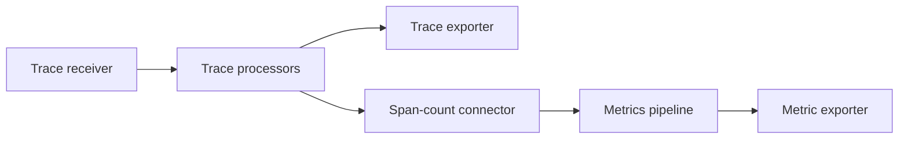

# Gateway graphs

Use `Gateway.builder()` to assemble named receivers, processors, exporters, and connectors into several telemetry pipelines. A gateway can accept network traffic, application submissions, or both.

## Receive and forward OTLP

This graph listens on an ephemeral localhost port and forwards traces to an OTLP/gRPC destination on localhost port 4317. Start the destination before sending data to the gateway.

```java
import static dev.nthings.otlp4j.core.signal.SignalDescriptor.TRACES;

import dev.nthings.otlp4j.core.component.ComponentId;
import dev.nthings.otlp4j.core.pipeline.PipelineId;
import dev.nthings.otlp4j.service.Gateway;
import dev.nthings.otlp4j.transport.OtlpExporterConfig;
import dev.nthings.otlp4j.transport.OtlpExporterFactory;
import dev.nthings.otlp4j.transport.OtlpReceiverConfig;
import dev.nthings.otlp4j.transport.OtlpReceiverFactory;

var graph = Gateway.builder();
var receiver = graph.receiver(
        ComponentId.parse("in"),
        OtlpReceiverFactory.grpc(),
        OtlpReceiverConfig.defaults(4317).withEphemeralPort());
var output = graph.exporter(
        ComponentId.parse("out"),
        OtlpExporterFactory.grpc(),
        OtlpExporterConfig.defaults(4317));
graph.pipeline(PipelineId.of(TRACES), path -> path.from(receiver).to(output));

try (var runtime = graph.build()) {
    runtime.start();
    int port = runtime.boundPort(receiver.id()).orElseThrow();
    System.out.println("Send OTLP/gRPC traces to localhost:" + port);
    // Keep the runtime open while the application serves traffic.
}
```

The block illustrates ownership and port lookup. A serving application must keep the block open for its serving lifetime. Use the [self-contained sample](../otlp4j-samples/README.md) to send data through a complete gateway and backend.

## Wire named components

Registration returns handles tied to the builder that created them. Pipeline wiring uses those handles:

| Registration | Returned handle | Pipeline position |
| --- | --- | --- |
| `input(id, signal)` | `InputHandle<T>` | `from(...)` |
| `receiver(id, factory, config)` | `ReceiverHandle` | `from(...)` |
| `processor(id, factory, config)` | `ProcessorHandle` | `via(...)` |
| `exporter(id, factory, config)` | `ExporterHandle` | `to(...)` |
| `connector(id, factory, config)` | `ConnectorHandle` | `to(...)` in the source signal; `from(...)` in the destination signal |

Factory registrations also accept an overload that uses `defaultConfig()`. IDs are unique within each component kind. A receiver and exporter can have the same ID; use `runtime.component(kind, id)` to disambiguate lookup.

In each pipeline block, call `from`, `via`, and `to` at most once. Pass several handles in one call for multiple sources, an ordered processor chain, or multiple terminals. Omit `via` when no processor is needed.

Multiple pipelines can share a receiver or exporter registration. The OTLP exporter shares one underlying client across its signal facets and releases it after the last facet shuts down. Use separate registrations when endpoints or policies must differ.

## Submit inside the JVM

Declare an application input before wiring the graph. This example uses an existing `graph`, `output`, and trace `batch`:

```java
import static dev.nthings.otlp4j.core.signal.SignalDescriptor.TRACES;

import dev.nthings.otlp4j.core.component.ComponentId;
import dev.nthings.otlp4j.core.pipeline.PipelineId;

var application = graph.input(ComponentId.parse("application"), TRACES);
graph.pipeline(PipelineId.of(TRACES, "application"),
        path -> path.from(application).to(output));

try (var runtime = graph.build()) {
    runtime.start();
    var input = runtime.input(application);
    var result = input.submit(batch).toCompletableFuture().join();
    System.out.println(result);
}
```

The runtime owns the resolved input. Use it while that runtime is running. A handle from another builder is rejected, and the generic input type prevents submitting a different signal's batch.

## Derive another signal

A connector terminates one signal pipeline and becomes the source of another. For example, the span-count connector emits metrics from trace batches:



With the `graph`, `receiver`, and `output` registrations from the first example, replace the trace pipeline definition with this wiring before building:

```java
import static dev.nthings.otlp4j.core.signal.SignalDescriptor.METRICS;
import static dev.nthings.otlp4j.core.signal.SignalDescriptor.TRACES;

import dev.nthings.otlp4j.components.connector.SpanCountConnectorFactory;
import dev.nthings.otlp4j.core.component.ComponentId;
import dev.nthings.otlp4j.core.pipeline.PipelineId;

var count = graph.connector(ComponentId.parse("count"), new SpanCountConnectorFactory());
graph.pipeline(PipelineId.of(TRACES), path -> path.from(receiver).to(output, count));
graph.pipeline(PipelineId.of(METRICS), path -> path.from(count).to(output));
```

See [Span counting](components.md#span-counting) for the metric's meaning and limitations. [Delivery](delivery.md#fan-out-results) explains how branch results combine.

## Validate and inspect a graph

The typed DSL checks component kinds at compile time and handle ownership during wiring. Graph compilation validates references, endpoint presence, supported signals, connector pairs, and cycles before creating components. `GraphValidationException` carries the validation diagnostics.

`graph.toConfig()` returns the immutable `GatewayConfig`. Call `Gateway.compile(config)` when your application constructs configuration records directly; this path applies the same validation and does not require the fluent builder.

After build, `runtime.describe()` renders nodes and edges, `component(...)` finds registered components, and `boundPort(id)` finds a receiver's assigned port. Lifecycle ordering and budgets are documented in [Delivery and lifecycle](delivery.md#lifecycle-and-deadlines).
