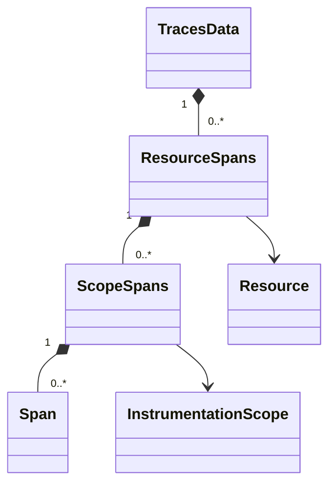
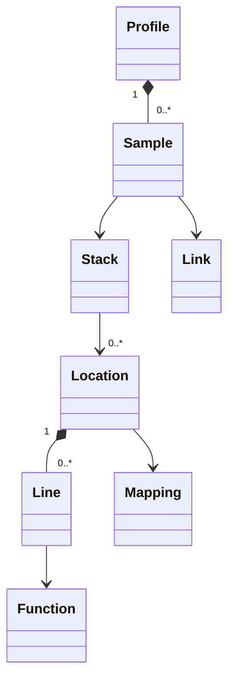

# Domain model

`otlp4j-model` contains immutable telemetry values without a protobuf, transport, or service dependency. Construct batches in an application, inspect them in a processor, or capture them in a test exporter.

## Signal batches and counting

Each `SignalDescriptor<T>` identifies a batch type and owns counting, empty-batch construction, merge, and split operations.

| Descriptor | Batch type     | Counted item                       |
| ---------- | -------------- | ---------------------------------- |
| `TRACES`   | `TracesData`   | Span                               |
| `METRICS`  | `MetricsData`  | Metric data point, not metric name |
| `LOGS`     | `LogsData`     | Log record                         |
| `PROFILES` | `ProfilesData` | Profile, not profile sample        |

These item definitions also apply to batch triggers and rejection counts. A metric containing many points counts as many items.

## Grouping and shared metadata

The model preserves OTLP's grouping by resource and instrumentation scope. A trace batch illustrates the relationships:



Metrics, logs, and profiles follow the same resource/scope hierarchy with their respective item types. Group records retain schema URLs. `Resource`, `InstrumentationScope`, and `Attributes` carry common metadata.

`AttributeValue` covers strings, booleans, integers, doubles, byte values, arrays, and key-value lists. Record constructors copy their collections, and byte-bearing values use defensive copies. Use builders or constructors to produce values and replacement methods such as `toBuilder()` and `Attributes.with(...)` to transform them.

Use `TracesData.of(resource, scope, spans)` and the equivalent batch helpers for one resource and scope. Use grouped records when batches contain several resources or scopes. [Getting started](getting-started.md#run-a-first-pipeline) contains a complete construction example.

## Traverse without flattening

Flattened accessors such as `spans()` allocate a list. Use count methods when you only need a count and `forEachSpan`, `forEachMetric`, `forEachLogRecord`, or `forEachProfile` when you only need to visit items.

## Select and replace items

Each batch type returns a new batch from item-level and resource-level operations. These operations keep resource and scope grouping and schema URLs, so a transform does not rebuild the hierarchy by hand.

| Batch          | Replace items   | Keep matching items |
| -------------- | --------------- | ------------------- |
| `TracesData`   | `mapSpans`      | `filterSpans`       |
| `MetricsData`  | `mapMetrics`    | `filterMetrics`     |
| `LogsData`     | `mapLogRecords` | `filterLogRecords`  |
| `ProfilesData` | `mapProfiles`   | `filterProfiles`    |

All four types also provide `mapResources` and `filterResources`. `filterResources` removes a rejected resource group together with its items.

For an existing `TracesData` value `traces`, this keeps server spans and masks one attribute where it is present:

```java
import dev.nthings.otlp4j.model.Span;

var selected = traces
        .filterSpans(span -> span.kind() == Span.Kind.SERVER)
        .mapSpans(span -> span.attributes().contains("enduser.id")
                ? span.toBuilder()
                        .attributes(span.attributes().with("enduser.id", "***"))
                        .build()
                : span);
```

An item filter removes a scope or resource group that loses all its items; a removed resource group takes any already-empty scopes with it. Other groups that lose nothing are kept as they are, including groups that were already empty. A mapper must return a non-null value for every item or resource.

An operation that changes nothing returns the same batch instance. Return the item you received when it needs no change, as the example does for spans without the attribute. A pipeline `map` stage then keeps the payload it received, so a payload that arrived over OTLP is forwarded without being encoded again; see [Payloads and wire fidelity](architecture.md#payloads-and-wire-fidelity).

Metric operations address whole metrics, although [counting](#signal-batches-and-counting) uses data points. To select data points, return a metric with replaced data from `mapMetrics`. Profile operations address whole profiles in the same way; to select samples, return a profile with replaced samples from `mapProfiles`.

Use these operations inside a pipeline's `map` stage; see [Transform immutable batches](pipelines.md#transform-immutable-batches).

## Payload views

Components exchange `Payload<T>`, which associates data with its descriptor, item count, and `RoutingMetadata`. Application code can create a domain-backed payload with `Payload.of(signal, batch)`.

`data()` exposes the domain batch. On a received OTLP payload, the implementation can construct this view lazily. Item counts and resource routing checks do not require a full domain conversion. `withData(replacement)` returns a payload for the replacement and updates its derived metadata. `encodedSize()` reports the exact OTLP size of a payload that has a wire form, such as one received over OTLP, and is empty for a payload built from a domain batch alone.

Routing metadata lists the attributes of each resource group through `resources()`, in wire order, without decoding the batch's items. A mixed-resource batch has one entry per group, and the built-in [filter](components.md#filtering-and-routing) decides each group separately.

## Profiles

Profiles use the experimental `v1development` schema, so their shape can still change. A `Profile` holds the samples of one sample type collected over a period, and `ProfilesData` groups profiles by resource and scope like the other signals.



A profile holds values rather than references, so it is complete on its own. OTLP shares repeated strings, stacks, and attributes between the profiles of a request through a `ProfilesDictionary` of indexed tables. The codec resolves those references when it decodes a batch and builds a new dictionary when it encodes one, so application code never handles an index. Moving a profile to another batch, merging batches, and replacing any field are therefore plain list and record operations.

For an existing `resource` and `scope`, this builds a batch holding one CPU profile:

```java
import dev.nthings.otlp4j.model.Attributes;
import dev.nthings.otlp4j.model.Profile;
import dev.nthings.otlp4j.model.ProfilesData;
import java.util.List;
import java.util.Map;

var handle = new Profile.Function("handle", "_Z6handlev", "handler.cc", 40);
var frame = Profile.Location.builder()
        .address(0x1234L)
        .addLine(new Profile.Line(handle, 44, 0))
        .build();
var stack = new Profile.Stack(List.of(frame));
var sample = Profile.Sample.builder()
        .stack(stack)
        .attributes(Attributes.builder().put("allocated", 128L).build())
        .attributeUnits(Map.of("allocated", "By"))
        .addValue(30_000_000L)
        .build();
var profile = Profile.builder()
        .profileId("0102030405060708090a0b0c0d0e0f10")
        .epochNanos(1_700_000_000_000_000_000L)
        .durationNanos(10_000_000_000L)
        .sampleType(new Profile.ValueType("cpu", "nanoseconds"))
        .addSample(sample)
        .build();
var batch = ProfilesData.of(resource, scope, List.of(profile));
```

`Profile`, `Sample`, `Location`, and `Mapping` carry `Attributes` plus `attributeUnits`, which maps an attribute key to its UCUM unit and lists only the attributes that have one. Reuse one `Stack` object for samples that repeat a stack: decoded batches already do, and encoding finds a repeated object without comparing its frames.

A `Sample` records its observations in `values`, `timestamps`, or both. When both are populated they have the same size, and a consumer counts each timestamp of a sample without values as one. `Sample.builder()` refuses a sample that breaks these rules. Decoding does not, so a sample received from a less careful sender is carried as it arrived rather than failing its batch.

| Situation | Behavior |
| --- | --- |
| Reference outside its dictionary table | `data()` throws `UndecodablePayloadException` rather than change what a profile says, and the receiver answers with [an invalid-request status](delivery.md#receiver-responses) |
| Attribute table values that string references expand past four times the dictionary's size, or 64 KiB if that is larger | Decoding fails the same way, because consumers read these values inline and encoding must write each reference out in full |
| Malformed dictionary entry that nothing references | Ignored and not carried forward |
| Duplicate attribute keys on one sample | The last wins; OTLP forbids them |
| Payload forwarded without a change | Keeps its received request, including dictionary order |
| Batch encoded from the domain | Equivalent profiles in a new dictionary, without duplicate or unreferenced entries, which OTLP states is unobservable. Resource and scope attribute keys and strings are written as dictionary references, as the Collector writes them |

Because each encoded batch gets its own dictionary, `SignalDescriptor.PROFILES.split(...)` output carries only what each part references, and a [byte cap](components.md#batch-profiles) measures that. An item is a whole profile, which [batching](components.md#batch-profiles) cannot divide.
