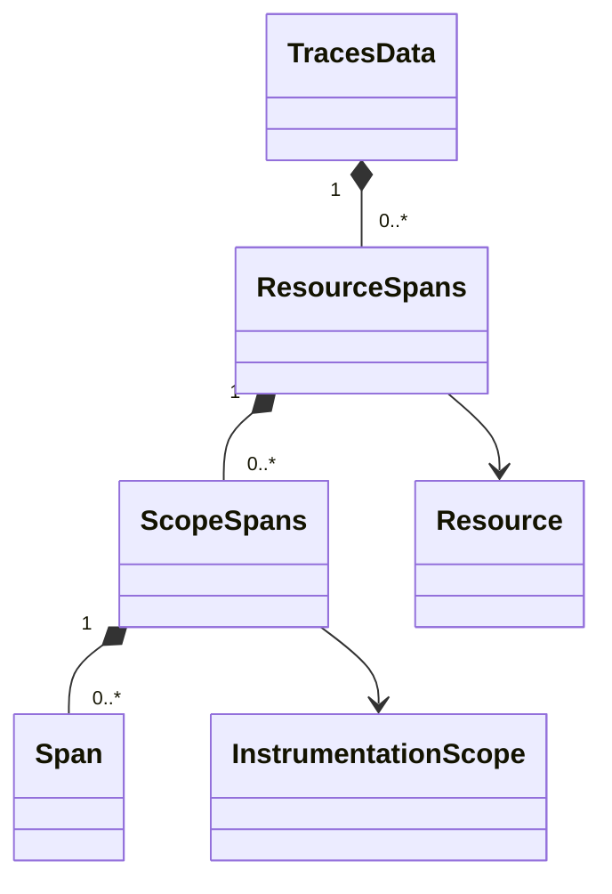

# Domain model

`otlp4j-model` contains immutable telemetry values without a protobuf, transport, or service dependency. Construct batches in an application, inspect them in a processor, or capture them in a test exporter.

## Signal batches and counting

Each `SignalDescriptor<T>` identifies a batch type and owns counting, empty-batch construction, merge, and split operations.

| Descriptor | Batch type     | Counted item                       |
| ---------- | -------------- | ---------------------------------- |
| `TRACES`   | `TracesData`   | Span                               |
| `METRICS`  | `MetricsData`  | Metric data point, not metric name |
| `LOGS`     | `LogsData`     | Log record                         |
| `PROFILES` | `ProfilesData` | Profile, not profile sample        |

These item definitions also apply to batch triggers and rejection counts. A metric containing many points counts as many items.

## Grouping and shared metadata

The model preserves OTLP's grouping by resource and instrumentation scope. A trace batch illustrates the relationships:



Metrics, logs, and profiles follow the same resource/scope hierarchy with their respective item types. Group records retain schema URLs. `Resource`, `InstrumentationScope`, and `Attributes` carry common metadata.

`AttributeValue` covers strings, booleans, integers, doubles, byte values, arrays, and key-value lists. Record constructors copy their collections, and byte-bearing values use defensive copies. Use builders or constructors to produce values and replacement methods such as `toBuilder()` and `Attributes.with(...)` to transform them.

Use `TracesData.of(resource, scope, spans)` and the equivalent batch helpers for one resource and scope. Use grouped records when batches contain several resources or scopes. [Getting started](getting-started.md#run-a-first-pipeline) contains a complete construction example.

## Traverse without flattening

Flattened accessors such as `spans()` allocate a list. Use count methods when you only need a count and `forEachSpan`, `forEachMetric`, `forEachLogRecord`, or `forEachProfile` when you only need to visit items.

## Select and replace items

Each batch type returns a new batch from item-level and resource-level operations. These operations keep resource and scope grouping and schema URLs, so a transform does not rebuild the hierarchy by hand.

| Batch          | Replace items   | Keep matching items |
| -------------- | --------------- | ------------------- |
| `TracesData`   | `mapSpans`      | `filterSpans`       |
| `MetricsData`  | `mapMetrics`    | `filterMetrics`     |
| `LogsData`     | `mapLogRecords` | `filterLogRecords`  |
| `ProfilesData` | `mapProfiles`   | `filterProfiles`    |

All four types also provide `mapResources` and `filterResources`. `filterResources` removes a rejected resource group together with its items.

For an existing `TracesData` value `traces`, this keeps server spans and masks one attribute where it is present:

```java
import dev.nthings.otlp4j.model.Span;

var selected = traces
        .filterSpans(span -> span.kind() == Span.Kind.SERVER)
        .mapSpans(span -> span.attributes().contains("enduser.id")
                ? span.toBuilder()
                        .attributes(span.attributes().with("enduser.id", "***"))
                        .build()
                : span);
```

An item filter removes a scope or resource group that loses all its items; a removed resource group takes any already-empty scopes with it. Other groups that lose nothing are kept as they are, including groups that were already empty. A mapper must return a non-null value for every item or resource.

An operation that changes nothing returns the same batch instance. Return the item you received when it needs no change, as the example does for spans without the attribute. A pipeline `map` stage then keeps the payload it received, so a payload that arrived over OTLP is forwarded without being encoded again; see [Payloads and wire fidelity](architecture.md#payloads-and-wire-fidelity).

Metric operations address whole metrics, although [counting](#signal-batches-and-counting) uses data points. To select data points, return a metric with replaced data from `mapMetrics`. Profile operations retain the shared dictionary under the rules in [Profiles](#profiles).

Use these operations inside a pipeline's `map` stage; see [Transform immutable batches](pipelines.md#transform-immutable-batches).

## Payload views

Components exchange `Payload<T>`, which associates data with its descriptor, item count, and `RoutingMetadata`. Application code can create a domain-backed payload with `Payload.of(signal, batch)`.

`data()` exposes the domain batch. On a received OTLP payload, the implementation can construct this view lazily. Item counts and resource routing checks do not require a full domain conversion. `withData(replacement)` returns a payload for the replacement and updates its derived metadata.

Routing metadata lists the attributes of each resource group through `resources()`, in wire order, without decoding the batch's items. A mixed-resource batch has one entry per group, and the built-in [filter](components.md#filtering-and-routing) decides each group separately.

## Profiles

Profiles use the experimental `v1development` schema. `ProfilesData` exposes resource and scope groups, selected scalar profile metadata, serialized raw profile bodies, and the shared serialized dictionary.

| Value | Contract |
| --- | --- |
| `dictionary` | Opaque bytes shared by the profiles in the batch |
| `Profile.rawProfile` | Opaque serialized profile body; when present, it takes precedence when re-emitting that profile |
| Scalar profile fields | Inspection metadata; when raw profile bytes are absent, the codec builds a body from the modeled fields except `sampleCount` |
| `Profile.sampleCount` | Inspection count; it cannot reconstruct samples, so a body built without raw profile bytes contains no samples |

Do not expect changes to scalar fields to rewrite an existing opaque body. Keep raw bodies with their dictionary so embedded references remain valid.

The codec preserves raw profile bodies and dictionaries for forwarding. `SignalDescriptor.PROFILES.split(...)` keeps the dictionary with each slice. Merging distinct non-empty dictionaries is rejected because dictionary references would need re-indexing. The built-in batch processor excludes profiles entirely.

Forward profile payloads one-to-one, or implement a processor that explicitly preserves dictionary ownership. Wire-level passthrough and domain conversion boundaries are explained in [Architecture](architecture.md#payloads-and-wire-fidelity).
