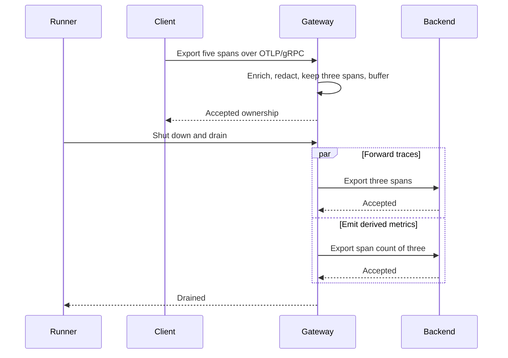

# Sample scenarios

The samples demonstrate application code using the public model, service, transport, and component APIs. They do not import generated protobuf messages or gRPC stubs.

| Example | Demonstrates | External destination |
| --- | --- | --- |
| [EmbeddedPipelineDemo](src/main/java/dev/nthings/otlp4j/samples/EmbeddedPipelineDemo.java) | A typed trace pipeline with empty-batch filtering, identifier redaction, and OTLP/gRPC export | Required when running its `main` method |
| [OtlpE2eDemo](src/main/java/dev/nthings/otlp4j/samples/OtlpE2eDemo.java) | A gateway, batching, fan-out, and a traces-to-metrics connector across two OTLP/gRPC hops | None; the sample starts its own backend |
| [LoggingGatewayMetrics](src/main/java/dev/nthings/otlp4j/samples/LoggingGatewayMetrics.java) | A logging adapter for the self-observability SPI | None |

For a complete introductory program, use [Getting started](../docs/getting-started.md). For pipeline assembly, use [Typed pipelines](../docs/pipelines.md).

## Embedded pipeline

`EmbeddedPipelineDemo.main` reads `OTEL_EXPORTER_OTLP_ENDPOINT`, defaulting to `http://localhost:4317`, and selects the gRPC exporter explicitly. Start a compatible destination before running it. The endpoint variable alone does not select HTTP export.

Its tests supply local destinations and verify the behavior without requiring an external service:

```sh
./mvnw -B -pl otlp4j-samples -am test \
  -Dtest=EmbeddedPipelineDemoTest \
  -Dsurefire.failIfNoSpecifiedTests=false
```

## End-to-end gateway

The client submits five spans: three `SERVER` and two `INTERNAL`. The gateway adds resource metadata, redacts a span attribute, retains only server spans, batches them, and fans out to trace export and span counting. The connector emits into a separate metrics pipeline.



The batch timer can also start delivery before shutdown. The sequence emphasizes that buffered acceptance precedes confirmed downstream delivery; see [Delivery and lifecycle](../docs/delivery.md).

Both gateway and backend receivers use ephemeral localhost ports. The test checks:

| Backend value                        | Expected |
| ------------------------------------ | -------- |
| Retained spans                       | 3        |
| Resource `deployment.environment`    | `demo`   |
| Span `enduser.id`                    | `***`    |
| Metric `otlp4j.connector.span.count` | 3        |

Run it from the repository root:

```sh
./mvnw -B -pl otlp4j-samples -am test \
  -Dtest=OtlpE2eDemoTest \
  -Dsurefire.failIfNoSpecifiedTests=false
```

For optional native-image packaging and toolchain requirements, see [Development](../docs/development.md#optional-builds).
