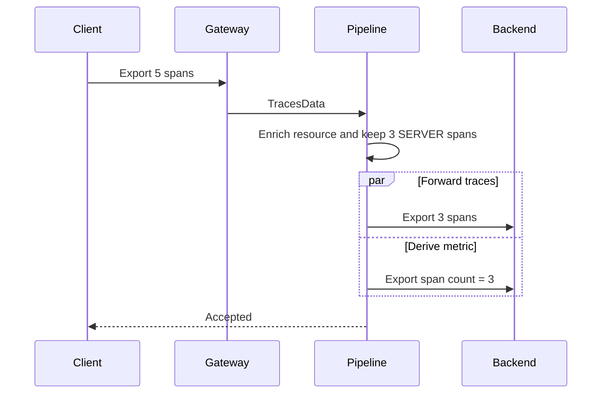

# End-to-end sample

`EmbeddedPipelineDemo` is the shortest example: it builds a typed trace pipeline, filters and maps immutable domain batches, and exports them over OTLP/gRPC without exposing generated types. `OtlpE2eDemo` exercises the public API and the bundled OTLP/gRPC transport together. The end-to-end sample builds its component graph with `Gateway.builder()` on `otlp4j-core` and `otlp4j-service`, wires the consolidated Armeria transport through `otlp4j-transport` (`OtlpReceiverFactory.grpc()` / `OtlpExporterFactory.grpc()` with the neutral `OtlpReceiverConfig` / `OtlpExporterConfig`), and adds the built-in batch processor and span-count connector from `otlp4j-components`; it never imports the generated proto or gRPC stub types, which stay encapsulated in `otlp4j-proto`.

## Scenario



Both receivers use ephemeral ports. The test asserts that the backend receives three spans, `deployment.environment=demo`, and an `otlp4j.connector.span.count` metric with value `3`.

Run it from the repository root:

```sh
./mvnw -B -pl otlp4j-samples -am test \
  -Dtest=OtlpE2eDemoTest \
  -Dsurefire.failIfNoSpecifiedTests=false
```

No external collector is required.

## Optional packaging

```sh
./mvnw -B -pl otlp4j-samples -am package -Pnative
```

The `native` profile requires a GraalVM JDK.
