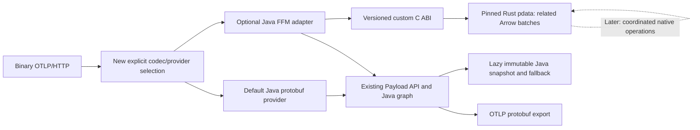

# Proceed selectively with an Arrow backend

**Conditional GO: implement an optional, batch-oriented Rust payload/codec/operations backend, not a drop-in model replacement or an embedded Rust collector.** OTel-Arrow exposes usable synchronous Rust conversion APIs, and lance4j supplies a relevant FFM binding pattern. However, otlp4j has no backend-provider SPI today, and persistent native payloads introduce ownership and fidelity obligations that FFM alone does not solve. Preserve the public immutable Java model, lazy compatibility snapshots, and the current Java implementation as the default and fallback. Start with a bounded, single-signal codec proof, then proceed only if semantic tests and representative end-to-end measurements justify retaining batches natively. This is a source-based feasibility judgment, not a demonstrated speedup or production-readiness claim.

## A second provider requires a new boundary

The inspected otlp4j architecture is an immutable Java domain model with lazy protobuf payloads, component factories, and Armeria transports, not a replaceable storage engine. `Payload<T>` is open, but `data()` returns the existing signal-specific records; there is no Arrow representation or provider-selection contract. `SignalCodec` is final and statically constructed, while `PayloadWire` recognizes bundled concrete payload classes and otherwise materializes Java data. Implementing another `Payload` alone therefore loses the native fast path at serialization. ([Payload.java:15-81](../otlp4j-core/src/main/java/dev/nthings/otlp4j/core/signal/Payload.java#L15-L81), [SignalCodec.java:28-101](../otlp4j-codec/src/main/java/dev/nthings/otlp4j/codec/SignalCodec.java#L28-L101), [PayloadWire.java:43-93](../otlp4j-codec/src/main/java/dev/nthings/otlp4j/codec/PayloadWire.java#L43-L93))

| Intended scope | Feasibility judgment | Principal qualification |
| --- | --- | --- |
| Synchronous native byte codec | Strong PoC candidate | Custom C ABI and conversion conformance required |
| Native payload plus selected batch operations | Recommended conditional target | New wire/provider boundary, lifetime protocol, and memory accounting |
| Stateful OTel-Arrow wire exchange | Separate later feature | Dictionary/session ordering, reconnect, and retry semantics |
| Transparent replacement of Java records | Not a drop-in provider | New model facade or repeated Java materialization |
| Full Rust collector embedded in the JVM | Outside recommended scope | Duplicates graph, scheduling, transport, and lifecycle responsibilities |

Existing factories permit explicit composition of a native component without replacing core/service, but that is not automatic provider discovery. A useful selectable backend needs **new representation-aware wire dispatch and an explicit selection policy**, preferably explicit factories/configuration initially. Keep Java transformations compatible through immutable snapshots; existing function processors, mixed-resource filtering, and batching materialize domain data and need provider-aware alternatives to retain native processing benefits. ([GatewayBuilder.java:62-148](../otlp4j-service/src/main/java/dev/nthings/otlp4j/service/GatewayBuilder.java#L62-L148), [FunctionProcessor.java:32-44](../otlp4j-core/src/main/java/dev/nthings/otlp4j/core/component/FunctionProcessor.java#L32-L44), [BatchProcessor.java:123-183](../otlp4j-components/src/main/java/dev/nthings/otlp4j/components/batch/BatchProcessor.java#L123-L183))

Binary OTLP/HTTP is the narrower first transport seam because it already owns request bytes. Bypassing Java protobuf parsing in gRPC requires custom marshallers/service adapters: generated ingress requests and egress stubs otherwise reintroduce Java messages. Preserve TLS, compression, admission, retries, deadlines, and response policy independently of representation. JPMS qualified exports also require deliberate module/SPI design, not production `--add-exports` workarounds. ([HttpProtocolMapping.java:116-130](../otlp4j-transport/src/main/java/dev/nthings/otlp4j/transport/internal/HttpProtocolMapping.java#L116-L130), [GrpcServiceAdapters.java:61-91](../otlp4j-transport/src/main/java/dev/nthings/otlp4j/transport/internal/GrpcServiceAdapters.java#L61-L91), [codec module-info.java:7-15](../otlp4j-codec/src/main/java/module-info.java#L7-L15))

## Rust covers three signals without replacing the collector

OTel-Arrow's `pdata` exposes OTLP-to-OTAP conversions, public builders, reverse protobuf encoders, and synchronous `Producer`/`Consumer` APIs for Arrow IPC inside `BatchArrowRecords`. `pdata-codec` offers a synchronous registry/service alternative. The source audit found **no telemetry C ABI, reusable cdylib exports, or OTel-Arrow C Data bridge**; those must be implemented downstream. Wrap `pdata`, optionally `pdata-codec`, at a pinned commit instead of linking engine/controller/collector runtime crates. ([payload.rs:720-781](https://github.com/open-telemetry/otel-arrow/blob/ddf1675fe65543594ce8149a34eadec5e17d40e8/rust/otap-dataflow/crates/pdata/src/payload.rs#L720-L781), [Rust boundary audit](../research_notes/Otlp4j%20Arrow%20backend%20feasibility/otel_arrow.md))

| Signal | Inspected Rust coverage | Recommended provider policy |
| --- | --- | --- |
| Logs | Bidirectional conversion, body/attributes and related payloads | First standalone proof |
| Traces | Bidirectional conversion, events, links, IDs and status | Native candidate after fidelity tests |
| Metrics | Empty/no-data, gauge, sum, histogram, exponential histogram, summary | Native candidate with complete variant corpus |
| Profiles | No OTAP signal variant | Preserve Java/opaque path |

An OTAP batch is **multiple related RecordBatches**, not one telemetry table: logs have 4 payload slots, traces 8, and metrics 19, including an unsupported multivariate-metrics production slot. This does not imply otlp4j currently models multivariate metrics. Native operations must coordinate root rows, attributes, child records, exemplars, and local parent IDs. A generic single C Stream cannot represent the heterogeneous batch schemas. ([raw_batch_store.rs:84-128](https://github.com/open-telemetry/otel-arrow/blob/ddf1675fe65543594ce8149a34eadec5e17d40e8/rust/otap-dataflow/crates/pdata/src/otap/raw_batch_store.rs#L84-L128), [encode/mod.rs:971-991](https://github.com/open-telemetry/otel-arrow/blob/ddf1675fe65543594ce8149a34eadec5e17d40e8/rust/otap-dataflow/crates/pdata/src/encode/mod.rs#L971-L991))

Avoiding the collector does not automatically yield a lightweight library: `pdata` unconditionally depends on DataFusion, Tokio, Tonic, and Nix. The workspace is pre-1.0 (`0.61.0`), documents API instability, and its lock resolves Arrow `58.4.0`; binary size, build cost, and dependency trimming remain unmeasured. Source-build a pinned wrapper rather than assume published crates or suitable prebuilt artifacts exist. ([pdata/Cargo.toml:1-47](https://github.com/open-telemetry/otel-arrow/blob/ddf1675fe65543594ce8149a34eadec5e17d40e8/rust/otap-dataflow/crates/pdata/Cargo.toml#L1-L47), [pdata/README.md:40-44](https://github.com/open-telemetry/otel-arrow/blob/ddf1675fe65543594ce8149a34eadec5e17d40e8/rust/otap-dataflow/crates/pdata/README.md#L40-L44), [Cargo.lock:209-248](https://github.com/open-telemetry/otel-arrow/blob/ddf1675fe65543594ce8149a34eadec5e17d40e8/rust/otap-dataflow/Cargo.lock#L209-L248))

## Reuse lance4j's seam, starting with bytes

**Proposed architecture:** preserve the Java graph and public API, isolate native integration in an optional module, and publish immutable native batches only after their lifetime contract exists. Arrow C Data is unnecessary if Java only needs metadata and serialized telemetry.

| Layer | Proposed responsibility |
| --- | --- |
| Java provider adapter | Selection, transport integration, lazy snapshots, lifetime gates, error translation |
| Rust shim | ABI validation, strict decoding, handle/buffer ownership, limits, panic containment |
| OTel-Arrow pdata | Signal conversion, Arrow batches, coordinated transforms, protobuf/IPC encoding |

Adapt lance4j's cbindgen checked header, handwritten FFM descriptors with `invokeExact`, loader/native-jar conventions, owned errors, and header/ownership tests. Its `ResourceGate`/`GatedHandle` protects calls against concurrent destruction, **not concurrent mutation**; its cleaner reports leaks but deliberately does not reclaim native handles. Add ABI/capability negotiation instead of copying its unreleased compatibility posture. Do not import database lifecycles or Tokio runtime semantics into synchronous telemetry conversion. ([LanceAbi.java:17-74](https://github.com/thiagogcm/lance4j/blob/4db50b8544e89782e1deb7630da2bca40adc2609/lance-abi-ffm/src/main/java/dev/nthings/lance4j/lanceabi/ffm/LanceAbi.java#L17-L74), [GatedHandle.java:12-109](https://github.com/thiagogcm/lance4j/blob/4db50b8544e89782e1deb7630da2bca40adc2609/lance-abi-ffm/src/main/java/dev/nthings/lance4j/lanceabi/ffm/GatedHandle.java#L12-L109), [HandleLeaks.java:7-59](https://github.com/thiagogcm/lance4j/blob/4db50b8544e89782e1deb7630da2bca40adc2609/lance-abi-ffm/src/main/java/dev/nthings/lance4j/lanceabi/ffm/HandleLeaks.java#L7-L59))

The proposed ABI should expose coarse `decode`, `encode`, metadata, operation, and release functions, not per-item/field downcalls. These names are illustrative, not existing exports. Specify:

- Version/capability handshake, upstream/schema provenance, fixed-width scalars, and no exposed Rust layouts.
- Borrowed input valid only during the call; owned output buffers with matching Rust free functions; exactly-once handle release.
- Status codes and owned diagnostic text, initialized outputs, and unwind containment, which cannot contain segmentation faults or allocator aborts.
- Bounded input, output, and total allocation; serialized mutable session access; no unnecessary async callbacks/upcalls.

Start with strict Prost decoding plus public builders, or the codec service. Raw views are not a safe validation default for untrusted wire input. Detach encoder scratch before returning; Arrow construction and protobuf emission still allocate/serialize. ([otlp codec:76-106](https://github.com/open-telemetry/otel-arrow/blob/ddf1675fe65543594ce8149a34eadec5e17d40e8/rust/otap-dataflow/crates/pdata-codec/src/codecs/otlp.rs#L76-L106), [codec README:81-93,138-149](https://github.com/open-telemetry/otel-arrow/blob/ddf1675fe65543594ce8149a34eadec5e17d40e8/rust/otap-dataflow/crates/pdata-codec/README.md#L81-L149))

Lance4j's Arrow Java 19 C Data path uses **`arrow_cdata_jni`**, so copying the complete bridge is not JNI-free. A byte-oriented shim can remain FFM-only. Defer C Data until Java genuinely needs columnar access, then qualify dictionaries, metadata, release callbacks, and coordinated per-payload exports separately. ([JniWrapper.java:19-53](https://github.com/apache/arrow-java/blob/v19.0.0/c/src/main/java/org/apache/arrow/c/jni/JniWrapper.java#L19-L53), [JniLoader.java:32-108](https://github.com/apache/arrow-java/blob/v19.0.0/c/src/main/java/org/apache/arrow/c/jni/JniLoader.java#L32-L108))

## Ownership and fidelity decide production readiness

**Persistent payload lifetime is the hardest core change.** Today's `Payload` has no close/retain protocol. Admission completion is not final release: batching, delivery queues, fan-out, retries, and receiver tap queues retain work, and application code can retain payloads independently. A component-owned arena cannot invalidate retained data at admission completion or shutdown. Scoped synchronous calls that copy outputs into Java ownership are a safe first proof, not end-to-end zero-copy. ([DeliveryQueue.java:109-312](../otlp4j-components/src/main/java/dev/nthings/otlp4j/components/internal/DeliveryQueue.java#L109-L312), [FanOutConsumer.java:18-53](../otlp4j-service/src/main/java/dev/nthings/otlp4j/service/internal/FanOutConsumer.java#L18-L53), [MulticastPublisher.java:129-240](../otlp4j-transport/src/main/java/dev/nthings/otlp4j/transport/internal/MulticastPublisher.java#L129-L240))

Before retaining native handles, define ownership across every queue/user boundary, concurrency-safe lazy access, and release on cancellation, failure, eviction, and shutdown without freeing live readers. Add native allocation quotas and live/peak gauges: the built-in limiter observes Java heap only. Keep `encodedSize()` as exact **OTLP protobuf size**, distinct from Arrow bytes or retained memory. Dual Java/native representations and fidelity sidecars count against memory budgets. ([MemoryLimiter.java:44-64](../otlp4j-components/src/main/java/dev/nthings/otlp4j/components/internal/MemoryLimiter.java#L44-L64), [Payload.java:59-76](../otlp4j-core/src/main/java/dev/nthings/otlp4j/core/signal/Payload.java#L59-L76))

Unchanged Java protobuf payloads preserve unknown fields; Arrow conversion does not establish that guarantee. Preserve original bytes or the Java protobuf path for unchanged forwarding, or declare narrower transformed-data semantics explicitly. Do not promise byte-identical protobuf re-encoding. Differential tests must distinguish wire-preservation behavior from Java-domain behavior, including duplicate-key collapse during domain mapping. Upstream canonical equivalence sorts/deduplicates and normalizes defaults, so it cannot prove strict order, multiplicity, grouping, or presence parity. ([PayloadWireMemoizationTest.java:20-40](../otlp4j-codec/src/test/java/dev/nthings/otlp4j/codec/PayloadWireMemoizationTest.java#L20-L40), [canonical.rs:4-151](https://github.com/open-telemetry/otel-arrow/blob/ddf1675fe65543594ce8149a34eadec5e17d40e8/rust/otap-dataflow/crates/pdata/src/testing/equiv/canonical.rs#L4-L151))

The shared corpus must cover empty groups, order/duplicates, absent/default values, nested attributes, IDs/timestamp boundaries/flags, schema URLs, routing/item counts, and exact sizes. Metrics require temporality, monotonicity, metadata, exemplars, optional sums/min/max, histogram bounds/counts, exponential buckets/scale/zero-threshold, and summaries. Checked u16/u32 counters require oversized-batch splitting. Schema drift is explicit: Java pins proto `b3f75588…` (`v1.11.1`), while Rust records `be5d5847…`. ([Java contract/schema findings](../research_notes/Otlp4j%20Arrow%20backend%20feasibility/otlp4j.md), [Rust coverage/schema findings](../research_notes/Otlp4j%20Arrow%20backend%20feasibility/otel_arrow.md))

## Advance through four gates before funding production

The following are **engineering estimates**, assuming one engineer skilled in FFM, Rust, and Arrow, usable public APIs, Linux x86_64, and no embedded collector. Durations are cumulative effort ranges, not validated delivery commitments.

| Gate | Required evidence | Estimated effort |
| --- | --- | --- |
| 1. Standalone logs proof | Source-built ABI; strict OTLP → OTAP → OTLP byte roundtrip using fresh Producer/Consumer; errors and all scoped allocations released | 2-4 person-weeks |
| 2. Useful three-signal prototype | Full standard-signal corpus; Java fallback; optional traces binary-HTTP integration through explicit factory/new neutral codec strategy; transport policy unchanged | 4-8 total |
| 3. Production-scoped Linux provider | Retained native batch, meaningful native operation, complete ownership/accounting, conformance, packaged loading, and measured workload crossover | 8-16 total |
| 4. Optional interoperability expansion | Stateful OTAP sessions or C Data only for a justified goal; dictionary/schema changes, reset/reconnect, release semantics | Separately scoped |

Stateful OTAP messages can depend on earlier schema/dictionary state; they are not universally standalone. Fresh producers/consumers isolate the first proof. Later sessions require ordered delivery and explicit recovery/reset behavior, not replaying incremental batches into fresh consumers. ([producer.rs:244-331](https://github.com/open-telemetry/otel-arrow/blob/ddf1675fe65543594ce8149a34eadec5e17d40e8/rust/otap-dataflow/crates/pdata/src/encode/producer.rs#L244-L331), [decoder.rs:68-114](https://github.com/open-telemetry/otel-arrow/blob/ddf1675fe65543594ce8149a34eadec5e17d40e8/rust/otap-dataflow/crates/pdata/src/decode/decoder.rs#L68-L114))

**Performance remains unknown.** Existing lazy-protobuf relay already avoids domain decoding; forcing OTLP → Arrow → OTLP can regress it. The strongest hypothesis is retained large batches undergoing native transformations, or future OTel-Arrow interoperability. Internal Arrow with OTLP protobuf egress does not itself save network bytes. Benchmark equal workloads against lazy Java passthrough, Java transformations, and a simple Java HTTP buffer-copy optimization control, since current HTTP export uses `ByteArrayOutputStream` plus `toByteArray()`. ([ProtoRequestPayload.java:20-64](../otlp4j-codec/src/main/java/dev/nthings/otlp4j/codec/ProtoRequestPayload.java#L20-L64), [ArmeriaOtlpClient.java:478-503](../otlp4j-transport/src/main/java/dev/nthings/otlp4j/transport/internal/ArmeriaOtlpClient.java#L478-L503))

Measure tiny/large batches, high-cardinality attributes, multiple resources, realistic metrics, native operations, and Java fallback. Include boundary copies, latency distributions, throughput, Java allocation, native live/peak bytes, RSS, and wire sizes. Require zero semantic loss, stable post-drain allocation counters, adversarial close/queue/cancellation tests, ABI layout/header checks, fuzzing, and relevant HTTP/gRPC policy suites. Agree workload-specific performance budgets before measuring; allocation moved off-heap is not automatically lower total memory.

Deploy separately from Java-only modules. Test classpath/module-path loading, native-access flags, ABI mismatch, cache failures, and unavailable-library fallback or explicit startup rejection. Lance4j currently packages Linux x86_64/glibc only, not a proven universal matrix. Pin build inputs and audit dependency notices: OTel-Arrow is Apache-2.0; explicit license coverage for adapted lance4j Java scaffolding should be settled before distribution. Broader platforms, transparent model replacement, strict FFM-only C Data, and full collector embedding exceed the estimates. ([Linux native artifact](https://github.com/thiagogcm/lance4j/blob/4db50b8544e89782e1deb7630da2bca40adc2609/lance4j-native/lance-abi-linux-x86_64/pom.xml#L12-L20), [OTel-Arrow notices](https://github.com/open-telemetry/otel-arrow/blob/ddf1675fe65543594ce8149a34eadec5e17d40e8/THIRD_PARTY_NOTICES.txt#L19-L71))

## Conclusion

Proceed when the goal is a bounded experiment in native batch processing or Arrow interoperability, with a named workload and a budget for ownership/conformance work. Do not proceed on the premise that an existing provider can simply be swapped or that FFM guarantees acceleration. If the retained-batch path cannot outperform the already-lazy Java baseline within agreed memory budgets, keep the integration experimental or interoperability-specific rather than making it the default.

### Evidence and verification scope

This report synthesizes the supplied notes only. Their inspections were source audits on 2026-10-09, not build/test/benchmark runs; Cargo metadata succeeded, but no native prototype was executed. Performance, native binary size, platform support, and complete semantic equivalence remain unverified.

| Evidence set | Inspected snapshot | Canonical notes and source scope |
| --- | --- | --- |
| otlp4j | `2ec6a258c83eb4a85d306729f2e4ca1c99b3d906` | [Java notes](../research_notes/Otlp4j%20Arrow%20backend%20feasibility/otlp4j.md): model, payload/wire coupling, transports, retention, tests |
| OTel-Arrow | `ddf1675fe65543594ce8149a34eadec5e17d40e8` | [Rust notes](../research_notes/Otlp4j%20Arrow%20backend%20feasibility/otel_arrow.md): pdata/codec APIs, signal slots, conversions, schema/state, dependencies |
| lance4j | `4db50b8544e89782e1deb7630da2bca40adc2609` | [FFM notes](../research_notes/Otlp4j%20Arrow%20backend%20feasibility/lance4j.md): ABI, resource gates, loader/packaging, Arrow Java 19 JNI, test patterns |
