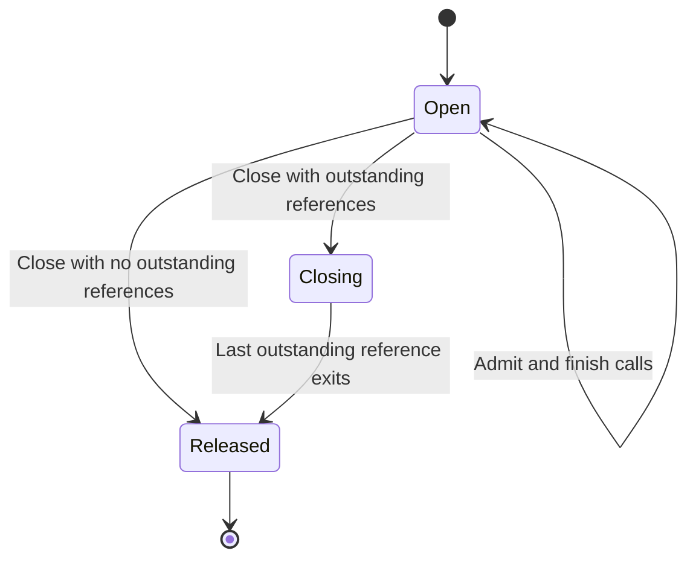

# lance4j Rust and Java FFM patterns for an otlp4j Arrow backend

## What does the implemented native seam do, and who owns its resources?

### Takeaway

lance4j supplies a substantial, real C ABI shim and handwritten Java FFM adapter, with explicit ownership transfers, concurrent-close protection, panic containment and asynchronous result handles. Its Lance calls use FFM, but its pinned Arrow Java C Data bridge uses JNI, so adopting the complete bridge is not an entirely JNI-free solution ([downcalls: `LanceAbi.java:17-48`][downcalls], [Arrow 19 JNI entry points: `JniWrapper.java:19-53`][arrow-jni]).

### Cited Findings

| Concern | Actual implementation and evidence |
| --- | --- |
| Rust shim shape | `lance-abi` is a Rust 2024 crate, version `0.1.0`, building `cdylib`, `staticlib` and `rlib`. Public boundaries use fixed-width scalars, pointers and `#[repr(C)]` structs. Compilation explicitly rejects `panic=abort` and non-64-bit targets. The Java adapter is a separate runtime module implementing SPI ports, not the database client itself ([`lance-abi/Cargo.toml:1-13`][manifest], [`lance-abi/src/lib.rs:1-10`][rust-boundary], [`lance-abi-ffm/pom.xml:12-34`][ffm-pom]). |
| C ABI exports | Functions use `#[unsafe(no_mangle)] pub unsafe extern "C" fn`, with `lance_abi_*` symbol names. Fallible operations generally return `i32` status and fill caller-provided slots, rather than exposing Rust `Result`, `Vec`, traits or futures. For example, runtime creation takes options and `LanceAbiRuntime **`; asynchronous scan initiation takes a scanner, callback and opaque context ([`runtime.rs:227-249`][runtime-new], [`scan/exec.rs:1195-1245`][async-start]). |
| Header and Java generation | cbindgen generates a checked-in C header from Rust. It forward-declares Arrow C structures and renames arrow-rs FFI types accordingly. `just generate-abi-header` regenerates and syntax-checks it; `just check-abi-header` compares fresh output with the checked-in header. Java downcalls, layouts and constants are handwritten. jextract is an exploratory proposal, not an implemented generation step ([`cbindgen.toml:1-51`][cbindgen], [`Justfile:134-154`][header-build], [`LanceAbi.java:35-74`][downcalls], [`AbiStructs.java:15-76`][layouts], [`docs/assessments/upstream-lance.md:270-278`][generation-assessment]). |
| Downcalls | A single native linker and resolved `SymbolLookup` bind method handles with explicit `FunctionDescriptor`s; wrappers use `invokeExact`. All declared bindings initialize together, so a missing required symbol fails initialization with the source library in the diagnostic. The descriptor set is retained for tests ([`LanceAbi.java:17-74`][downcalls]). |
| Native loader | Resolution is explicit property/environment override, then bundled platform resource, then OS loader search. An invalid explicit override fails rather than silently falling through. Libraries use `SymbolLookup.libraryLookup(..., Arena.global())`, so the library and its callback code remain loaded for process lifetime. One load success or `LinkageError` is cached ([`NativeLibraryResolver.java:124-157,178-239`][loader], [`NativeLoad.java:31-50`][load-cache]). |
| Extraction integrity | A bundled descriptor supplies library, SHA-256 and size. New extraction is hashed, placed in a content-addressed cache and atomically moved. Cache directories reject symlinks and other owners where owner checks are available. Existing library files are checked by size only, not rehashed, and existing directories are not checked for restrictive mode bits. The loader's own diagnostic calls out writable-cache and `noexec` failures ([`NativeLibraryResolver.java:214-305`][extraction], [`NativeLibraryResolver.java:308-359,412-435`][cache-checks]). |
| Synchronous errors | Rust uses thread-local `Option<Box<LanceAbiError>>`; status zero is success and failures are negative. `guard` clears a prior pending error, catches unwind, and publishes an owned error. `error_take` transfers it once on the same thread; borrowed message/details views remain valid until `error_free`. Java checks immediately after the downcall, copies diagnostic text and frees the error in `finally`, mapping codes to typed exceptions and redacting URI credentials ([`core/error.rs:12-100`][error-types], [`core/handles.rs:29-49`][panic-guard], [`core/error.rs:294-377`][error-transfer], [`AbiErrors.java:104-166`][java-errors]). |
| Panic containment | Release helpers null caller storage before dropping, catch drop panics and log them. Scan execution also catches panics while polling an asynchronous future and makes execution/export errors sticky. Arrow stream callbacks have their own catch-unwind and per-stream error message, using Arrow errno conventions rather than thread-local ABI errors. Containment is not memory safety for forged or stale pointers ([`core/handles.rs:84-139`][handle-free], [`scan/exec.rs:133-203`][cursor], [`stream.rs:94-141,193-230`][stream-errors]). |
| Java lifetime protection | `GatedHandle` is `AutoCloseable`; pointer access is admitted through `ResourceGate`. Close stops new admission and release runs once after outstanding calls and held references leave. This is a use-versus-free gate, not automatic serialization of all operations. The cleaner reports leaked handles but deliberately never frees them, avoiding a cleanup-thread race with native address use ([`GatedHandle.java:12-109`][gated-handle], [`ResourceGate.java:94-153`][resource-gate], [`HandleLeaks.java:7-59`][leak-detector]). |
| Arena policy | Request and output wrappers use a fresh `Arena.ofConfined()` for synchronous calls. Arrow output headers use confined storage, while Arrow import moves their ownership into separately retained objects before that arena closes. The library lookup and asynchronous completion upcall stub use `Arena.global()`. This is not a pattern of allocating all native payloads in one shared Java arena ([`AbiResource.java:40-66,90-99`][abi-resource], [`AbiArrow.java:50-125`][arrow-import], [`AbiScanner.java:135-176`][upcall], [Arrow `ArrayImporter.java:53-70`][arrow-array-importer], [Arrow `ArrowArrayStreamReader.java:36-47`][arrow-stream-reader]). |
| Arrow input streams | Java exports an `ArrowReader` through Arrow's `Data.exportArrayStream`; the Java helper consumes the reader on every path, releasing any untaken stream or closing a reader if export fails. Rust validates live callbacks and takes the stream with `FFI_ArrowArrayStream::from_raw`, leaving the original storage empty. The Rust C contract differs: validation before taking leaves input live for retry. Producer callbacks can run on native runtime worker threads and must not reenter blocking ABI calls ([`AbiArrow.java:179-197`][arrow-export], [`stream.rs:20-50`][stream-take], [`write.rs:387-432`][write-stream]). |
| Arrow output buffers | Rust exports record batches with `FFI_ArrowArray::new(&StructArray::from(batch).to_data())`. Java imports into a `VectorSchemaRoot` and releases the original headers in `finally`. Arrow Java moves the array header into an owned allocation, marks the source released and keeps the foreign allocation alive through reference counting. The consumer closes the root or reader; releasing a C header is distinct from freeing its caller-owned outer storage. Streams independently own their cursor after transfer ([`scan/exec.rs:186-209`][array-export], [`AbiArrow.java:70-125`][arrow-import], [Arrow `ArrayImporter.java:53-70`][arrow-array-importer], [`scan/exec.rs:1322-1360`][stream-transfer]). |
| Dictionary lifetime | Schema reuse is rejected recursively for dictionary-encoded fields. `AbiArrow.importRoot` creates a call-scoped `CDataDictionaryProvider`, whereas an imported Arrow stream reader retains its provider until reader close. This is evidence to test dictionary-bearing telemetry explicitly, not proof that every telemetry dictionary/extension layout is supported ([`AbiArrow.java:86-125`][arrow-import], [Arrow `ArrowArrayStreamReader.java:33-47,77-81`][arrow-stream-reader]). |
| Non-Arrow arrays and bytes | Rust exports metadata arrays as boxed slices, paired with count and pointer; matching native free functions reclaim them. Java copies string/byte/long-array requests into call-scoped native memory and copies native owned bytes back to heap before freeing them. Thus the bridge does not claim every argument and result is zero-copy ([`core/arrays.rs:55-100`][rust-arrays], [`AbiMarshal.java:98-119,149-184`][marshal]). |
| Actual additional native dependency | Arrow Java `19.0.0`, selected by the root POM, uses `JniWrapper` native methods for release, stream pull, schema pull and exports. Its `JniLoader` loads `arrow_cdata_jni`, independently extracting a JNI library into `java.io.tmpdir`; the Rust shim loader's configurable cache does not configure this second loader ([`pom.xml:24-26,133-136`][root-pom], [Arrow `JniWrapper.java:19-53`][arrow-jni], [Arrow `JniLoader.java:32-35,77-108`][arrow-jni-loader]). |

### Inferences

- The useful zero-copy property is retained Arrow payload buffers across the language seam, not zero allocations or zero serialization in a complete OTLP-to-Arrow-to-OTLP pipeline. C headers, schemas, wrappers, reference bookkeeping, strings and heap-array marshalling still allocate. Neither the examined ownership tests nor the JMH benchmark establishes pointer identity or copy counts for otel-arrow telemetry buffers ([array export][array-export], [Arrow ownership move][arrow-array-importer], [heap/native copies][marshal], [benchmark scope][benchmark]).
- Never pass confined-arena request pointers to a retained native task without copying or transferring them first. The safe asynchronous precedent is a global upcall stub, an opaque numeric registration identifier, native-owned completed-operation handles and result import on the receiving Java thread. The request arena does not need to stay open for the asynchronous scan ([`AbiScanner.java:68-87,111-176`][upcall], [`scan/exec.rs:1195-1304`][async-start]).
- An Arrow C interface is a trusted in-process memory contract, not an input-validation sandbox. Rust's schema checks still trust readable pointers and NUL termination, and the handle code cannot distinguish an aligned stale pointer from a live one. Parse untrusted telemetry bytes into validated native structures before exposing C Data, and do not expose arbitrary-address imports as a general public API ([`schema.rs:115-130`][schema-safety], [`core/handles.rs:84-113`][handle-free]).
- The cleaner policy trades deterministic safety for permanent leaks if consumers forget close. Reuse it only alongside explicit lifecycle APIs, leak tests and memory accounting, not as a promise of eventual GC reclamation ([`HandleLeaks.java:7-59`][leak-detector]).

### Gaps

- No execution was performed against the current native library, because `lance-abi/target/release/liblance_abi.so` was absent. Stream ownership and panic results above are source-backed contracts and test assertions, not freshly verified execution results.
- Broad Arrow type coverage, dictionary IDs and buffers after provider close, extension metadata fidelity, sliced/offset arrays, newer Arrow buffer layouts and actual buffer pointer identity need a telemetry-specific test matrix. Java Arrow 19 and Rust Arrow 58 coexist here through C Data, but that version pair is not itself a guarantee for another pair.
- No proof was found that every possible exception, including allocation failure while preparing an upcall dispatch, is contained in the Java upcall frame. Treat `AbiScanner.completed` as a design reference requiring explicit audit, rather than a complete no-throw proof.

## How are native builds, compatibility, distribution and tests handled?

### Takeaway

The project has useful Maven/Cargo packaging and cross-language test scaffolding, but it is a Linux-glibc-only, unreleased development binding with intentionally breaking native layouts. Reuse the mechanics, not the absence of a compatibility contract or an assumed multi-platform release process ([native module: `pom.xml:12-20`][linux-native], [compatibility policy: `compatibility.md:3-15,24-30`][compatibility]).

### Cited Findings

| Topic | Evidence-backed result |
| --- | --- |
| Dependency and toolchain baseline | Rust minimum is `1.99.0`; all Lance Git dependencies share pin `db684d1f0726c00b6defb7963a604a7719e82b5a`. Rust Arrow dependencies are `58`; Java Arrow is `19.0.0`; Java compilation targets release `25`. The root Maven version is `1.0-SNAPSHOT`, separate from the Rust crate's `0.1.0` ([`lance-abi/Cargo.toml:1-40`][manifest], [`pom.xml:21-26,53`][root-pom]). |
| Native build integration | A normal Maven reactor build does not invoke Cargo. `-Dlance4j.native` opts in to the platform module; Cargo runs in `generate-resources`, using `build --release --target-dir target`. A skip option packages an already-built library. The declared Rust target is metadata; the actual Cargo invocation does not pass `--target` or `--locked` ([`lance4j-native/pom.xml:15-33,45-86`][native-build], [`lance-abi-linux-x86_64/pom.xml:16-20`][linux-native]). |
| Supported native artifacts | The sole configured native artifact is `lance-abi-native-linux-x86_64`, targeting `x86_64-unknown-linux-gnu` and describing glibc. It is a platform-specific artifact ID, not a Maven classifier on one universal artifact. The loader normalizes Windows/macOS and x86_64/aarch64 names, and Rust links a macOS install name, but neither establishes a packaged or tested platform beyond Linux x86_64 ([`lance4j-native/pom.xml:45-60`][native-build], [`lance-abi-linux-x86_64/pom.xml:12-20`][linux-native], [`NativeLibraryResolver.java:58-92`][platform-detection], [`lance-abi/build.rs:1-12`][link-names]). |
| Packaged metadata | A jar contains `META-INF/lance4j-native/<platform>/liblance_abi.so` and a descriptor recording SHA-256, size, crate version, current repository commit, Lance revision, Maven version and Rust target. The metadata is derived during packaging, not read out of the binary. Skipping Cargo can therefore stamp an old binary with current source provenance if the caller does not ensure freshness ([`lance4j-native/pom.xml:104-155`][native-metadata]). |
| Reproducibility | Cargo.lock is tracked; Git upstream dependencies are revision-pinned; Maven defines a fixed output timestamp. Release Rust uses unwind, thin LTO and stripped symbols. CI installs a moving stable Rust toolchain and runs on `ubuntu-latest`, rather than pinning a toolchain version and build image, and Cargo commands omit `--locked`. These improve traceability but do not establish byte-reproducible native builds or a minimum glibc baseline ([`Cargo.lock`][lockfile], [`Cargo.toml:24-40,86-89`][manifest], [`pom.xml:21-26`][root-pom], [`.github/workflows/ci.yml:15-38`][ci]). |
| Runtime compatibility | Required symbols resolve at initialization, but the native descriptor's version and commit are recorded, not compared with a required ABI signature. The documented policy explicitly has no release compatibility promise and changes symbols/layouts directly. No ABI-size/version negotiation is added merely by packaging a descriptor ([`LanceAbi.java:17-48`][downcalls], [`NativeLibraryResolver.java:214-227`][extraction], [`docs/design/compatibility.md:3-15,24-30`][compatibility]). |
| Publishing/release handling | Documentation says the project is not published and has no release planned. `just install` installs locally; CI uploads the Linux native jar on main with two-day retention. This is not Maven Central deployment, a signed release pipeline or a maintained native platform matrix ([`docs/design/compatibility.md:3-7`][compatibility], [`Justfile:63-70`][local-install], [`.github/workflows/ci.yml:49-64`][ci]). |
| JVM/module requirements | Test flags open `java.base/java.nio` to Arrow memory and grant native access to the FFM module, `org.apache.arrow.c` and unnamed modules. The FFM JPMS module exports nothing and provides its SPI through service loading. A native jar is an otherwise-unreferenced automatic module, so module-path deployments must additionally resolve it with `--add-modules` or `ALL-MODULE-PATH`. Java library path does not select the Rust library because the OS loader lookup is used ([`pom.xml:73-82`][root-pom], [`module-info.java:1-10`][ffm-module], [`docs/guide/getting-started.md:61-77`][jvm-flags]). |
| Rust/C verification | `just test-abi` checks header freshness, runs Rust tests and Clippy with warnings denied, builds the shim, compiles and runs a C fixture, and runs a schema interoperability example. CI pins cbindgen `0.29.4` and uses the release profile with one Cargo build job to bound linking memory ([`Justfile:156-168`][rust-test-gate], [`.github/workflows/ci.yml:21-38`][ci]). |
| Java verification | Header tests check defined constant values, account for all exported functions except two intentional C-only functions, and compare FFM descriptors with parsed C prototypes. Separate integration tests exercise consumed inputs on failure, reader/batch survival after source close, exclusive drain modes, concurrent mutations and runtime retention after owner close. CI runs the tests against the packaged native jar with search paths empty ([`AbiHeaderConstantsTest.java:12-26`][constant-tests], [`AbiHeaderBindingsIT.java:21-59,73-117`][descriptor-tests], [`AbiArrowOwnershipIT.java:20-153`][ownership-tests], [`AbiHandleRaceIT.java:24-87`][race-tests], [`.github/workflows/ci.yml:47-55`][ci]). |
| Performance evidence scope | JMH compares full Lance read/decode paths, not isolated FFM call overhead; the `take` paths differ because the comparison JNI implementation serializes IPC. Defaults are five two-second warmups, eight two-second measurements and three forks. A separate evidence harness reports cancellation settlement, Java Arrow buffering, RSS and sampled threads, and explicitly says it cannot bound or measure native readahead allocations ([`BackendComparisonBenchmark.java:36-51`][benchmark], [`ScanEvidenceHarness.java:38-75`][evidence-harness]). |

### Inferences

- Add an explicit ABI version/capability handshake before binding or using layout-sensitive functions. Missing-symbol checking cannot detect a library that preserves a symbol while changing its argument or structure layout. Exact backend and shim revisions should be paired at release time ([binding mechanism][downcalls], [breaking-layout policy][compatibility]).
- Strengthen layout conformance with compiled C `sizeof`, alignment and every field's `offsetof`, including structures passed by pointer. The examined descriptor test checks pointers only as pointers and checks by-value structure name/size/alignment, not every member offset. Header parsing and tests written against the same handwritten Java offsets are not an independent complete layout oracle ([`AbiHeaderBindingsIT.java:73-117`][descriptor-tests], [`AbiStructs.java:15-76`][layouts]).
- Pin Rust and native build images, enforce a clean provenance check when packaging an existing binary, use `--locked`, and publish an actual OS/architecture/libc support matrix. Names normalized by a loader should not be advertised as tested native platforms ([Cargo invocation][native-build], [metadata stamping][native-metadata], [CI image/toolchain][ci]).
- Native payload memory must be measured separately from Java heap and Arrow allocator bookkeeping. Compare telemetry processing end to end under equal encodings, compression, dictionaries, signal mix and consumer behavior, rather than extrapolating from Lance scan-versus-IPC benchmarks ([benchmark scope][benchmark], [native-memory limitation][evidence-harness]).

### Gaps

- No Gradle build was found in the tracked file inventory; the inspected build path is Maven plus Cargo and Justfile. No release-signing, remote deployment, software bill of materials, dependency-license audit, sanitizer/fuzzer CI or multi-platform test matrix was established by the inspected workflow.
- The dynamic library was absent, so ELF dependencies, native artifact size, exported-symbol behavior, glibc symbol requirements and native smoke execution were not measured. Do not infer these operational properties from `ubuntu-latest` or the declared target triple.
- Existing documentation occasionally overstates structural checks. The observed descriptor check is narrower than complete independent structure-field verification; a PoC should add that missing gate instead of repeating the broad documentation claim.

## Which patterns transfer, what are the risks, and what should a PoC prove?

### Takeaway

For an in-process Rust telemetry library that already exposes usable transformation APIs, the interop approach is highly feasible, but most reusable value lies in small ownership, loading and test abstractions rather than Lance ports. My conditional rating is **4/5 for a narrow synchronous codec PoC** and **3/5 for a production second backend**, with readiness dependent on the independently researched otel-arrow API and semantic fit, not demonstrated by lance4j alone ([separable runtime adapter][ffm-pom], [C boundary primitives][rust-boundary], [ownership checks][ownership-tests]).

### Cited Findings

- The Rust runtime is explicit and per handle: a multi-thread Tokio runtime, leases held by children/streams/tasks, a shutdown reaper OS thread and separate close, await-idle and free operations. Runtime close stops admission but existing admitted work continues. Lance additionally has a process-global CPU pool controlled by `LANCE_CPU_THREADS`, outside this handle's shutdown. Fork without exec is unsupported, and nested current-thread Tokio blocking is explicitly unsupported ([`runtime.rs:27-39,48-95,106-193,252-319`][runtime-lifetime]).
- Native asynchronous pull allows one outstanding pull per scanner, moves cursor state into an owned task, catches polling failures, restores scanner state and transfers one completed operation to the callback. Taking that operation on another thread publishes its error on the taking thread, solving TLS error-thread mismatch. Accepted work survives scanner close ([`scan/exec.rs:219-306`][scanner-state], [`scan/exec.rs:1195-1304,1386-1404`][async-start]).
- Java registers its pending pull before starting native work, uses one process-global upcall stub and dispatches completion onto a virtual thread before importing results or invoking user code. Its fallback executor has one prestarted daemon thread and an unbounded `LinkedBlockingQueue`. Both-dispatch-failure logs without a demonstrated result-disposal path in that branch ([`AbiScanner.java:68-87,135-223`][upcall], [`CompletionDispatch.java:9-51`][completion-dispatch]).
- Java handover has an eight-batch count cap and a byte-accounting threshold, and owns/cleans undelivered batches. The threshold is checked before receiving another batch and is not a hard bound on a large single batch or all backend allocations. Subscribers own delivered batches. Cancellation requests are prompt but do not promise all non-cancellable native CPU work has stopped ([`BatchHandover.java:12-20,27-64,76-109`][handover], [`BatchPublisher.java:15-18`][publisher], [`scan/exec.rs:1363-1371`][cancellation]).
- Rust crate licensing is explicitly `Apache-2.0`. A tracked-file inventory and source/manifest search found no repository-wide LICENSE/NOTICE or Java Maven license declaration; therefore the Rust manifest should not be treated as proof of an explicit grant covering all Java scaffolding. Arrow's inspected sources carry Apache licensing notices. Apache 2.0 redistribution requires a license copy, notices of modifications, preservation of applicable notices and relevant NOTICE attribution when present ([`lance-abi/Cargo.toml:1-7`][manifest], [lance4j source tree at inspected commit][source-tree], [Arrow source notice][arrow-jni], [Apache License, section 4][apache-license]).

### Inferences

#### Transferable patterns and cautionary counterexamples

The following is a recommendation for otlp4j, not a description of its current implementation or of otel-arrow's available exports. Its existing public API, backend selection and Rust conversion entry points must be reconciled with the other researchers' findings.

| Candidate | Conceptual or code-level reuse | Required adaptation or reason not to copy wholesale |
| --- | --- | --- |
| Native/backend boundary | Keep public Java types and backend contract independent from FFM. Put loading, pointers, native errors and layouts inside a separately selectable adapter ([FFM module][ffm-module]). | Replace database ports with telemetry conversion/processing operations. Do not import datasets, snapshots, manifests, indexes, transactions or object-store lifecycles just to obtain the binding architecture. |
| ABI primitives | Adapt the byte-view/owned-byte distinction, fixed-width status, output-slot initialization, borrowed-versus-consumed contract and nulling frees ([Rust handles][handle-free], [marshalling][marshal]). | Add size/version negotiation and define empty-versus-absent semantics for telemetry. A copied helper still needs telemetry limits, overflow checks and a complete ownership contract. |
| Error handling | Adapt panic guard, one-time owned errors and same-thread translation; use owned completed-operation errors if async work becomes necessary ([panic guard][panic-guard], [operation take][async-start]). | Build telemetry-specific error categories, including malformed input, unsupported signal/schema, resource exhaustion, cancellation and queue admission failure. Lance's namespace, commit and retry categories do not fit; its backpressure-to-I/O exception mapping loses a useful admission distinction. |
| Resource gates | `ResourceGate`, `GatedHandle`, `NativeLoad` and small scoped-call helpers are the strongest candidates for direct adaptation after license clearance ([resource gate][resource-gate], [load cache][load-cache]). | A gate protects destruction, not general mutable processor concurrency. Decide per-context serialization and whether context/dictionary state is stream-specific. Retained outputs must survive processor close or explicitly forbid it. |
| Loader/packaging | Adapt override, bundled resource, fail-fast diagnostics, private content-addressed extraction, and packaging tests with empty search paths ([loader][loader], [CI][ci]). | Simplify for the initial platform, add ABI checks, define libc requirements and publish supported targets. Consider rehashing existing cached files and checking directory permissions. Preserve metadata provenance accurately. |
| Arrow C Data/Stream | Reuse Arrow's standard interfaces if Java genuinely needs foreign `RecordBatch` buffers ([Arrow import move][arrow-array-importer], [stream transfer][stream-transfer]). | If the stable Java contract is serialized telemetry, an initial byte-buffer ABI may avoid an unnecessary Arrow Java/C Data dependency. Reusing Arrow 19 C Data adds `arrow_cdata_jni`; a strict FFM-only requirement needs an alternative bridge and its own callback/lifetime proof. |
| Async completion | Adapt explicit result ownership and off-native-frame delivery only when required ([upcall][upcall], [scanner state][scanner-state]). | Do not adopt Tokio, one virtual thread per completion, a global pending map or an unbounded fallback queue without admission limits and shutdown requirements. For synchronous in-memory codec operations, keeping native execution synchronous may be both simpler and safer. |
| Test scaffolding | Adapt C fixture, header freshness, descriptor/constant checks, close-race tests, consumed-input tests and packaged-load tests ([Rust gate][rust-test-gate], [descriptor checks][descriptor-tests], [ownership checks][ownership-tests]). | Add independent full layout checks, telemetry semantic/wire conformance, corruption/failure injection and performance baselines. Database row-count and dataset read tests cannot substitute for telemetry correctness. |

#### Interop responsibility map

This proposed split preserves the proven distinction between short-lived call storage and transferred payload ownership. It should be implemented with the smallest Rust runtime surface the actual otel-arrow library requires ([confined call pattern][abi-resource], [transferred Arrow ownership][arrow-import], [Rust runtime leases][runtime-lifetime]).

| Responsibility | Java adapter | Rust shim | Rust telemetry library |
| --- | --- | --- | --- |
| Selection and configuration | Implement the existing Java backend contract; validate public options; load a chosen backend explicitly. | Expose capability/version query and validate C configuration. | Define supported processing options and transformations. |
| ABI and representation | Maintain or generate FFM descriptors/layouts; own request/output header arenas. | Own the C ABI, length/count validation, output defaults and stable status categories. | Keep Rust-native representations private to the shim. |
| Input bytes | Copy heap bytes for a synchronous borrowed call, or explicitly transfer retained native storage. | Borrow only for the documented interval; copy/retain before asynchronous return. | Decode/process using its documented API. |
| Output bytes | Copy to existing Java return types and call matching native free, or own a closeable direct-buffer result. | Allocate and release owned output; never require Java to guess allocator/free behavior. | Produce transformed telemetry payloads. |
| Arrow outputs, if required | Import C Data into closeable Java roots/readers; retain allocator/dictionary prerequisites. | Export release callbacks and native ownership independent from temporary headers. | Own or reference-count actual Arrow buffers. |
| Async work, if required | Keep registration alive; enforce bounded admission; dispatch without running users in native callback frames; release abandoned completions. | Own tasks/results; guarantee completion/abandon semantics; distinguish cancellation from destruction. | Supply processing cancellation and queue behavior, if any. |
| Errors and shutdown | Translate errors before changing threads; block new Java calls after close; report leak diagnostics. | Catch unwind, reject invalid state, free once, drain or cancel accepted work under explicit deadlines. | Define processing/state-reset semantics and native allocations/threads that outlive a call. |

The reusable handle gate has the following lifecycle; it does not itself settle asynchronous results or free Arrow buffers already transferred to a consumer ([`ResourceGate.java:94-153`][resource-gate], [independent output lifetime][stream-transfer]).

#### Feasibility and effort estimate

These are engineering estimates, not measurements or upstream commitments. They assume one engineer comfortable with Rust, Java FFM and Arrow, a Linux x86_64 PoC, available otel-arrow library APIs, no new collector/network service, and an existing Java contract that can represent the native backend's output. The estimates use lance4j's demonstrated ABI, ownership and packaging patterns as architectural precedent only ([ABI][rust-boundary], [adapter separation][ffm-pom], [packaging][native-build]).

| Deliverable | Estimated effort | Assumptions and exclusions |
| --- | --- | --- |
| Narrow synchronous PoC | 2-4 person-weeks | One signal or one representative conversion path; byte-oriented boundary; pinned upstream; source-built Linux library; differential correctness, error/close tests and a credible benchmark. No async callbacks, broad platform publishing or full semantic parity. |
| Useful multi-signal prototype | 4-8 person-weeks total | Logs, metrics and traces only where the native library already supports the required transformations; richer type/error tests; stable context lifecycle; bundled Linux artifact; CI. Arrow C Data output and dictionary handling can move this toward the high end. |
| Production second backend | 8-16 person-weeks total | Full declared API parity, version handshake, bounded memory/admission, conformance corpus, adversarial lifetimes, release/provenance/licensing gates and deployment guidance. Broader OS/architecture publishing, a strict no-JNI bridge or adapting a collector engine instead of a reusable library can exceed this range. |

The rating falls to **2/5 pending a separate design** if the required API is only a long-running collector pipeline, requires network transport for local conversion, or cannot preserve the current Java semantics. None of those conditions is established by the Lance research; the otel-arrow researcher must settle them before accepting the estimate.

#### Operational risks to carry into design

1. **Native failure scope:** Rust unwind containment cannot catch segmentation faults, invalid-pointer UB, allocator aborts or foreign Java exceptions escaping an upcall. Keep raw pointers internal and test callback failure paths ([schema trust contract][schema-safety], [upcall implementation][upcall]).
2. **Memory pressure and forgotten close:** Native-owned Arrow buffers, retained dictionary/processor state, pending operations and Java-owned results can outlive a call. A Java queue limit alone does not limit all native memory, and cleaner diagnostics do not reclaim leaks ([leak policy][leak-detector], [queue accounting][handover], [native memory caveat][evidence-harness]).
3. **Shutdown versus cancel:** Separate stop-admission, cancellation, completed-result disposal, drain timeout and free. Accepted tasks and exported streams can remain alive after owner close, and cancellation does not prove CPU quiescence ([native lifetimes][runtime-lifetime], [stream transfer][stream-transfer], [cancel contract][cancellation]).
4. **Scheduling/backpressure:** The scanner's one-outstanding-pull rule limits each cursor, not the global number of contexts/tasks/results. Unbounded fallback queues and indefinite registration retention need explicit admission budgets and metrics in a telemetry workload ([scanner state][scanner-state], [dispatch queue][completion-dispatch]).
5. **Packaging environment:** Executable/writable extraction paths, correct module resolution, native-access flags, libc dependencies and the second Arrow JNI loader are distinct deployment requirements. One loader cache override does not solve the other loader's extraction problem ([Rust loader][loader], [module flags][jvm-flags], [Arrow JNI loader][arrow-jni-loader]).
6. **ABI/schema drift:** Same-name symbols do not validate layouts, and cross-version Arrow C Data does not validate every telemetry type or semantic convention. Tie releases to a pinned native API and test the actual schema corpus ([compatibility policy][compatibility], [descriptor check limits][descriptor-tests], [dictionary policy][arrow-import]).

#### Acceptance gates for a PoC

The following are proposed gates, not claims that lance4j or otel-arrow has passed them. They deliberately extend the source-backed tests where the native telemetry backend introduces additional responsibilities ([existing lifetime tests][ownership-tests], [existing C/Java checks][rust-test-gate], [benchmark scope limitation][benchmark]).

| Gate | Required evidence |
| --- | --- |
| Integration shape | Call usable Rust library APIs directly from a small shim, without starting a collector/network service merely to convert one payload. Document input/output representation and whether processing state spans batches. |
| Contract and versioning | An ABI header states all lifetime/ownership/thread rules; version mismatch fails before processing; C and Java independently agree on sizes, alignments, offsets and symbols. |
| Semantic correctness | Differential round-trip or expected-output fixtures against the existing Java backend and independent expected values, covering the declared signal scope, nested attributes, null/empty values, IDs, timestamps, metric variants, schemas/dictionaries and unknown/unsupported fields. Preserve any existing encoding contract or explicitly limit the prototype. |
| Failure safety | Malformed/truncated input, invalid lengths, backend errors, panic injection, failed allocation/admission and close-during-use return declared outcomes without native abort, double free or silent lost results. |
| Ownership | Released headers are nulled, free is idempotent under its contract, input failure consumption is defined, imported outputs survive producer close if promised, and all test-owned allocator/native allocations return to the stated baseline after drain. |
| Scheduling | Start synchronously unless async is justified. If async is introduced, demonstrate bounded admission and result memory, prompt callback return, callback-exception isolation, abandoned-result disposal and deadline-bounded cancellation/drain settlement. |
| Packaging | A clean consumer JVM loads a packaged library with OS search paths empty. Test class path and module path, correct/missing native-access settings, unavailable/incorrect ABI, unwritable/noexec cache, and the Arrow JNI dependency if retained. |
| Performance | Measure end-to-end throughput and p50/p95/p99 latency, heap allocation, native/process memory, batch sizes and startup cost against the same Java behavior. No universal performance threshold is implied here; define one with the backend's intended workload. A no-payload-copy claim needs address/copy instrumentation, not only elapsed time. |
| Licensing and provenance | Establish the license grant for every copied file, include required LICENSE/NOTICE and modified-file notices, record actual native build provenance and dependency licenses, and reject mismatched prebuilt artifacts. |

#### Licensing recommendation

Reuse the Rust crate's Apache-declared helpers only with appropriate attribution and redistribution handling. Before copying Java `ResourceGate`, loader, gate wrappers or build scaffolding, obtain repository-wide license clarification or confirmation that the relevant copyright holder authorizes reuse; otherwise implement the concepts independently. Do not import Lance/database dependencies into the telemetry backend merely because their shim patterns are useful. Separately audit the otel-arrow workspace and resulting native dependency graph with the other researcher, since this assignment did not establish their complete licensing scope ([Rust license declaration][manifest], [Java source tree][source-tree], [Apache redistribution conditions][apache-license]).

### Gaps

#### Verification scope

- Inspected repository: `/home/thiagomoura/projects/thiagogcm/lance4j`, commit `4db50b8544e89782e1deb7630da2bca40adc2609`, dated 2026-10-09. `git status --short` was empty before and after source research. Citations below use that immutable commit; this establishes the source baseline, not that CI has passed it ([commit][source-tree]).
- Read the requested researcher instructions first. Checked AGENTS.md in the filesystem/project ancestor hierarchy and searched scoped lance4j and otlp4j paths; none was found there. The session's supplied `/home/thiagomoura/.config/opencode/AGENTS.md` documentation constraints were followed.
- Read actual Rust exports, error/handle/array/runtime/stream implementations, Java binding/loader/lifetime/Arrow/callback implementations, manifests, Justfile, workflow, relevant tests and benchmark source. Inspected Arrow Java 19.0.0 source from the existing Maven source jar with Python zip reads, then verified JNI and array-import implementation against the upstream `v19.0.0` source tag. No build, test execution, implementation edit, destructive operation or agent delegation occurred.
- Lightweight installed-tool checks reported Java `25.0.4.1.1` (Oracle GraalVM), `rustc 1.99.0` and Cargo `1.99.0`. The expected release `.so` was absent, so no runtime assertions or native performance measurements are reported as observed.
- The otlp4j public contract and otel-arrow source/API/license investigation are intentionally left to their assigned researchers. Feasibility ratings and effort estimates above are conditional integration judgments, not a claim that either current tree already has the needed API or semantic compatibility.

#### Source references

All lance4j links identify exact source paths and line ranges at the inspected commit. Arrow Java links identify the `v19.0.0` tag matching the pinned dependency.

[manifest]: https://github.com/thiagogcm/lance4j/blob/4db50b8544e89782e1deb7630da2bca40adc2609/lance-abi/Cargo.toml#L1-L109
[rust-boundary]: https://github.com/thiagogcm/lance4j/blob/4db50b8544e89782e1deb7630da2bca40adc2609/lance-abi/src/lib.rs#L1-L41
[ffm-pom]: https://github.com/thiagogcm/lance4j/blob/4db50b8544e89782e1deb7630da2bca40adc2609/lance-abi-ffm/pom.xml#L12-L34
[runtime-new]: https://github.com/thiagogcm/lance4j/blob/4db50b8544e89782e1deb7630da2bca40adc2609/lance-abi/src/runtime.rs#L227-L249
[cbindgen]: https://github.com/thiagogcm/lance4j/blob/4db50b8544e89782e1deb7630da2bca40adc2609/lance-abi/cbindgen.toml#L1-L51
[header-build]: https://github.com/thiagogcm/lance4j/blob/4db50b8544e89782e1deb7630da2bca40adc2609/Justfile#L134-L154
[downcalls]: https://github.com/thiagogcm/lance4j/blob/4db50b8544e89782e1deb7630da2bca40adc2609/lance-abi-ffm/src/main/java/dev/nthings/lance4j/lanceabi/ffm/LanceAbi.java#L17-L74
[layouts]: https://github.com/thiagogcm/lance4j/blob/4db50b8544e89782e1deb7630da2bca40adc2609/lance-abi-ffm/src/main/java/dev/nthings/lance4j/lanceabi/ffm/AbiStructs.java#L15-L76
[generation-assessment]: https://github.com/thiagogcm/lance4j/blob/4db50b8544e89782e1deb7630da2bca40adc2609/docs/assessments/upstream-lance.md#L270-L278
[loader]: https://github.com/thiagogcm/lance4j/blob/4db50b8544e89782e1deb7630da2bca40adc2609/lance-abi-ffm/src/main/java/dev/nthings/lance4j/lanceabi/ffm/NativeLibraryResolver.java#L124-L239
[load-cache]: https://github.com/thiagogcm/lance4j/blob/4db50b8544e89782e1deb7630da2bca40adc2609/lance-abi-ffm/src/main/java/dev/nthings/lance4j/lanceabi/ffm/NativeLoad.java#L31-L50
[extraction]: https://github.com/thiagogcm/lance4j/blob/4db50b8544e89782e1deb7630da2bca40adc2609/lance-abi-ffm/src/main/java/dev/nthings/lance4j/lanceabi/ffm/NativeLibraryResolver.java#L214-L305
[cache-checks]: https://github.com/thiagogcm/lance4j/blob/4db50b8544e89782e1deb7630da2bca40adc2609/lance-abi-ffm/src/main/java/dev/nthings/lance4j/lanceabi/ffm/NativeLibraryResolver.java#L308-L435
[error-types]: https://github.com/thiagogcm/lance4j/blob/4db50b8544e89782e1deb7630da2bca40adc2609/lance-abi/src/core/error.rs#L12-L100
[panic-guard]: https://github.com/thiagogcm/lance4j/blob/4db50b8544e89782e1deb7630da2bca40adc2609/lance-abi/src/core/handles.rs#L29-L49
[error-transfer]: https://github.com/thiagogcm/lance4j/blob/4db50b8544e89782e1deb7630da2bca40adc2609/lance-abi/src/core/error.rs#L294-L377
[java-errors]: https://github.com/thiagogcm/lance4j/blob/4db50b8544e89782e1deb7630da2bca40adc2609/lance-abi-ffm/src/main/java/dev/nthings/lance4j/lanceabi/ffm/AbiErrors.java#L104-L166
[handle-free]: https://github.com/thiagogcm/lance4j/blob/4db50b8544e89782e1deb7630da2bca40adc2609/lance-abi/src/core/handles.rs#L84-L139
[cursor]: https://github.com/thiagogcm/lance4j/blob/4db50b8544e89782e1deb7630da2bca40adc2609/lance-abi/src/scan/exec.rs#L133-L203
[stream-errors]: https://github.com/thiagogcm/lance4j/blob/4db50b8544e89782e1deb7630da2bca40adc2609/lance-abi/src/stream.rs#L94-L230
[gated-handle]: https://github.com/thiagogcm/lance4j/blob/4db50b8544e89782e1deb7630da2bca40adc2609/lance-abi-ffm/src/main/java/dev/nthings/lance4j/lanceabi/ffm/GatedHandle.java#L12-L109
[resource-gate]: https://github.com/thiagogcm/lance4j/blob/4db50b8544e89782e1deb7630da2bca40adc2609/lance4j-spi/src/main/java/dev/nthings/lance4j/spi/support/ResourceGate.java#L94-L153
[leak-detector]: https://github.com/thiagogcm/lance4j/blob/4db50b8544e89782e1deb7630da2bca40adc2609/lance-abi-ffm/src/main/java/dev/nthings/lance4j/lanceabi/ffm/HandleLeaks.java#L7-L59
[abi-resource]: https://github.com/thiagogcm/lance4j/blob/4db50b8544e89782e1deb7630da2bca40adc2609/lance-abi-ffm/src/main/java/dev/nthings/lance4j/lanceabi/ffm/AbiResource.java#L40-L99
[arrow-import]: https://github.com/thiagogcm/lance4j/blob/4db50b8544e89782e1deb7630da2bca40adc2609/lance-abi-ffm/src/main/java/dev/nthings/lance4j/lanceabi/ffm/AbiArrow.java#L50-L125
[arrow-export]: https://github.com/thiagogcm/lance4j/blob/4db50b8544e89782e1deb7630da2bca40adc2609/lance-abi-ffm/src/main/java/dev/nthings/lance4j/lanceabi/ffm/AbiArrow.java#L179-L197
[stream-take]: https://github.com/thiagogcm/lance4j/blob/4db50b8544e89782e1deb7630da2bca40adc2609/lance-abi/src/stream.rs#L20-L50
[write-stream]: https://github.com/thiagogcm/lance4j/blob/4db50b8544e89782e1deb7630da2bca40adc2609/lance-abi/src/write.rs#L387-L432
[array-export]: https://github.com/thiagogcm/lance4j/blob/4db50b8544e89782e1deb7630da2bca40adc2609/lance-abi/src/scan/exec.rs#L186-L209
[stream-transfer]: https://github.com/thiagogcm/lance4j/blob/4db50b8544e89782e1deb7630da2bca40adc2609/lance-abi/src/scan/exec.rs#L1322-L1360
[rust-arrays]: https://github.com/thiagogcm/lance4j/blob/4db50b8544e89782e1deb7630da2bca40adc2609/lance-abi/src/core/arrays.rs#L55-L100
[marshal]: https://github.com/thiagogcm/lance4j/blob/4db50b8544e89782e1deb7630da2bca40adc2609/lance-abi-ffm/src/main/java/dev/nthings/lance4j/lanceabi/ffm/AbiMarshal.java#L98-L184
[upcall]: https://github.com/thiagogcm/lance4j/blob/4db50b8544e89782e1deb7630da2bca40adc2609/lance-abi-ffm/src/main/java/dev/nthings/lance4j/lanceabi/ffm/AbiScanner.java#L68-L223
[schema-safety]: https://github.com/thiagogcm/lance4j/blob/4db50b8544e89782e1deb7630da2bca40adc2609/lance-abi/src/schema.rs#L115-L130
[root-pom]: https://github.com/thiagogcm/lance4j/blob/4db50b8544e89782e1deb7630da2bca40adc2609/pom.xml#L21-L82
[native-build]: https://github.com/thiagogcm/lance4j/blob/4db50b8544e89782e1deb7630da2bca40adc2609/lance4j-native/pom.xml#L15-L86
[linux-native]: https://github.com/thiagogcm/lance4j/blob/4db50b8544e89782e1deb7630da2bca40adc2609/lance4j-native/lance-abi-linux-x86_64/pom.xml#L12-L20
[platform-detection]: https://github.com/thiagogcm/lance4j/blob/4db50b8544e89782e1deb7630da2bca40adc2609/lance-abi-ffm/src/main/java/dev/nthings/lance4j/lanceabi/ffm/NativeLibraryResolver.java#L58-L92
[link-names]: https://github.com/thiagogcm/lance4j/blob/4db50b8544e89782e1deb7630da2bca40adc2609/lance-abi/build.rs#L1-L12
[native-metadata]: https://github.com/thiagogcm/lance4j/blob/4db50b8544e89782e1deb7630da2bca40adc2609/lance4j-native/pom.xml#L104-L155
[lockfile]: https://github.com/thiagogcm/lance4j/blob/4db50b8544e89782e1deb7630da2bca40adc2609/lance-abi/Cargo.lock
[compatibility]: https://github.com/thiagogcm/lance4j/blob/4db50b8544e89782e1deb7630da2bca40adc2609/docs/design/compatibility.md#L3-L30
[local-install]: https://github.com/thiagogcm/lance4j/blob/4db50b8544e89782e1deb7630da2bca40adc2609/Justfile#L63-L70
[ci]: https://github.com/thiagogcm/lance4j/blob/4db50b8544e89782e1deb7630da2bca40adc2609/.github/workflows/ci.yml#L15-L73
[ffm-module]: https://github.com/thiagogcm/lance4j/blob/4db50b8544e89782e1deb7630da2bca40adc2609/lance-abi-ffm/src/main/java/module-info.java#L1-L10
[jvm-flags]: https://github.com/thiagogcm/lance4j/blob/4db50b8544e89782e1deb7630da2bca40adc2609/docs/guide/getting-started.md#L61-L77
[rust-test-gate]: https://github.com/thiagogcm/lance4j/blob/4db50b8544e89782e1deb7630da2bca40adc2609/Justfile#L156-L168
[constant-tests]: https://github.com/thiagogcm/lance4j/blob/4db50b8544e89782e1deb7630da2bca40adc2609/lance-abi-ffm/src/test/java/dev/nthings/lance4j/lanceabi/ffm/AbiHeaderConstantsTest.java#L12-L26
[descriptor-tests]: https://github.com/thiagogcm/lance4j/blob/4db50b8544e89782e1deb7630da2bca40adc2609/lance-abi-ffm/src/test/java/dev/nthings/lance4j/lanceabi/ffm/AbiHeaderBindingsIT.java#L21-L117
[ownership-tests]: https://github.com/thiagogcm/lance4j/blob/4db50b8544e89782e1deb7630da2bca40adc2609/lance-abi-ffm/src/test/java/dev/nthings/lance4j/lanceabi/ffm/AbiArrowOwnershipIT.java#L20-L153
[race-tests]: https://github.com/thiagogcm/lance4j/blob/4db50b8544e89782e1deb7630da2bca40adc2609/lance-abi-ffm/src/test/java/dev/nthings/lance4j/lanceabi/ffm/AbiHandleRaceIT.java#L24-L87
[benchmark]: https://github.com/thiagogcm/lance4j/blob/4db50b8544e89782e1deb7630da2bca40adc2609/lance4j-benchmarks/src/jmh/java/dev/nthings/lance4j/benchmarks/BackendComparisonBenchmark.java#L36-L51
[evidence-harness]: https://github.com/thiagogcm/lance4j/blob/4db50b8544e89782e1deb7630da2bca40adc2609/lance4j-benchmarks/src/main/java/dev/nthings/lance4j/benchmarks/ScanEvidenceHarness.java#L38-L75
[runtime-lifetime]: https://github.com/thiagogcm/lance4j/blob/4db50b8544e89782e1deb7630da2bca40adc2609/lance-abi/src/runtime.rs#L27-L319
[scanner-state]: https://github.com/thiagogcm/lance4j/blob/4db50b8544e89782e1deb7630da2bca40adc2609/lance-abi/src/scan/exec.rs#L219-L306
[async-start]: https://github.com/thiagogcm/lance4j/blob/4db50b8544e89782e1deb7630da2bca40adc2609/lance-abi/src/scan/exec.rs#L1195-L1404
[completion-dispatch]: https://github.com/thiagogcm/lance4j/blob/4db50b8544e89782e1deb7630da2bca40adc2609/lance-abi-ffm/src/main/java/dev/nthings/lance4j/lanceabi/ffm/CompletionDispatch.java#L9-L51
[handover]: https://github.com/thiagogcm/lance4j/blob/4db50b8544e89782e1deb7630da2bca40adc2609/lance4j/src/main/java/dev/nthings/lance4j/BatchHandover.java#L12-L109
[publisher]: https://github.com/thiagogcm/lance4j/blob/4db50b8544e89782e1deb7630da2bca40adc2609/lance4j/src/main/java/dev/nthings/lance4j/BatchPublisher.java#L15-L18
[cancellation]: https://github.com/thiagogcm/lance4j/blob/4db50b8544e89782e1deb7630da2bca40adc2609/lance-abi/src/scan/exec.rs#L1363-L1371
[source-tree]: https://github.com/thiagogcm/lance4j/tree/4db50b8544e89782e1deb7630da2bca40adc2609
[arrow-jni]: https://github.com/apache/arrow-java/blob/v19.0.0/c/src/main/java/org/apache/arrow/c/jni/JniWrapper.java#L1-L53
[arrow-jni-loader]: https://github.com/apache/arrow-java/blob/v19.0.0/c/src/main/java/org/apache/arrow/c/jni/JniLoader.java#L32-L108
[arrow-array-importer]: https://github.com/apache/arrow-java/blob/v19.0.0/c/src/main/java/org/apache/arrow/c/ArrayImporter.java#L53-L70
[arrow-stream-reader]: https://github.com/apache/arrow-java/blob/v19.0.0/c/src/main/java/org/apache/arrow/c/ArrowArrayStreamReader.java#L33-L81
[apache-license]: https://www.apache.org/licenses/LICENSE-2.0.txt
