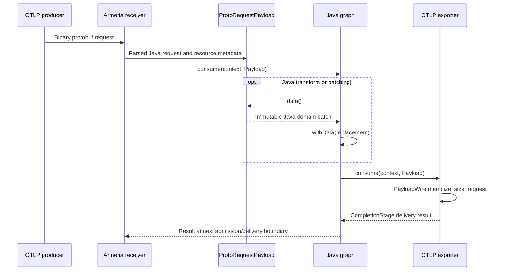

# otlp4j feasibility: a Rust otel-arrow backend through Java FFM

## What is the present backend boundary, and what must change?

### Takeaway

Coordinator summary: the premise needs correction, since this checkout has neither an existing Arrow backend nor a backend-provider SPI; it has a Java immutable domain model, a lazy Java protobuf codec, an Armeria transport, and component-factory extension contracts. Keeping the existing application model and pipeline API is feasible for an alternative internal representation/codec, but a native fast path is not a drop-in provider today because transport serialization recognizes concrete bundled payload classes and generic processing explicitly materializes Java records. [Architecture, `docs/architecture.md:9-23,62-82`](../../docs/architecture.md#L9-L82), [`PayloadWire.java:43-52,83-93`](../../otlp4j-codec/src/main/java/dev/nthings/otlp4j/codec/PayloadWire.java#L43-L93), [`FunctionProcessor.java:32-44`](../../otlp4j-core/src/main/java/dev/nthings/otlp4j/core/component/FunctionProcessor.java#L32-L44).

### Cited Findings

- **Research snapshot:** inspection was at commit `2ec6a258c83eb4a85d306729f2e4ca1c99b3d906`, commit timestamp `2026-10-09 11:19:03 -0300`, subject `test: stop the receivers of a wire test class together`; initial `git status --short` was empty. These are read-only diagnostic observations from `git rev-parse HEAD`, `git log -1 --format=%H%n%ci%n%s`, and `git status --short`, not an assertion that tests passed at this commit. `origin` is `https://github.com/thiagogcm/otlp4j.git`. [Inspected commit](https://github.com/thiagogcm/otlp4j/commit/2ec6a258c83eb4a85d306729f2e4ca1c99b3d906).
- **No pre-existing backend-provider boundary:** `Payload<T>` is an open interface for an immutable telemetry unit, but its only public representation is `T data()`. Accounting, routing and optional exact OTLP size can be answered without constructing `T`; replacement remains the same signal. `SignalDescriptor` is final, has a private constructor, and exposes exactly four predefined descriptors tied to concrete `TracesData`, `MetricsData`, `LogsData`, and `ProfilesData` classes. This permits alternative payload implementations, not interchangeable user-facing model classes or arbitrary new signals. [`Payload.java:5-81`](../../otlp4j-core/src/main/java/dev/nthings/otlp4j/core/signal/Payload.java#L5-L81), [`SignalDescriptor.java:25-89,185-190`](../../otlp4j-core/src/main/java/dev/nthings/otlp4j/core/signal/SignalDescriptor.java#L25-L190).
- **Actual extension API:** `SignalConsumer<T>.consume(context, payload)` returns `CompletionStage<DeliveryResult>`. Receiver, processor, exporter and connector factories create graph components; `GatewayBuilder` explicitly accepts factory instances and configurations, and `GatewayCompiler` calls their `create` methods. This is explicit composition, not provider discovery. The project also documents no extension host/plugin-discovery service, no built-in storage/query engine, and bounded in-memory rather than persistent buffering. [`SignalConsumer.java:7-19`](../../otlp4j-core/src/main/java/dev/nthings/otlp4j/core/consumer/SignalConsumer.java#L7-L19), [`ComponentFactory.java:3-26`](../../otlp4j-core/src/main/java/dev/nthings/otlp4j/core/component/ComponentFactory.java#L3-L26), [`GatewayBuilder.java:62-148`](../../otlp4j-service/src/main/java/dev/nthings/otlp4j/service/GatewayBuilder.java#L62-L148), [`GatewayCompiler.java:453-522`](../../otlp4j-service/src/main/java/dev/nthings/otlp4j/service/GatewayCompiler.java#L453-L522), [`docs/project.md:40-53`](../../docs/project.md#L40-L53).
- **The codec is not an SPI:** `SignalCodec<T,REQ,RESP>` is final, privately constructed and statically binds the four signal descriptors to Java mapper functions and generated request/response parsers. `forDescriptor` searches those static instances by descriptor identity. Its request parsing API consumes `byte[]`; its request type parameter is bounded by protobuf `MessageLite`. [`SignalCodec.java:28-101,186-225`](../../otlp4j-codec/src/main/java/dev/nthings/otlp4j/codec/SignalCodec.java#L28-L225).
- **No Arrow exchange surface exists in the inspected implementation:** the model module requires only static/transitive JSpecify; core re-exports the model; codec requires model, proto, core and protobuf; transport requires codec, proto, Armeria, gRPC and Netty. A read-only `git grep -niE 'arrow|foreign|ServiceLoader|backend|provider|Arena|MemorySegment'` over main Java, POMs and docs found no Apache Arrow, FFM or backend-provider implementation. The ServiceLoader references concern logging or upstream gRPC service resources, not an otlp4j backend SPI. [`otlp4j-model/src/main/java/module-info.java:1-8`](../../otlp4j-model/src/main/java/module-info.java#L1-L8), [`otlp4j-core/src/main/java/module-info.java:7-20`](../../otlp4j-core/src/main/java/module-info.java#L7-L20), [`otlp4j-codec/src/main/java/module-info.java:7-15`](../../otlp4j-codec/src/main/java/module-info.java#L7-L15), [`otlp4j-transport/src/main/java/module-info.java:7-34`](../../otlp4j-transport/src/main/java/module-info.java#L7-L34), [`otlp4j-benchmarks/pom.xml:108-140`](../../otlp4j-benchmarks/pom.xml#L108-L140).

#### Architecture map

| Layer | Actual responsibility | Native integration consequence | Evidence |
| --- | --- | --- | --- |
| `otlp4j-model` | Immutable Java records, hierarchical resource/scope grouping, attributes and builders | Preserve as compatibility snapshots; it is not a pluggable Arrow storage abstraction | [`TracesData.java:9-21,104-127`](../../otlp4j-model/src/main/java/dev/nthings/otlp4j/model/TracesData.java#L9-L127) |
| `otlp4j-core` | Signals, payloads, consumers, delivery/context/lifecycle and factory contracts; domain merge/split/filter operations | Open `Payload<T>` is the closest representation boundary, but descriptor operations are fixed Java-model operations | [`Payload.java:15-81`](../../otlp4j-core/src/main/java/dev/nthings/otlp4j/core/signal/Payload.java#L15-L81), [`SignalDescriptor.java:112-182,219-256,324-392`](../../otlp4j-core/src/main/java/dev/nthings/otlp4j/core/signal/SignalDescriptor.java#L112-L392) |
| `otlp4j-service` | Typed input/builders, validated graph, construction, fan-out and lifecycle | Largely reusable unchanged if provider still produces ordinary payloads and delivery results | [`module-info.java:1-13`](../../otlp4j-service/src/main/java/module-info.java#L1-L13), [`FanOutConsumer.java:12-53`](../../otlp4j-service/src/main/java/dev/nthings/otlp4j/service/internal/FanOutConsumer.java#L12-L53) |
| `otlp4j-codec` | Java domain/protobuf mappers, lazy representations, exact request sizing, response mapping | Principal refactor point for alternative payload/wire implementations | [`SignalCodec.java:42-101`](../../otlp4j-codec/src/main/java/dev/nthings/otlp4j/codec/SignalCodec.java#L42-L101), [`PayloadWire.java:21-93`](../../otlp4j-codec/src/main/java/dev/nthings/otlp4j/codec/PayloadWire.java#L21-L93) |
| `otlp4j-transport` | Armeria OTLP/gRPC and OTLP/HTTP, TLS/compression/retries/admission | Reuse policies and endpoints; generated gRPC messages and HTTP codec dispatch are coupling points | [`ArmeriaOtlpClient.java:62-74,229-270`](../../otlp4j-transport/src/main/java/dev/nthings/otlp4j/transport/internal/ArmeriaOtlpClient.java#L62-L270), [`GrpcServiceAdapters.java:61-91`](../../otlp4j-transport/src/main/java/dev/nthings/otlp4j/transport/internal/GrpcServiceAdapters.java#L61-L91) |
| `otlp4j-components` | Java batching, filtering, memory limiting, span-count derivation | Metadata-only paths can remain lazy; mixed-resource filtering and batching force snapshots | [`BatchProcessor.java:104-183,257-272`](../../otlp4j-components/src/main/java/dev/nthings/otlp4j/components/batch/BatchProcessor.java#L104-L272), [`FilterProcessor.java:50-81`](../../otlp4j-components/src/main/java/dev/nthings/otlp4j/components/routing/FilterProcessor.java#L50-L81) |
| `otlp4j-opentelemetry` | Official SDK exporters snapshot SDK data into Java model and borrow typed input | Not a storage/codec provider; native encode after SDK ingress still pays the Java snapshot cost | [`SdkSpanExporter.java:12-33`](../../otlp4j-opentelemetry/src/main/java/dev/nthings/otlp4j/opentelemetry/SdkSpanExporter.java#L12-L33), [`SdkDataMapper.java:55-83,117-145`](../../otlp4j-opentelemetry/src/main/java/dev/nthings/otlp4j/opentelemetry/SdkDataMapper.java#L55-L145) |

The following sequence is the existing receive/forward path, not a proposed Rust architecture. Both ingress adapters create a protobuf-backed payload; the exporter memoizes/selects its request. The domain branch is taken only by code asking for `data()`. [`GrpcServiceAdapters.java:61-101`](../../otlp4j-transport/src/main/java/dev/nthings/otlp4j/transport/internal/GrpcServiceAdapters.java#L61-L101), [`HttpProtocolMapping.java:116-130`](../../otlp4j-transport/src/main/java/dev/nthings/otlp4j/transport/internal/HttpProtocolMapping.java#L116-L130), [`ProtoRequestPayload.java:20-64`](../../otlp4j-codec/src/main/java/dev/nthings/otlp4j/codec/ProtoRequestPayload.java#L20-L64), [`OtlpExporter.java:136-163`](../../otlp4j-transport/src/main/java/dev/nthings/otlp4j/transport/OtlpExporter.java#L136-L163).

#### Exact coupling points

| Coupling | Current behavior | Mandatory versus optional refactor | Evidence |
| --- | --- | --- | --- |
| Wire dispatch checks concrete classes | `memoize` preserves only `ProtoRequestPayload` / `DomainRequestPayload`; other payloads become Java-domain codec wrappers. `requestUnchecked` similarly falls back to `codec.toProto(payload.data())` | **Mandatory for native wire reuse:** make representation recognition/capability dispatch extensible. Merely implementing `Payload` cannot retain a native fast path | [`PayloadWire.java:43-52,83-93`](../../otlp4j-codec/src/main/java/dev/nthings/otlp4j/codec/PayloadWire.java#L43-L93) |
| Fixed codecs and generated messages | Four static codecs, private constructor, `MessageLite` request types; receiver/exporter bind those directly | **Mandatory for a selectable codec provider:** add an internal encoding/decoding strategy and bind transport to it. A separate custom factory can instead own its implementation without changing service | [`SignalCodec.java:40-101,209-218`](../../otlp4j-codec/src/main/java/dev/nthings/otlp4j/codec/SignalCodec.java#L40-L218), [`GatewayBuilder.java:66-125`](../../otlp4j-service/src/main/java/dev/nthings/otlp4j/service/GatewayBuilder.java#L66-L125) |
| gRPC generated service adapters | Ingress receives generated `Export*ServiceRequest`; egress calls generated future stubs with generated requests | **Optional for functional compatibility**, but **mandatory to bypass Java protobuf parse/materialization**: change gRPC marshalling/service bindings or implement another transport factory. Native output parsed back into generated messages preserves function, not the intended parse-allocation savings | [`GrpcServiceAdapters.java:13-24,61-91`](../../otlp4j-transport/src/main/java/dev/nthings/otlp4j/transport/internal/GrpcServiceAdapters.java#L13-L91), [`ArmeriaOtlpClient.java:155-169,229-242`](../../otlp4j-transport/src/main/java/dev/nthings/otlp4j/transport/internal/ArmeriaOtlpClient.java#L155-L242) |
| HTTP adapters own bytes | Ingress aggregates and parses `byte[]`; egress writes generated request to a `ByteArrayOutputStream`, then copies through `toByteArray()` | **Mandatory for direct native HTTP codec path:** replace request parsing/serialization with strategy calls. This is a narrower POC seam than generated gRPC adapters | [`HttpProtocolMapping.java:69-75,116-126,184-210`](../../otlp4j-transport/src/main/java/dev/nthings/otlp4j/transport/internal/HttpProtocolMapping.java#L69-L210), [`ArmeriaOtlpClient.java:478-503`](../../otlp4j-transport/src/main/java/dev/nthings/otlp4j/transport/internal/ArmeriaOtlpClient.java#L478-L503) |
| Domain merge/split and item transforms | Descriptor methods work on concrete Java batches; function processors call `data()` before user functions; mixed-resource filter calls `data()`; batching buffers `M`, not original payloads | **Optional for compatibility:** materialize immutable snapshots. **Mandatory for native processing performance:** introduce payload/backend operations and implement provider-aware batch/filter components | [`FunctionProcessor.java:32-44`](../../otlp4j-core/src/main/java/dev/nthings/otlp4j/core/component/FunctionProcessor.java#L32-L44), [`FilterProcessor.java:72-81`](../../otlp4j-components/src/main/java/dev/nthings/otlp4j/components/routing/FilterProcessor.java#L72-L81), [`BatchProcessor.java:123-125,165-183,257-272`](../../otlp4j-components/src/main/java/dev/nthings/otlp4j/components/batch/BatchProcessor.java#L123-L272) |
| Core model and input API | Public descriptors name final Java records; `TelemetryInput.submit` accepts domain `T`; application input calls `Payload.of` | **No mandatory replacement for a compatible codec backend.** A genuinely interchangeable zero-copy model, native mutable builders or columnar user traversal requires a new/fundamentally refactored model surface | [`SignalDescriptor.java:25-89`](../../otlp4j-core/src/main/java/dev/nthings/otlp4j/core/signal/SignalDescriptor.java#L25-L89), [`TelemetryInput.java:19-36`](../../otlp4j-core/src/main/java/dev/nthings/otlp4j/core/consumer/TelemetryInput.java#L19-L36), [`ApplicationInput.java:49-51`](../../otlp4j-service/src/main/java/dev/nthings/otlp4j/service/internal/ApplicationInput.java#L49-L51) |

### Inferences

- **Recommended meaning of provider:** define an internal *payload representation plus OTLP codec/operations provider*, not a complete SDK, storage system, or replacement graph runtime. Keep `Payload<TracesData>` and sibling types externally, with provider-owned immutable representation, lazy Java snapshot, native item count/resource metadata, exact protobuf wire size and binary protobuf export. This aligns with the existing open payload contract without pretending `SignalCodec` is already extensible. [Boundary premises: `Payload.java:5-81`](../../otlp4j-core/src/main/java/dev/nthings/otlp4j/core/signal/Payload.java#L5-L81), [`SignalCodec.java:40-101`](../../otlp4j-codec/src/main/java/dev/nthings/otlp4j/codec/SignalCodec.java#L40-L101).
- **Recommended incremental boundary:** first make codec/wire capabilities transport-internal and neutral with respect to Java generated requests. Keep the Java codec default and use the native implementation only when deliberately selected. A first useful integration target is HTTP binary protobuf ingress/egress with unchanged application records and Java-transform fallback. Native batch/filter operations are a later extension, not a prerequisite for a native codec experiment. [Premises: `HttpProtocolMapping.java:116-126`](../../otlp4j-transport/src/main/java/dev/nthings/otlp4j/transport/internal/HttpProtocolMapping.java#L116-L126), [`ArmeriaOtlpClient.java:478-503`](../../otlp4j-transport/src/main/java/dev/nthings/otlp4j/transport/internal/ArmeriaOtlpClient.java#L478-L503), [`BatchProcessor.java:123-125`](../../otlp4j-components/src/main/java/dev/nthings/otlp4j/components/batch/BatchProcessor.java#L123-L125).
- **Three different feasibility claims must not be conflated:** (1) a native processor/exporter implemented through existing factories is structurally possible without modifying core/service, but may round-trip Java records/protobuf and give poor performance; (2) an alternative codec/native payload with existing application APIs needs wire/capability refactoring but not model replacement; (3) a fully native columnar processing engine and zero-copy Java access is a materially larger API/ownership project. [Premises: `GatewayBuilder.java:66-148`](../../otlp4j-service/src/main/java/dev/nthings/otlp4j/service/GatewayBuilder.java#L66-L148), [`PayloadWire.java:43-52,83-93`](../../otlp4j-codec/src/main/java/dev/nthings/otlp4j/codec/PayloadWire.java#L43-L93), [`TracesData.java:13-17,104-127`](../../otlp4j-model/src/main/java/dev/nthings/otlp4j/model/TracesData.java#L13-L127).
- **No new user-facing APIs is conditional:** existing batch construction, `Pipeline.map`, SDK adapters and gateway composition can stay source-compatible if `data()` returns today's records and replacements are handled correctly. Explicit provider selection still needs a design decision, such as another factory implementation, a configuration addition, or internal deployment selection. There is no existing backend selector that can be reused unchanged. [Premises: `Pipeline.java:35-86`](../../otlp4j-service/src/main/java/dev/nthings/otlp4j/service/Pipeline.java#L35-L86), [`OtlpReceiverFactory.java:32-40,66-74`](../../otlp4j-transport/src/main/java/dev/nthings/otlp4j/transport/OtlpReceiverFactory.java#L32-L74), [`OtlpExporterFactory.java:31-39,65-72`](../../otlp4j-transport/src/main/java/dev/nthings/otlp4j/transport/OtlpExporterFactory.java#L31-L72).

### Gaps

- Native otel-arrow signal/schema coverage, availability of Rust protobuf codecs and exported C ABI, Arrow IPC/C Data semantics, thread safety and native operators are intentionally outside this agent's assignment. No feasibility conclusion here assumes those exist.
- The product requirement does not define whether “backend” means codec acceleration, native processing, OTLP/Arrow wire exchange, or final telemetry storage. The current repository supports the first two as extension/refactor discussions, but has no storage engine to swap.
- A completely automatic classpath/module-path provider selector has not been designed or implemented. Decide whether selection is per receiver/exporter, per pipeline, per gateway or process-wide, and whether Java/native payloads may mix.

## What contracts govern data, memory, processing, wire exchange and schemas?

### Takeaway

Current ownership is ordinary immutable JVM object retention, with no `Payload.close`, retain/release, native allocator or Arrow schema contract. A native representation must preserve Java snapshot semantics and asynchronous lifetimes, and “zero-copy” cannot describe conversion to today's public domain model or the whole existing networking path. [`Payload.java:15-81`](../../otlp4j-core/src/main/java/dev/nthings/otlp4j/core/signal/Payload.java#L15-L81), [`AttributeValue.java:23-61`](../../otlp4j-model/src/main/java/dev/nthings/otlp4j/model/AttributeValue.java#L23-L61), [`FanOutConsumer.java:18-53`](../../otlp4j-service/src/main/java/dev/nthings/otlp4j/service/internal/FanOutConsumer.java#L18-L53), [`ArmeriaOtlpClient.java:478-503`](../../otlp4j-transport/src/main/java/dev/nthings/otlp4j/transport/internal/ArmeriaOtlpClient.java#L478-L503).

### Cited Findings

- **Allocation and mutable builders:** batches and group records use `List.copyOf`; spans are records with validated IDs/flags and copied events/links; `Span.Builder` owns mutable Java lists, while `toBuilder()` reconstructs a builder from existing fields. `Attributes` copies to an insertion-ordered unmodifiable `LinkedHashMap`, and `with` copies the map. `AttributeValue` is sealed; its byte variant clones on construction/access; its array and nested key/value variants copy collections. These APIs build Java snapshots rather than native views. [`TracesData.java:13-17,104-127`](../../otlp4j-model/src/main/java/dev/nthings/otlp4j/model/TracesData.java#L13-L127), [`Span.java:11-66,236-263`](../../otlp4j-model/src/main/java/dev/nthings/otlp4j/model/Span.java#L11-L263), [`Attributes.java:10-48,113-129`](../../otlp4j-model/src/main/java/dev/nthings/otlp4j/model/Attributes.java#L10-L129), [`AttributeValue.java:13-61`](../../otlp4j-model/src/main/java/dev/nthings/otlp4j/model/AttributeValue.java#L13-L61).
- **ID and value representations cost real conversion:** public trace/span IDs are strings; decode renders protobuf `ByteString` to hex via `toByteArray`, and encode parses hex and creates a `ByteString`. Resource attributes become maps, duplicate keys overwrite earlier values, nested AnyValue arrays/maps are recursively materialized, and profiling string-table references become `AttributeValue.empty()` when unresolved. A native bridge must match these domain conversion semantics rather than assuming identical raw representation. [`CommonMapper.java:30-33,55-92,111-124`](../../otlp4j-codec/src/main/java/dev/nthings/otlp4j/codec/CommonMapper.java#L30-L124), [`Ids.java:20-61`](../../otlp4j-model/src/main/java/dev/nthings/otlp4j/model/Ids.java#L20-L61).
- **Lazy payload caching is shared and thread-safe:** proto-backed payload holds its immutable request and eagerly converts only resource routing metadata; `data()` is volatile/double-checked synchronized lazy decode. Domain-codec-backed payload likewise memoizes a generated request. Identity-preserving `withData` retains the payload/cache; a replacement generates a new domain-backed payload. A no-op map can therefore materialize Java data while still preserving wire fidelity. [`ProtoRequestPayload.java:15-64`](../../otlp4j-codec/src/main/java/dev/nthings/otlp4j/codec/ProtoRequestPayload.java#L15-L64), [`DomainRequestPayload.java:14-67`](../../otlp4j-codec/src/main/java/dev/nthings/otlp4j/codec/DomainRequestPayload.java#L14-L67), [`PayloadWireMemoizationTest.java:20-40`](../../otlp4j-codec/src/test/java/dev/nthings/otlp4j/codec/PayloadWireMemoizationTest.java#L20-L40).
- **Retention is longer than original admission:** fan-out passes the same immutable payload to all peers. The batch processor constructs the domain before admission, stores it in `batch.parts`, detaches transport cancellation/deadline state, and returns an accepted result before eventual delivery. `DeliveryQueue` keeps payload references and returns immediately accepted stages; its internal callback fires after downstream delivery/eviction, not original submission completion. Consequently, closing a native arena when the initial submission stage completes would be unsafe if native data remained in a buffer. [`FanOutConsumer.java:18-53`](../../otlp4j-service/src/main/java/dev/nthings/otlp4j/service/internal/FanOutConsumer.java#L18-L53), [`BatchProcessor.java:123-183`](../../otlp4j-components/src/main/java/dev/nthings/otlp4j/components/batch/BatchProcessor.java#L123-L183), [`DeliveryQueue.java:109-112,164-190,244-273,305-312`](../../otlp4j-components/src/main/java/dev/nthings/otlp4j/components/internal/DeliveryQueue.java#L109-L312).
- **Additional async holder:** the owned receiver publishes payloads to its internal tap before signal dispatch; multicast subscriptions own bounded queues and virtual-thread dispatchers. Queue clear/cancel currently discards ordinary references, with no payload release protocol. Although tap subscription access is internal, it is relevant to native-lifetime auditing and tests. [`OtlpReceiver.java:127-136`](../../otlp4j-transport/src/main/java/dev/nthings/otlp4j/transport/OtlpReceiver.java#L127-L136), [`ReceiverTap.java:11-15,55-64`](../../otlp4j-transport/src/main/java/dev/nthings/otlp4j/transport/internal/ReceiverTap.java#L11-L64), [`MulticastPublisher.java:17-18,129-179,227-240`](../../otlp4j-transport/src/main/java/dev/nthings/otlp4j/transport/internal/MulticastPublisher.java#L17-L240).
- **Component resource lifecycle exists, payload lifetime does not:** factories must free allocations when creation fails; successfully returned components own cleanup. Components are `AutoCloseable`, implement bounded start/flush/shutdown and require idempotent shutdown even before start or after partial failure. Those are useful rules for a native library/context, but do not define when individual native payload buffers are no longer retained by users. [`ComponentFactory.java:3-8`](../../otlp4j-core/src/main/java/dev/nthings/otlp4j/core/component/ComponentFactory.java#L3-L8), [`Component.java:10-59`](../../otlp4j-core/src/main/java/dev/nthings/otlp4j/core/component/Component.java#L10-L59), [`Payload.java:15-81`](../../otlp4j-core/src/main/java/dev/nthings/otlp4j/core/signal/Payload.java#L15-L81).
- **Memory limiter does not see native heap by default:** the built-in factory explicitly constructs `MemoryLimiter.heapGauge()`, which reads `Runtime.totalMemory() - Runtime.freeMemory()`. The underlying internal limiter accepts a `LongSupplier`, but the public factory does not expose that injection. Payload byte sizing reports encoded protobuf size, not actual retained heap/native footprint. Native allocation quotas and accounting must be separate or the limiter factory/config must be extended. [`MemoryLimiterProcessorFactory.java:39-52`](../../otlp4j-components/src/main/java/dev/nthings/otlp4j/components/memory/MemoryLimiterProcessorFactory.java#L39-L52), [`MemoryLimiter.java:9-11,44-64`](../../otlp4j-components/src/main/java/dev/nthings/otlp4j/components/internal/MemoryLimiter.java#L9-L64), [`PayloadSizer.java:3-20`](../../otlp4j-core/src/main/java/dev/nthings/otlp4j/core/signal/PayloadSizer.java#L3-L20), [`OtlpPayloadSizer.java:13-20`](../../otlp4j-transport/src/main/java/dev/nthings/otlp4j/transport/OtlpPayloadSizer.java#L13-L20).
- **Processing invariants:** grouping order and resource/scope schema URLs survive Java maps/filters; item traversal avoids allocating flattened lists, whereas `spans()` allocates. Unchanged maps/filters return identical objects; replacements are immutable branch-local changes. Descriptor merge appends resource groups without coalescing them; split cuts spans/logs/profiles by item and metrics by individual data point, rebuilding envelopes in order. Exact byte splitting recursively halves candidates and rejects an indivisible oversized item. [`TracesData.java:24-101`](../../otlp4j-model/src/main/java/dev/nthings/otlp4j/model/TracesData.java#L24-L101), [`SignalDescriptor.java:219-256,278-303,324-392`](../../otlp4j-core/src/main/java/dev/nthings/otlp4j/core/signal/SignalDescriptor.java#L219-L392), [`ExactBatchSplitter.java:10-20,38-92`](../../otlp4j-components/src/main/java/dev/nthings/otlp4j/components/internal/ExactBatchSplitter.java#L10-L92).
- **Cheap compatibility cases:** the resource filter forwards the original payload if it keeps every resource, drops locally if none are kept, but materializes and replaces when only some groups survive. The span-count connector uses `itemCount()` without decoding spans, then constructs a Java delta-sum metric and emits `Payload.of(METRICS, metrics)`. Native routing/accounting can work with existing components in the all/none/count-only cases; native output construction is not automatic. [`FilterProcessor.java:50-81`](../../otlp4j-components/src/main/java/dev/nthings/otlp4j/components/routing/FilterProcessor.java#L50-L81), [`SpanCountConnectorFactory.java:88-125`](../../otlp4j-components/src/main/java/dev/nthings/otlp4j/components/connector/SpanCountConnectorFactory.java#L88-L125).
- **Signals and transports:** traces, metrics, logs and `v1development` profiles are present. Transport speaks OTLP/gRPC and binary OTLP/HTTP, not JSON or an Arrow wire protocol. HTTP routes are the four `/v1/...` endpoints; gRPC uses four collector services. TLS, headers, gzip, retries, request/response limits and admission are part of bundled transport behavior and should not be conflated with payload representation. Receiver defaults include 64 MiB decoded message maximum and 30-second client timeout; exporter defaults include 64 MiB request and 4 MiB response limits. [`docs/project.md:40-53`](../../docs/project.md#L40-L53), [`ArmeriaOtlpServer.java:27-37,54-60,134-160`](../../otlp4j-transport/src/main/java/dev/nthings/otlp4j/transport/internal/ArmeriaOtlpServer.java#L27-L160), [`ArmeriaOtlpClient.java:62-74`](../../otlp4j-transport/src/main/java/dev/nthings/otlp4j/transport/internal/ArmeriaOtlpClient.java#L62-L74), [`OtlpReceiverConfig.java:42-46`](../../otlp4j-transport/src/main/java/dev/nthings/otlp4j/transport/OtlpReceiverConfig.java#L42-L46), [`OtlpExporterConfig.java:211-212`](../../otlp4j-transport/src/main/java/dev/nthings/otlp4j/transport/OtlpExporterConfig.java#L211-L212).
- **Schema pin:** read-only `git ls-tree HEAD opentelemetry-proto` reported gitlink `b3f75588eb23c5fca62264edd05d382de49beb1a`; `git -C opentelemetry-proto describe --tags --always` reported `v1.11.1`. The source mirror/generation process uses the superproject-recorded submodule revision, and generated Java uses protobuf `4.36.2`, gRPC `1.84.1`. Align native schema compatibility to this pin, not merely the current upstream default branch. [`docs/development.md:48-65`](../../docs/development.md#L48-L65), [`pom.xml:42-43`](../../pom.xml#L42-L43), [Pinned schema commit](https://github.com/open-telemetry/opentelemetry-proto/commit/b3f75588eb23c5fca62264edd05d382de49beb1a).
- **Wire fidelity is representation-dependent:** unchanged proto payloads preserve unknown fields in the parsed generated request. A real Java-domain replacement discards unknown request fields. Unknown enum values have modeled fallbacks without discarding items; metrics include a no-data variant and gauge/sum/histogram/exponential-histogram/summary variants. Construction also enforces histogram bucket-bound cardinality and unsigned-32-bit flags. A backend cannot silently narrow these semantics while claiming full compatibility. [`PayloadWireMemoizationTest.java:20-40`](../../otlp4j-codec/src/test/java/dev/nthings/otlp4j/codec/PayloadWireMemoizationTest.java#L20-L40), [`UnknownWireValuesTest.java:27-73`](../../otlp4j-codec/src/test/java/dev/nthings/otlp4j/codec/UnknownWireValuesTest.java#L27-L73), [`Metric.java:8-17,78-122`](../../otlp4j-model/src/main/java/dev/nthings/otlp4j/model/Metric.java#L8-L122), [`HistogramPoint.java:27-38`](../../otlp4j-model/src/main/java/dev/nthings/otlp4j/model/HistogramPoint.java#L27-L38), [`Ids.java:55-61`](../../otlp4j-model/src/main/java/dev/nthings/otlp4j/model/Ids.java#L55-L61).
- **Profiles are not fully columnar modeled data:** the Java batch stores cloned serialized dictionary bytes and each profile stores cloned raw body bytes. Mapper decode serializes the profile to preserve its opaque body; encode reparses those bytes and the dictionary, giving raw bodies precedence over exposed scalar metadata. Scalar-only profiles do not reconstruct samples. Profile merge rejects distinct non-empty dictionaries; split copies the dictionary into slices, and built-in batching excludes profiles. [`ProfilesData.java:16-38,170-193`](../../otlp4j-model/src/main/java/dev/nthings/otlp4j/model/ProfilesData.java#L16-L193), [`ProfilesMapper.java:90-100,118-178`](../../otlp4j-codec/src/main/java/dev/nthings/otlp4j/codec/ProfilesMapper.java#L90-L178), [`SignalDescriptor.java:239-256,340-347`](../../otlp4j-core/src/main/java/dev/nthings/otlp4j/core/signal/SignalDescriptor.java#L239-L347), [`BatchProcessor.java:50-51`](../../otlp4j-components/src/main/java/dev/nthings/otlp4j/components/batch/BatchProcessor.java#L50-L51).
- **Existing zero-copy limit:** `PayloadWire.write` avoids an intermediate byte array when writing a generated request to an `OutputStream`, but the actual HTTP client allocates a growable buffer and calls `toByteArray()`. HTTP receiver aggregation and gzip inflation also operate on heap arrays. Parsed protobuf-object reuse is not preservation of original complete request bytes or zero-copy networking. [`PayloadWire.java:71-75`](../../otlp4j-codec/src/main/java/dev/nthings/otlp4j/codec/PayloadWire.java#L71-L75), [`ArmeriaOtlpClient.java:478-503`](../../otlp4j-transport/src/main/java/dev/nthings/otlp4j/transport/internal/ArmeriaOtlpClient.java#L478-L503), [`HttpProtocolMapping.java:184-210`](../../otlp4j-transport/src/main/java/dev/nthings/otlp4j/transport/internal/HttpProtocolMapping.java#L184-L210), [`docs/architecture.md:64-70`](../../docs/architecture.md#L64-L70).

### Inferences

- **Safe narrow POC ownership:** initially keep all FFM/native allocations scoped to one synchronous codec/operator invocation, copying outputs to Java-owned records/bytes before returning. That avoids changing payload lifetime, though it cannot establish end-to-end zero-copy and must include copy costs in results. Persistent native-backed payloads need a documented ownership protocol rather than an arena bound to request completion. [Premises: `Payload.java:15-81`](../../otlp4j-core/src/main/java/dev/nthings/otlp4j/core/signal/Payload.java#L15-L81), [`BatchProcessor.java:170-183`](../../otlp4j-components/src/main/java/dev/nthings/otlp4j/components/batch/BatchProcessor.java#L170-L183).
- **Persistent native representation is an ownership subproject:** internal handles need shared lifetime across fan-out, buffering, retries and concurrent lazy snapshot access. Potential designs are reference counting at explicit graph/queue boundaries or GC-owned immutable handles with cleaners plus strict allocation quotas; neither is present. Cleaners alone do not provide prompt release, and explicit release must account for application code retaining the public payload, not just graph completion. A component-owned arena must not invalidate a payload still usable by a capturing exporter or user after shutdown. [Premises: `FanOutConsumer.java:18-53`](../../otlp4j-service/src/main/java/dev/nthings/otlp4j/service/internal/FanOutConsumer.java#L18-L53), [`DeliveryQueue.java:164-190,244-273`](../../otlp4j-components/src/main/java/dev/nthings/otlp4j/components/internal/DeliveryQueue.java#L164-L273), [`Component.java:15-17`](../../otlp4j-core/src/main/java/dev/nthings/otlp4j/core/component/Component.java#L15-L17).
- **Keep exact protobuf size distinct from Arrow/native footprint:** `Payload.encodedSize()` promises OTLP encoding size. It must not start returning Arrow IPC size, compressed size, retained native bytes or a heuristic. Add private/native allocation metrics and quotas rather than overloading that API. [Premises: `Payload.java:59-76`](../../otlp4j-core/src/main/java/dev/nthings/otlp4j/core/signal/Payload.java#L59-L76), [`OtlpPayloadSizer.java:13-16`](../../otlp4j-transport/src/main/java/dev/nthings/otlp4j/transport/OtlpPayloadSizer.java#L13-L16).
- **Do not promise transparent native mutation:** a Rust builder/operator must finish into an immutable published representation; changing native buffers already shared by sibling branches violates the present contract. Java `map`/`toBuilder` code requires a materialized Java snapshot unless a new columnar API is explicitly introduced. [Premises: `Payload.java:5-11`](../../otlp4j-core/src/main/java/dev/nthings/otlp4j/core/signal/Payload.java#L5-L11), [`FanOutConsumer.java:18-20`](../../otlp4j-service/src/main/java/dev/nthings/otlp4j/service/internal/FanOutConsumer.java#L18-L20), [`Span.java:44-66`](../../otlp4j-model/src/main/java/dev/nthings/otlp4j/model/Span.java#L44-L66).
- **Arrow C Data or IPC, if chosen, is an entirely new internal boundary:** there is no existing Java Arrow allocator/vector API to reuse. Exchange can potentially be hidden below `Payload`, but protobuf-to-Arrow layout transformation and conversion back to Java strings/maps/lists still perform work. Reserve “zero-copy” for a specifically measured shared-buffer step, with explicit ownership/release and schema/version guarantees. [Premises: `otlp4j-model/src/main/java/module-info.java:1-8`](../../otlp4j-model/src/main/java/module-info.java#L1-L8), [`CommonMapper.java:30-33,55-92,111-124`](../../otlp4j-codec/src/main/java/dev/nthings/otlp4j/codec/CommonMapper.java#L30-L124).

### Gaps

- The application-facing lifetime of a received payload retained beyond component/runtime shutdown is not specified in the current interface. Today JVM retention makes it naturally accessible; deterministic native invalidation would introduce observable new behavior.
- Need a policy for unknown protobuf fields when converting through Arrow, empty resource/scope groups, duplicate attribute keys, unknown enums and noncanonical original protobuf bytes. Domain round-trip parity alone is insufficient for unchanged-wire fidelity.
- Native schema coverage must include all metric variants, exemplars, log body AnyValue types, flags, metadata and schema URLs. Profiles should remain on the Java/opaque forwarding path until native compatibility is proven; do not silently drop the signal.
- Need native thread-safety and FFM arena decisions for event-loop/blocking-executor calls, virtual-thread workers and concurrent fan-out. No such decisions can be inferred from Java payload caching alone.

## How should a native provider be packaged, validated and judged?

### Takeaway

The Java baseline is already 25, and core/service separation supports an optional native integration module, but there is no native dependency packaging, provider loading or native-memory conformance setup today. Judge the POC on full boundary cost and fidelity against the existing lazy-protobuf path, not just Rust operator speed or reduced Java GC allocations. [`pom.xml:39,393-398`](../../pom.xml#L39-L398), [`otlp4j-service/src/main/java/module-info.java:7-13`](../../otlp4j-service/src/main/java/module-info.java#L7-L13), [`CodecMarshallingBenchmark.java:22-35,91-104`](../../otlp4j-benchmarks/src/main/java/dev/nthings/otlp4j/bench/CodecMarshallingBenchmark.java#L22-L104), [`docs/development.md:26-46,67-77`](../../docs/development.md#L26-L77).

### Cited Findings

- **Toolchain/build:** compiler release is 25; build enforces JDK 25+ and Maven 3.9.9+; wrapper pins Maven 3.9.16. The inspected environment's read-only `java -version` reported Oracle GraalVM JDK `25.0.4.1.1`, Linux. CI runs Ubuntu with Temurin 25 and `just ci`. The sample `native` profile is a GraalVM native-image build of a Java demo, not a Rust shared-library build or FFM integration. No `enable-native-access`, Cargo, Rust, jextract or native-library settings were found in the tracked parent/module POMs or CI file. [`pom.xml:39,393-398`](../../pom.xml#L39-L398), [`.mvn/wrapper/maven-wrapper.properties:1-3`](../../.mvn/wrapper/maven-wrapper.properties#L1-L3), [`.github/workflows/ci.yml:12-33`](../../.github/workflows/ci.yml#L12-L33), [`otlp4j-samples/pom.xml:57-89`](../../otlp4j-samples/pom.xml#L57-L89).
- **JPMS boundary:** library modules are named `dev.nthings.otlp4j.<suffix>`. Codec exports only to `dev.nthings.otlp4j.transport`; generated messages export only to codec/transport, with collector service packages additionally exported to Armeria gRPC. A separate named native module cannot simply import those packages. Core exports the payload/factory packages generally, so a custom factory using only core/model is legal. There are no otlp4j backend `uses`/`provides` clauses. [`otlp4j-codec/src/main/java/module-info.java:7-15`](../../otlp4j-codec/src/main/java/module-info.java#L7-L15), [`otlp4j-proto/src/main/java/module-info.java:5-34`](../../otlp4j-proto/src/main/java/module-info.java#L5-L34), [`otlp4j-core/src/main/java/module-info.java:10-20`](../../otlp4j-core/src/main/java/module-info.java#L10-L20), [`otlp4j-service/src/main/java/module-info.java:7-13`](../../otlp4j-service/src/main/java/module-info.java#L7-L13).
- **Classpath test caveat:** the benchmark artifact is deliberately non-modular to access qualified-exported codec/proto types, and its shade step removes `module-info.class` and merges third-party service files. Classpath success does not demonstrate that a native provider is usable on the module path. Automatic dependencies also mean current JPMS encapsulation does not imply jlink compatibility. [`otlp4j-benchmarks/pom.xml:15-20,108-151`](../../otlp4j-benchmarks/pom.xml#L15-L151), [`docs/architecture.md:72-78`](../../docs/architecture.md#L72-L78).
- **Relevant existing codec/model tests:** seeded property tests cover domain-to-proto-to-domain and generated-proto-to-domain-to-proto mappings; item-count and routing parity cover all four signals; lazy payload tests cover no forced materialization, replacement and profile dictionaries; memoization tests cover unknown-field passthrough versus transformed output. Model tests cover immutable list snapshots. Reuse these as provider-differential expectations rather than just adding a happy-path trace test. [`TraceCodecPropertyTest.java:13-55`](../../otlp4j-codec/src/test/java/dev/nthings/otlp4j/codec/TraceCodecPropertyTest.java#L13-L55), [`MetricsCodecPropertyTest.java:13-55`](../../otlp4j-codec/src/test/java/dev/nthings/otlp4j/codec/MetricsCodecPropertyTest.java#L13-L55), [`PayloadItemCountParityTest.java:25-74`](../../otlp4j-codec/src/test/java/dev/nthings/otlp4j/codec/PayloadItemCountParityTest.java#L25-L74), [`RoutingMetadataParityTest.java:30-79`](../../otlp4j-codec/src/test/java/dev/nthings/otlp4j/codec/RoutingMetadataParityTest.java#L30-L79), [`ProtoRequestPayloadTest.java:38-118`](../../otlp4j-codec/src/test/java/dev/nthings/otlp4j/codec/ProtoRequestPayloadTest.java#L38-L118), [`ModelImmutabilityTest.java:19-126`](../../otlp4j-model/src/test/java/dev/nthings/otlp4j/model/ModelImmutabilityTest.java#L19-L126).
- **Reusable wire conformance:** abstract gRPC/HTTP suites boot a `GatewayUnderTest` through a concrete `boot(Scenario,Protocol)` seam, then exercise real clients. They cover all-signal success and partial success plus rejection mapping, admission/recovery, sizes, gzip, TLS, HTTP content-type/method/malformed-body behavior. The exporter policy suite has a `newSeam()` abstraction and covers retries, permanent failures, pushback, Retry-After, RetryInfo and per-attempt/total deadlines. The bundled runner hardcodes `OtlpReceiverFactory`; a provider runner can substitute construction at that seam. [`OtlpGrpcConformanceSuite.java:25-162`](../../otlp4j-testing/src/main/java/dev/nthings/otlp4j/testing/conformance/OtlpGrpcConformanceSuite.java#L25-L162), [`OtlpHttpConformanceSuite.java:25-198`](../../otlp4j-testing/src/main/java/dev/nthings/otlp4j/testing/conformance/OtlpHttpConformanceSuite.java#L25-L198), [`PolicySemanticsSuite.java:31-249`](../../otlp4j-testing/src/main/java/dev/nthings/otlp4j/testing/policy/PolicySemanticsSuite.java#L31-L249), [`Otlp4jGatewayUnderTest.java:86-121`](../../otlp4j-conformance/src/test/java/dev/nthings/otlp4j/conformance/Otlp4jGatewayUnderTest.java#L86-L121).
- **Lifecycle/SDK behaviors need retention:** the SDK bridge implements traces, metrics and logs, not profiles; it borrows its input and does not close it. Snapshot isolation, wire-field parity and shutdown timeout without cancelling borrowed-input work are tested. These can remain unchanged for a codec provider with Java compatibility snapshots. [`SdkExporters.java:14-71`](../../otlp4j-opentelemetry/src/main/java/dev/nthings/otlp4j/opentelemetry/SdkExporters.java#L14-L71), [`SdkExportersTest.java:117-171,358-395,450-511`](../../otlp4j-opentelemetry/src/test/java/dev/nthings/otlp4j/opentelemetry/SdkExportersTest.java#L117-L511).
- **Present benchmark coverage:** the optional `bench` reactor profile builds JMH 1.37. Codec benchmarks parameterize traces/metrics/logs and 1/500 items; one measures Java protobuf parse/domain decode/re-encode/serialization, another parse/serialize without domain. Network benchmark covers only traces, HTTP/gRPC, two real hops, no processors, an immediately accepting final exporter and blocking acknowledgment. Classes use one fork, three one-second warmups and five one-second measurement iterations, with throughput/average time. Existing inputs have one resource/scope, modest attributes and simple one-point gauges; they do not characterize complex metrics, profiles, high-cardinality dictionaries, multi-resource filtering, overload or native memory. [`pom.xml:57-60,447-459`](../../pom.xml#L57-L459), [`CodecMarshallingBenchmark.java:22-104`](../../otlp4j-benchmarks/src/main/java/dev/nthings/otlp4j/bench/CodecMarshallingBenchmark.java#L22-L104), [`ReceiveForwardExportBenchmark.java:45-105,125-140`](../../otlp4j-benchmarks/src/main/java/dev/nthings/otlp4j/bench/ReceiveForwardExportBenchmark.java#L45-L140), [`BenchmarkPayloads.java:25-115`](../../otlp4j-benchmarks/src/main/java/dev/nthings/otlp4j/bench/BenchmarkPayloads.java#L25-L115).
- **Do not treat recorded benchmarks as the current baseline:** checked-in JSON captures are named for July 2026 and report JDK `25.0.3`, while the inspected checkout/environment differ; no benchmark was run for this research. More importantly, the codec `parseSerialize` benchmark uses a presized fixed buffer, but its comment references an old `HttpOtlpClient` path, whereas the actual current `ArmeriaOtlpClient` uses `ByteArrayOutputStream` plus a copy. Source behavior overrides that comment. The performance guide explicitly requires comparable environment/options/workloads and warns results are not guarantees. [`baseline-2026-07-06.json`](../../otlp4j-benchmarks/baselines/baseline-2026-07-06.json), [`phase4-2026-07-07.json`](../../otlp4j-benchmarks/baselines/phase4-2026-07-07.json), [`CodecMarshallingBenchmark.java:99-110`](../../otlp4j-benchmarks/src/main/java/dev/nthings/otlp4j/bench/CodecMarshallingBenchmark.java#L99-L110), [`ArmeriaOtlpClient.java:478-503`](../../otlp4j-transport/src/main/java/dev/nthings/otlp4j/transport/internal/ArmeriaOtlpClient.java#L478-L503), [`baselines/README.md:54-66`](../../otlp4j-benchmarks/baselines/README.md#L54-L66).

### Inferences

#### Packaging recommendation

Keep an optional native integration artifact separate from pure model/core/service. If using ServiceLoader, add an explicit SPI and corresponding named-module `uses`/`provides` contracts, deterministic selection/capability negotiation and classpath service entries; the current gRPC shade resources do not provide this automatically. Alternatively use explicit factories and avoid discovery for the POC. Any new module that legitimately needs internal Java wire helpers must receive deliberate qualified exports or use a new neutral internal SPI, not rely on `--add-exports` in production. [Premises: `otlp4j-core/src/main/java/module-info.java:10-20`](../../otlp4j-core/src/main/java/module-info.java#L10-L20), [`otlp4j-codec/src/main/java/module-info.java:7-15`](../../otlp4j-codec/src/main/java/module-info.java#L7-L15), [`otlp4j-proto/src/main/java/module-info.java:21-30`](../../otlp4j-proto/src/main/java/module-info.java#L21-L30).

Specify supported OS/architecture/libc combinations, native binary provenance/version, ABI version handshake, library loading/extraction and permissions, native-access launch policy, bounded allocations, panic/error translation, and missing-library/unsupported-signal fallback before claiming deployability. These are proposed requirements, not features found in otlp4j. The existing Java 25 baseline does not itself impose a Java-version migration for a contemporary FFM integration; exact FFM flags/native-image support belong to the integration investigation, not assumptions from the sample's GraalVM profile. [Premises: `pom.xml:39,393-398`](../../pom.xml#L39-L398), [`otlp4j-samples/pom.xml:57-89`](../../otlp4j-samples/pom.xml#L57-L89), [Current component resource contract, `ComponentFactory.java:3-8`](../../otlp4j-core/src/main/java/dev/nthings/otlp4j/core/component/ComponentFactory.java#L3-L8).

#### Credible performance motivations and costs

| Hypothesis to test, not an established result | Why it is plausible here | Costs/control that must be counted | Evidence for premise |
| --- | --- | --- | --- |
| Reduce JVM allocation for large native-compatible batch transformations | Java decode builds strings, maps, records, lists and protobuf builders; batching forces those snapshots | FFM call setup, heap/native input/output copies, Arrow builders/buffers, dictionary work, native-to-protobuf conversion, Java fallback materialization | [`TraceMapper.java:56-110,141-192`](../../otlp4j-codec/src/main/java/dev/nthings/otlp4j/codec/TraceMapper.java#L56-L192), [`BatchProcessor.java:123-125`](../../otlp4j-components/src/main/java/dev/nthings/otlp4j/components/batch/BatchProcessor.java#L123-L125) |
| Faster metadata routing and passthrough | Existing lazy payload already avoids signal-item domain decode | Compare against *current lazy protobuf passthrough*, not only forced decode/re-encode; Arrow transcode might add unnecessary work | [`ProtoRequestPayload.java:20-59`](../../otlp4j-codec/src/main/java/dev/nthings/otlp4j/codec/ProtoRequestPayload.java#L20-L59), [`FilterProcessor.java:50-76`](../../otlp4j-components/src/main/java/dev/nthings/otlp4j/components/routing/FilterProcessor.java#L50-L76) |
| Better native batch merge/split efficiency | Current batching buffers domain `M`, reconstructs envelopes and recursively sizes byte-cap candidates | Need native operations before this benefit exists; generic Java batch processor alone cancels it by calling `data()` | [`BatchProcessor.java:165-183,257-272`](../../otlp4j-components/src/main/java/dev/nthings/otlp4j/components/batch/BatchProcessor.java#L165-L272), [`ExactBatchSplitter.java:68-92`](../../otlp4j-components/src/main/java/dev/nthings/otlp4j/components/internal/ExactBatchSplitter.java#L68-L92) |
| Lower wire bytes from OTLP/Arrow | Not a feature of this transport; output currently remains binary protobuf | Requires a separately supported protocol/server, Arrow batch/dictionary state, retries and interoperability tests. Internal Arrow plus protobuf egress does not automatically reduce network bytes | [`ArmeriaOtlpServer.java:27-37,54-60`](../../otlp4j-transport/src/main/java/dev/nthings/otlp4j/transport/internal/ArmeriaOtlpServer.java#L27-L60), [`ArmeriaOtlpClient.java:62-74`](../../otlp4j-transport/src/main/java/dev/nthings/otlp4j/transport/internal/ArmeriaOtlpClient.java#L62-L74) |
| Reduced GC pressure | Java allocation profiler exists and snapshots are allocation-heavy | Measure native peak/live bytes and process RSS as well; off-heap transfer is not reduced total memory. Include queues, fan-out and fallback holding both representations | [`baselines/README.md:56-66`](../../otlp4j-benchmarks/baselines/README.md#L56-L66), [`MemoryLimiterProcessorFactory.java:39-43`](../../otlp4j-components/src/main/java/dev/nthings/otlp4j/components/memory/MemoryLimiterProcessorFactory.java#L39-L43), [`ProtoRequestPayload.java:15-39`](../../otlp4j-codec/src/main/java/dev/nthings/otlp4j/codec/ProtoRequestPayload.java#L15-L39) |

#### Proposed exact POC gates

These are recommended acceptance criteria for coordinator/user agreement, not current project requirements or performance claims. They extend the repository's boundary-focused testing and benchmark guidance. [Premises: `docs/development.md:26-46`](../../docs/development.md#L26-L46), [`baselines/README.md:54-66`](../../otlp4j-benchmarks/baselines/README.md#L54-L66).

1. **Scope gate:** document one supported native slice, preferably traces over binary OTLP/HTTP initially, retaining the existing public Java records and pipeline methods. Other signals/protocols must remain on the Java backend or reject explicit native-only configuration before startup; no accepted-but-dropped unsupported data. Distinguish a bounded-call FFM codec POC from persistent native payload ownership. [Existing scope/entry points: `docs/project.md:40-53`](../../docs/project.md#L40-L53), [`Pipeline.java:35-86`](../../otlp4j-service/src/main/java/dev/nthings/otlp4j/service/Pipeline.java#L35-L86).
2. **Semantic gate:** all existing relevant model/codec parity tests must pass against Java and native paths. Add differential fixtures for multiple resources/scopes, nested/mixed AnyValue, byte attributes, duplicate keys, unknown enums/fields, flags and invalid IDs, empty groups, all metric variants when enabled, malformed wire input and exact OTLP encoded sizes. Zero item loss/duplication; item counts and ordered routing metadata must equal Java expectations. Unchanged payload retains existing wire-fidelity guarantees; transformed payload matches the modeled Java result. Profiles remain opaque/Java until dedicated dictionary/raw-body tests pass. [Existing tests/contracts: `PayloadItemCountParityTest.java:25-74`](../../otlp4j-codec/src/test/java/dev/nthings/otlp4j/codec/PayloadItemCountParityTest.java#L25-L74), [`RoutingMetadataParityTest.java:30-79`](../../otlp4j-codec/src/test/java/dev/nthings/otlp4j/codec/RoutingMetadataParityTest.java#L30-L79), [`PayloadWireMemoizationTest.java:20-40`](../../otlp4j-codec/src/test/java/dev/nthings/otlp4j/codec/PayloadWireMemoizationTest.java#L20-L40), [`ProfilesRoundTripTest.java:24-124`](../../otlp4j-codec/src/test/java/dev/nthings/otlp4j/codec/ProfilesRoundTripTest.java#L24-L124).
3. **Fast-path gate:** an instrumented native payload must service `itemCount`, routing, exact protobuf size and unchanged HTTP forwarding with **zero calls to `data()`**, while first Java access yields an immutable snapshot and repeated access reuses it. An identity-preserving Java map must preserve the payload/wire cache; a changed map must not affect sibling fan-out. This gate applies only to a persistent/native-payload phase, not a copying codec-only POC. [Existing lazy/identity contracts: `ProtoRequestPayload.java:20-64`](../../otlp4j-codec/src/main/java/dev/nthings/otlp4j/codec/ProtoRequestPayload.java#L20-L64), [`FanOutConsumer.java:18-20`](../../otlp4j-service/src/main/java/dev/nthings/otlp4j/service/internal/FanOutConsumer.java#L18-L20).
4. **Ownership gate:** instrument native allocated/live bytes and handles. For scoped-call POC, after each invocation returns or fails, live handles/allocations return to zero. For persistent phase, after a 100,000-operation stress sequence and complete drain/release, counters return to zero, with no growth across ten repeated cycles. Test two concurrent fan-out branches, delayed consumers, repeated lazy access, queue overflow/eviction, malformed decode, FFM/native errors, startup rollback, cancellation, retry, flush timeout, late completion and repeated shutdown. A timeout is not permission to free buffers still in use. [Existing retention/lifecycle premises: `DeliveryQueue.java:109-112,244-273,305-312`](../../otlp4j-components/src/main/java/dev/nthings/otlp4j/components/internal/DeliveryQueue.java#L109-L312), [`Component.java:10-17`](../../otlp4j-core/src/main/java/dev/nthings/otlp4j/core/component/Component.java#L10-L17), [`TelemetryInput.java:12-15`](../../otlp4j-core/src/main/java/dev/nthings/otlp4j/core/consumer/TelemetryInput.java#L12-L15).
5. **Transport/packaging gate:** run the existing relevant HTTP/gRPC black-box suites and exporter policy semantics without changing expected outcomes. Add named-module and classpath consumer smoke tests, packaged-library load tests, unsupported/missing library and ABI mismatch failures. Java-only deployment must work without any native binary. CI must build/test at least Linux x86_64 for the POC and explicitly list other platforms as unverified rather than imply universal support. [Existing test seams/encapsulation: `OtlpHttpConformanceSuite.java:25-198`](../../otlp4j-testing/src/main/java/dev/nthings/otlp4j/testing/conformance/OtlpHttpConformanceSuite.java#L25-L198), [`PolicySemanticsSuite.java:31-249`](../../otlp4j-testing/src/main/java/dev/nthings/otlp4j/testing/policy/PolicySemanticsSuite.java#L31-L249), [`otlp4j-codec/src/main/java/module-info.java:14`](../../otlp4j-codec/src/main/java/module-info.java#L14).
6. **Measurement gate:** recapture a baseline at the inspected/new implementation commit on the same JDK/machine/options. Benchmark full wire→native→wire and wire→native→Java fallback boundaries, not just downcalls; add a JNI/FFM empty-call control if needed to isolate overhead. Compare 1, 500 and a predeclared larger batch (for example 10,000 items), low/high attribute cardinality, one/multiple resources, passthrough, mixed-resource selection and batching. Include pure Java lazy protobuf, Java domain transform and a simple Java HTTP fixed-buffer optimization control. Use at least three JMH forks, five warmups and ten measurements for decision captures; report confidence/error intervals, latency, throughput, Java allocation/op, native peak/live bytes, total RSS and output wire bytes. [Existing measurement path and missing control: `CodecMarshallingBenchmark.java:30-35,91-110`](../../otlp4j-benchmarks/src/main/java/dev/nthings/otlp4j/bench/CodecMarshallingBenchmark.java#L30-L110), [`ArmeriaOtlpClient.java:478-503`](../../otlp4j-transport/src/main/java/dev/nthings/otlp4j/transport/internal/ArmeriaOtlpClient.java#L478-L503), [`baselines/README.md:54-66`](../../otlp4j-benchmarks/baselines/README.md#L54-L66).
7. **Performance go/no-go proposal:** for the workload chosen *before* measuring, require at least **20% lower mean end-to-end latency or 20% higher throughput** on 500+/larger-item native-compatible processing, with error intervals supporting an improvement; no more than **10% regression** for the one-item and lazy passthrough cases intended to use native; and no more than **10% higher total steady-state RSS** at equal offered load. Java allocation reduction alone is insufficient. If these gates fail, keep the integration as an explicitly experimental interoperability option rather than claim the provider is a general performance improvement. Numeric thresholds are engineering proposals, not estimates of attainable Rust benefit. [Why comparable full-path results are needed: `baselines/README.md:3,54-66`](../../otlp4j-benchmarks/baselines/README.md#L3-L66), [`ReceiveForwardExportBenchmark.java:100-105,125-140`](../../otlp4j-benchmarks/src/main/java/dev/nthings/otlp4j/bench/ReceiveForwardExportBenchmark.java#L100-L140).

### Gaps

- No current-commit tests or benchmarks were executed. Research was source inspection plus lightweight read-only git/JDK diagnostics; the only authorized repository write is this notes file. Presence and inspected assertions of tests are evidence of intended coverage, not a verified passing result.
- There are no credible native speedup or engineering-duration numbers in this checkout. Estimate implementation effort only after the coordinator combines Rust otel-arrow ABI/schema evidence and the separate lance4j FFM investigation with these refactor points.
- Need an agreed bottleneck/workload and numeric acceptance budget. Pure relay, arbitrary Java redaction, SDK ingestion, native filter/merge and OTLP/Arrow network export are different performance cases.
- Native access configuration on JDK 25, panic containment, crash isolation, native-image interaction, platform binaries, licensing and supply-chain controls need explicit decisions. The default Java-only CI does not validate them.
- If native data leaves the JVM as Arrow, define protocol negotiation, dictionary/session lifetime, reconnect/retry behavior and Java/native compatibility versions separately. None is covered by today's OTLP binary-protobuf conformance suite.
