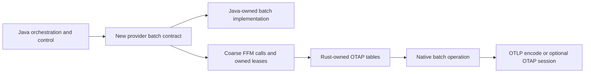

# Greenfield otlp4j: native Arrow viability and value

## Is there a structural dead end once compatibility is removed?

### Takeaway

**No engineering dead end is proven. Conditional GO for one small native-batch experiment; NO-GO for committing to a complete second backend before that experiment demonstrates value.** Rust otel-arrow exposes synchronous OTLP/Arrow conversion and batch operations independently of its collector engine, and lance4j supplies concrete FFM/ownership implementation precedent. Neither establishes telemetry performance. [Rust conversions][conversions], [native concatenation][concat], [FFM downcalls][downcalls], [handle gate][gate].

Scope assumptions supplied by the user: otlp4j is greenfield; all APIs and internals may be replaced; compatibility shims and automatic Java fallback are forbidden. The proposed Java backend implements the same new batch contract directly, not an adapter preserving the old model. Prior notes are background evidence, not a migration plan: [otlp4j audit](../Otlp4j%20Arrow%20backend%20feasibility/otlp4j.md), [otel-arrow audit](../Otlp4j%20Arrow%20backend%20feasibility/otel_arrow.md), [lance4j audit](../Otlp4j%20Arrow%20backend%20feasibility/lance4j.md).

### Cited Findings

| Previously identified issue | Greenfield disposition | What actually remains | Evidence |
| --- | --- | --- | --- |
| No backend SPI | Disappears as a blocker: define the required provider/batch contract | Agree on operations and explicit supported capabilities | [Current component contracts][components], [Rust batch representation][records] |
| Immutable Java public records | Disappears: replace with provider-owned closeable batches | Converting to Java strings/objects costs work when users actually request them | [Current Java materialization][java-function], [Rust column builders][builders] |
| Concrete `PayloadWire` dispatch and generated protobuf binding | Disappears: replace dispatch and transport codec interfaces | Protobuf input still needs parsing and row-to-column construction if Arrow processing is chosen | [Current dispatch][wire], [Rust conversion][conversions] |
| Original payload has no close/retain | Disappears: design consumer ownership from the outset | Correct fan-out, queued work, async sends and cancellation still need explicit leases | [Current delayed acceptance][queue], [native use-versus-close gate][gate] |
| JPMS qualified exports | Disappears: redesign module boundaries and provider registration | Native loading/access settings and matched native binaries remain deployment work | [Current codec module][codec-module], [FFM loading/packaging audit][lance-notes] |
| No stable upstream C ABI | Not a blocker: own a small C wrapper and evolve Java/Rust together | Paired versions must agree on symbols, types, layouts and ownership before use | [Lance breaking-change policy][breaking], [downcall descriptors][downcalls] |

- **Reusable backend, not necessarily a collector:** `pdata` has Arrow, DataFusion, Prost, Tokio/Tonic and config dependencies but no engine/controller entry in its manifest. Conversion methods operate synchronously; `concatenate` is a public function consuming multiple related-table batches with schema unification and ID reindexing. A custom wrapper is needed, but launching another collector runtime is not required merely to process telemetry batches. [Manifest][pdata-manifest], [conversions][conversions], [concatenation][concat].
- **Coverage is a real limit:** `OtapArrowRecords` contains logs, metrics and traces, not profiles; upstream explicitly calls profiles future work. Logs use four possible payload tables, traces eight, metrics nineteen, with multivariate metrics not implemented by the OTLP builder. These are related-table batches, not one flat table. [Signal enum][records], [payload slots][slots], [profiles status][profiles], [metric builder limit][builders].
- **A newly rechecked operational limit:** the native metric splitter explicitly does not divide an individual metric with more datapoints than the requested maximum, emitting that metric in its own oversized batch instead. Native builders also have checked finite-width IDs. These require declared limits, rejection or additional native implementation if strict arbitrary-size splitting is demanded; they are not evidence that native batching itself cannot work. [Split implementation/comment, `split.rs:40-69`][split], [checked IDs, `encode/mod.rs:950-979`][builders].
- **Lance precedent reduces uncertainty, not obligations:** inspected code binds C symbols through FFM, gates destruction until admitted calls/references leave, marshals heap bytes through native memory, and catches recoverable Rust unwinds. Its Arrow Java 19 bridge also uses JNI. This is substantial source-backed feasibility evidence, not freshly executed proof that otel-arrow schemas, overhead or every failure case work. [Bindings][downcalls], [gate][gate], [marshalling][marshal], [panic guard][panic], [Arrow JNI][jni], [prior execution limits][lance-notes].

### Inferences

**Native-owned handles can solve lifetime structurally.** Give each batch owner an independent closeable lease over Rust-owned storage; `retain()` returns another owner, not the same Java wrapper. Define `consume` as taking one lease on every path: accepted work owns it until processing/send finishes, rejection/drop closes it, and callers retain before submission if they need continued access. Fan-out retains one lease per branch, queues release on delivery/eviction, and in-flight calls retain while executing. Closing one owner cannot invalidate another; close prevents new use through that owner, with final destruction after outstanding operations/references exit. A timeout does not authorize freeing data still in use. This is a proposed contract supported by gate/retention precedents, not an existing otlp4j constraint. [Gate][gate], [current asynchronous holders][queue], [current fan-out][fanout].

Published batches should be immutable or operations should consume exclusively owned inputs, returning new handles. Native encoders may mutate normalization state, and codecs use exclusive mutable access, so retain/release alone does not make concurrent mutation safe. Keep mutable codec/session contexts serialized or thread-confined; use copy-on-write or separate results where branches need different transforms. Treat Java arenas as call/header storage, not the owner of all retained Rust buffers. [Mutable conversion][conversions], [encoder contract][encoder], [ownership audit][lance-notes].

**Recommended topology:** Java owns configuration, graph orchestration, scheduling, admission and delivery control; provider batches own data; coarse provider operations decode, concatenate/filter/query and encode. The native provider owns Rust Arrow allocations; the Java provider owns its chosen representation and implements the same new contract. Unsupported operations/signals are explicit errors or unsupported configurations, never invisible cross-provider fallback. There is no need to expose Arrow Java vectors for this first design. [Separable Java runtime][service-module], [native pdata surface][records], [native concatenate][concat].

### Gaps

- No native wrapper was built or run, so structural feasibility is source-backed judgment rather than a tested artifact. No crash-safety or performance result is established.
- Full byte/unknown-field fidelity is not proven by upstream semantic equivalence tests, which normalize defaults and compare sets. Greenfield removes legacy Java parity, not the need to define and verify the new telemetry semantics, multiplicity, parent relationships and invalid-input policy. [Existing equivalence limitations][canonical].
- The new batch API and consumer ownership rules still need implementation, but their absence is not a reason to reject a greenfield experiment.

## Which workloads justify native Arrow, and which probably do not?

### Takeaway

**Native Arrow is plausible when enough work stays native and columnar to amortize ingress/egress; it is a weak default for relay or JVM-centric row processing.** Internal batching can pay off with OTLP output, but OTAP wire-format savings require actually sending OTAP, not just using Arrow internally. [Existing lazy forwarding][proto-payload], [native builders/conversions][builders], [native batching][concat], [OTAP production][producer].

### Cited Findings

- **Present relay already avoids domain decode:** proto-backed payloads preserve a parsed generated request, answer count/size from it and decode the domain only when asked. Resource filtering forwards that same payload when all resources survive; none-survive is a local drop. Comparing Rust Arrow with compulsory Java domain decode would misrepresent this cheap existing path. [Proto payload, `ProtoRequestPayload.java:20-69`][proto-payload], [filter, `FilterProcessor.java:50-81`][java-filter], [wire request selection][wire].
- **Present Java processing has a different cost profile:** user map/predicate processors call `data()`; batching also materializes the domain and merges/splits it. SDK ingress begins with Java SDK objects and currently builds Java maps/lists/records before submission. Greenfield can remove this intermediate otlp4j model, but cannot erase the original SDK objects or the work to produce native columns from them. [Function processor][java-function], [batch processor][java-batch], [SDK mapping][sdk].
- **Conversion and native operators do real work:** raw protobuf views avoid Prost object reconstruction but still append into Arrow builders. Strict decoding currently Prost-decodes before building columns. Concatenation explicitly reindexes joins, unifies schemas and writes combined arrays, rather than always linking buffers without copying. OTLP encoding serializes bytes; OTAP production also copies its IPC output buffer. [Builders][builders], [strict decoding][strict], [concat algorithm][concat], [OTLP conversion][conversions], [IPC copying, `producer.rs:111-127`][producer].
- **OTAP interoperability is more than IPC bytes:** one signal has separate IPC streams per payload type, with schema IDs, dictionary state and resets. Producer/consumer maintain that state; subsequent messages may depend on previous schemas/dictionaries. A standalone codec round trip does not prove ordered gRPC interoperability/reconnect/retry behavior. [Protocol, `otap-spec.md:274-356`][otap-spec], [producer][producer], [consumer][consumer].

### Inferences

| Intended workload | Conditional judgment | Reason and condition for changing the judgment | Source premises |
| --- | --- | --- | --- |
| Pure OTLP relay or cheap metadata routing | **NO-GO as the reason to build an Arrow processing backend** | Already has lazy protobuf forwarding. Native protobuf-only relay may compete, but is a different hypothesis; converting to columns solely to forward is extra work without a demonstrated payoff | [Lazy payload][proto-payload], [filter][java-filter], [builders][builders] |
| Arbitrary Java per-item map/redaction | **Usually NO-GO for native acceleration** | Object-oriented callbacks require object/value access and repeated crossings can erase gains. A new bulk column API or compiled native expression can change this workload; preserving arbitrary row lambdas with no allocation is not a credible promise | [Current callback path][java-function], [FFM byte/string marshaling][marshal] |
| SDK data predominantly produced and consumed on JVM | **Usually NO-GO as the default backend** | Native column construction adds a boundary to existing Java production/consumption. Reconsider only for substantial intermediate native operations or required OTAP output | [SDK input path][sdk], [builders][builders] |
| Large native-compatible batching/filter/query workflows | **GO for a small experiment** | Decode once, retain native batches across coarse operations, encode at the edge. Even OTLP egress can be worthwhile if operation savings exceed conversions. Concatenate exists; filters/queries require their own supported semantics and related-table handling, with query-engine maturity not assumed | [Concat][concat], [split][split], [query status][query], [conversions][conversions] |
| Actual OTAP peer interoperability | **GO as a feature experiment if a peer/use case exists** | Rust Producer/Consumer are real reusable components. This can justify a native backend even absent a universal CPU speedup, but session state and native transport interoperability must be tested | [Producer][producer], [consumer][consumer], [protocol][otap-spec] |

Java callbacks do not inherently force a complete row object: a redesigned cursor over columns or bulk Java buffer processing can avoid that. Nevertheless arbitrary user code can allocate, string-valued access may decode UTF-8, and a field-by-field downcall/upcall design adds crossings. FFM's value is access to useful Rust operations and a retained representation, not automatic compilation of Java lambdas into native vector kernels. [Native column construction][builders], [actual string/byte marshaling][marshal], [FFM descriptors][downcalls].

Use the break-even model **native input handling + protobuf-to-column conversion + native operations + column-to-output conversion + output handling < equivalent optimized Java total**. Count dictionary/schema and native memory costs, not only JVM allocations. Transient input/protobuf and Arrow buffers can coexist while decoding, but persistent full Java-row and native-column copies are a design mistake rather than an unavoidable property of FFM. Coarse calls and native-owned outputs can avoid routine intermediate copies; they cannot eliminate row-to-column layout construction. [Strict decoder][strict], [builders][builders], [owned encoder output][encoder], [Lance copy paths][marshal].

### Gaps

- No speedup, native memory reduction or break-even batch size is measured. Existing JMH coverage cannot establish arbitrary-transform, overload or query economics. [Benchmark scope warning][bench-guide].
- Query-engine status is explicitly under development, not proof that every desired filter/redaction/query is available as a small standalone operation. [Query README][query].
- Native dependency size/build overhead remains unmeasured; `pdata` already brings substantial dependencies even without embedding the collector engine. [Manifest][pdata-manifest].

## What would make this a no-go, and what is enough to decide?

### Takeaway

**Try one useful coarse native operator, not an entire backend or embedded Rust collector. Stop if complete-boundary cost does not beat a simpler Java implementation on the intended workload and there is no concrete OTAP feature need.** Lance4j shows the interop shape is practical engineering, not that costs, deployment or native process-failure scope disappear. [Native operator][concat], [Java serialization control][java-http], [FFM implementation][downcalls], [native risk audit][lance-notes].

### Cited Findings

- **Cheaper Java control exists:** the current uncompressed HTTP serialization path writes a generated request to `ByteArrayOutputStream` and then calls `toByteArray()`, copying the completed buffer. The codec benchmark already demonstrates writing to a presized fixed buffer. This is an optimization control to evaluate fairly, not a compatibility shim or automatic fallback. It does not by itself remove protobuf parsing or batching costs. [Current HTTP serialization, `ArmeriaOtlpClient.java:478-503`][java-http], [fixed-buffer benchmark, `CodecMarshallingBenchmark.java:99-110`][java-control].
- **JNI is not automatically fatal:** Lance's FFM adapter uses Arrow Java JNI for its chosen C Data import/export. This project need not copy that layer if Rust owns batches and Java calls coarse operations on handles. If Java Arrow is useful later, JNI is another deployment choice, not a disqualifying fact under these requirements. [Arrow JNI][jni], [Lance ownership/Arrow audit][lance-notes], [native representation][records].
- **The old compatibility inference was overstated:** Lance itself intentionally changes native layouts and Java together with no release compatibility promise. That is compatible with this greenfield goal. Matching Java/native builds and validating their contract remain safety requirements because equal symbol names alone do not establish correct signatures/layouts. [Breaking policy][breaking], [descriptor binding][downcalls].
- **In-process failure and deployment remain:** an unwind guard catches recoverable Rust panics, not segmentation faults, pointer UB or process aborts. The inspected Lance native artifact is specifically Linux x86_64/glibc, not a universal binary; its loading and Arrow JNI arrangements illustrate additional runtime obligations. An in-process native backend shares the JVM's process failure boundary. [Panic guard][panic], [platform artifact][native-artifact], [risk/loading audit][lance-notes].

### Inferences

#### Requirements that would invalidate the proposal

| Requirement | Why it is a no-go under that requirement | Category | Evidence |
| --- | --- | --- | --- |
| All four signals natively, including profiles, immediately with existing otel-arrow APIs | Native profiles representation/conversion is absent. Requires new upstream/downstream implementation, not just FFM | Unsupported today, not impossible forever | [Signal enum][records], [profiles roadmap][profiles] |
| Universal speedup for pure relay and tiny batches | No evidence supports it; Arrow conversion adds work absent from lazy protobuf forwarding | Unjustified performance requirement | [Lazy payload][proto-payload], [builders][builders] |
| No data-layout conversion for protobuf input into usable Arrow columns | Input wire and native columnar layout differ; inspected builder constructs columns | Contradicts chosen representations | [Builder traversal][builders] |
| Unchanged arbitrary Java row lambdas, with guaranteed zero allocation/crossing overhead | Arbitrary user code cannot be promised allocation-free; preserving row access defeats a native-only columnar path | Impossible guarantee, not a reason to reject a redesigned API | [Row callback path][java-function], [marshalling][marshal] |
| Whole OTAP batch through one standard Arrow C Stream with no multiplexing | Related payloads have different schemas; OTAP explicitly separates streams per payload type | Incorrect protocol/model boundary | [Slots][slots], [IPC stream management][otap-spec] |
| Incremental OTAP messages independently decodable after reconnect with no state/reset | Decoder needs schema/dictionary state; producer provides resets precisely for independence | Incorrect stream semantics | [Producer reset][producer], [consumer state][consumer] |
| No native artifacts, loader/access/libc obligations, or guaranteed isolation from native faults inside JVM | Native in-process execution inherently introduces these responsibilities | Contradictory deployment/failure requirement | [Native artifact][native-artifact], [panic guard][panic], [loading audit][lance-notes] |

SPI creation, API redesign, ownership design, module changes, a small Rust C wrapper, a new batch contract and paired-version packaging are ordinary engineering work. None independently makes the idea unworthy of trying. Native semantic gaps such as strict metric item splitting require implementing a feature or defining a narrower contract, not preserving legacy Java behavior. [Existing split limit][split], [new synchronous backend operations][concat], [breaking paired development][breaking].

#### Minimum useful experiment and stop rule

Use **one signal and one existing meaningful operation**, for example logs concatenation: complete OTLP inputs -> strict native decode -> retained native batch handles -> one concatenate with reindexing -> OTLP output -> release all leases. Keep calls synchronous, Rust-owned storage, Java orchestration, no Arrow Java dependency, no per-item callbacks, no hidden Java fallback and no native collector runtime. Compare the same declared new semantics with a straightforward Java/protobuf implementation; neither implementation must preserve the old record API. This exercises real boundary/operation costs, unlike an empty FFM call or codec-only stunt. [Strict decode][strict], [concat contract][concat], [OTLP output][conversions], [pdata dependencies][pdata-manifest].

Measure complete-path time/throughput, Java allocation, native live/peak memory and process RSS on tiny and representative larger/multi-resource inputs. Include optimized Java HTTP serialization when measuring a network path. Check expected telemetry values and multiplicity, related-table integrity, bounded handles, malformed-input failure and all owned allocations released after success/error/close. Do not make old model identity, legacy Java parity, broad platform support, full OTAP transport or all signals prerequisites for this experiment. [Native join handling][concat], [strict decoder][strict], [ownership gate][gate], [fixed-buffer control][java-control], [measurement comparability][bench-guide].

**Stop rather than build the full backend** if conversion/copy/operator totals lose to the simpler Java control on the actual target workload, and results offer neither a useful memory advantage nor required OTAP interoperability. If only kernel-only benchmarks win, but complete boundaries lose, that is not an integration win. If benefit exists only after long native pipelines, proceed only if those pipelines are genuinely the product, not a hypothetical excuse to expand scope. No universal numeric speedup threshold or effort estimate is supported by current evidence. [Measured-scope caution][bench-guide], [conversion costs][builders], [concat costs][concat].

Embedding the entire Rust engine is a separate product decision. It becomes plausible if Java is intentionally a thin configuration/control facade over a native telemetry engine, with native scheduling, transport and processing replacing rather than duplicating Java orchestration. Otherwise importing collector lifecycle, queues, networking and threads alongside the Java runtime buys duplicated control planes before one operator has justified itself. Start with reusable pdata APIs; revisit the engine only for an actual engine-level requirement. [Separable pdata manifest][pdata-manifest], [engine architecture][engine], [Java orchestration module][service-module].

### Gaps

- No benchmarks/builds/tests were executed, and no performance or delivery-cost conclusion is presented as measured. The inspected commits remain otlp4j `2ec6a258c83eb4a85d306729f2e4ca1c99b3d906`, otel-arrow `ddf1675fe65543594ce8149a34eadec5e17d40e8`, lance4j `4db50b8544e89782e1deb7630da2bca40adc2609`. Only this new notes file was written.
- Need the actual intended workload and whether OTAP peers are part of it. Without that, the defensible verdict is conditional GO for the small native-batch experiment, not GO for an unrestricted second backend.
- Lance precedent does not prove this integration's native build size, library load behavior, malformed telemetry policy, Arrow schema fidelity, crash safety or end-to-end economics. Those are experiment/release evidence gaps, not proven dead ends.

[components]: ../../otlp4j-core/src/main/java/dev/nthings/otlp4j/core/component/ComponentFactory.java#L3-L26
[wire]: ../../otlp4j-codec/src/main/java/dev/nthings/otlp4j/codec/PayloadWire.java#L43-L93
[codec-module]: ../../otlp4j-codec/src/main/java/module-info.java#L7-L15
[service-module]: ../../otlp4j-service/src/main/java/module-info.java#L1-L13
[proto-payload]: ../../otlp4j-codec/src/main/java/dev/nthings/otlp4j/codec/ProtoRequestPayload.java#L20-L69
[java-function]: ../../otlp4j-core/src/main/java/dev/nthings/otlp4j/core/component/FunctionProcessor.java#L32-L44
[java-filter]: ../../otlp4j-components/src/main/java/dev/nthings/otlp4j/components/routing/FilterProcessor.java#L50-L81
[java-batch]: ../../otlp4j-components/src/main/java/dev/nthings/otlp4j/components/batch/BatchProcessor.java#L118-L272
[queue]: ../../otlp4j-components/src/main/java/dev/nthings/otlp4j/components/internal/DeliveryQueue.java#L109-L312
[fanout]: ../../otlp4j-service/src/main/java/dev/nthings/otlp4j/service/internal/FanOutConsumer.java#L18-L53
[sdk]: ../../otlp4j-opentelemetry/src/main/java/dev/nthings/otlp4j/opentelemetry/SdkDataMapper.java#L55-L83
[java-http]: ../../otlp4j-transport/src/main/java/dev/nthings/otlp4j/transport/internal/ArmeriaOtlpClient.java#L478-L503
[java-control]: ../../otlp4j-benchmarks/src/main/java/dev/nthings/otlp4j/bench/CodecMarshallingBenchmark.java#L99-L110
[bench-guide]: ../../otlp4j-benchmarks/baselines/README.md#L54-L66
[pdata-manifest]: https://github.com/open-telemetry/otel-arrow/blob/ddf1675fe65543594ce8149a34eadec5e17d40e8/rust/otap-dataflow/crates/pdata/Cargo.toml#L15-L47
[records]: https://github.com/open-telemetry/otel-arrow/blob/ddf1675fe65543594ce8149a34eadec5e17d40e8/rust/otap-dataflow/crates/pdata/src/otap.rs#L39-L202
[slots]: https://github.com/open-telemetry/otel-arrow/blob/ddf1675fe65543594ce8149a34eadec5e17d40e8/rust/otap-dataflow/crates/pdata/src/otap/raw_batch_store.rs#L84-L128
[concat]: https://github.com/open-telemetry/otel-arrow/blob/ddf1675fe65543594ce8149a34eadec5e17d40e8/rust/otap-dataflow/crates/pdata/src/otap/transform/concatenate.rs#L4-L235
[split]: https://github.com/open-telemetry/otel-arrow/blob/ddf1675fe65543594ce8149a34eadec5e17d40e8/rust/otap-dataflow/crates/pdata/src/otap/transform/split.rs#L25-L69
[conversions]: https://github.com/open-telemetry/otel-arrow/blob/ddf1675fe65543594ce8149a34eadec5e17d40e8/rust/otap-dataflow/crates/pdata/src/payload.rs#L720-L781
[builders]: https://github.com/open-telemetry/otel-arrow/blob/ddf1675fe65543594ce8149a34eadec5e17d40e8/rust/otap-dataflow/crates/pdata/src/encode/mod.rs#L53-L991
[strict]: https://github.com/open-telemetry/otel-arrow/blob/ddf1675fe65543594ce8149a34eadec5e17d40e8/rust/otap-dataflow/crates/pdata-codec/src/codecs/otlp.rs#L76-L106
[encoder]: https://github.com/open-telemetry/otel-arrow/blob/ddf1675fe65543594ce8149a34eadec5e17d40e8/rust/otap-dataflow/crates/pdata-codec/src/encoder.rs#L4-L49
[profiles]: https://github.com/open-telemetry/otel-arrow/blob/ddf1675fe65543594ce8149a34eadec5e17d40e8/README.md#L106-L120
[query]: https://github.com/open-telemetry/otel-arrow/blob/ddf1675fe65543594ce8149a34eadec5e17d40e8/rust/otap-dataflow/crates/query-engine/README.md#L3-L33
[producer]: https://github.com/open-telemetry/otel-arrow/blob/ddf1675fe65543594ce8149a34eadec5e17d40e8/rust/otap-dataflow/crates/pdata/src/encode/producer.rs#L23-L331
[consumer]: https://github.com/open-telemetry/otel-arrow/blob/ddf1675fe65543594ce8149a34eadec5e17d40e8/rust/otap-dataflow/crates/pdata/src/decode/decoder.rs#L48-L117
[otap-spec]: https://github.com/open-telemetry/otel-arrow/blob/ddf1675fe65543594ce8149a34eadec5e17d40e8/docs/otap-spec.md#L274-L356
[canonical]: https://github.com/open-telemetry/otel-arrow/blob/ddf1675fe65543594ce8149a34eadec5e17d40e8/rust/otap-dataflow/crates/pdata/src/testing/equiv/canonical.rs#L4-L151
[engine]: https://github.com/open-telemetry/otel-arrow/blob/ddf1675fe65543594ce8149a34eadec5e17d40e8/rust/otap-dataflow/README.md#L29-L447
[downcalls]: https://github.com/thiagogcm/lance4j/blob/4db50b8544e89782e1deb7630da2bca40adc2609/lance-abi-ffm/src/main/java/dev/nthings/lance4j/lanceabi/ffm/LanceAbi.java#L17-L48
[gate]: https://github.com/thiagogcm/lance4j/blob/4db50b8544e89782e1deb7630da2bca40adc2609/lance-abi-ffm/src/main/java/dev/nthings/lance4j/lanceabi/ffm/GatedHandle.java#L12-L109
[marshal]: https://github.com/thiagogcm/lance4j/blob/4db50b8544e89782e1deb7630da2bca40adc2609/lance-abi-ffm/src/main/java/dev/nthings/lance4j/lanceabi/ffm/AbiMarshal.java#L98-L184
[panic]: https://github.com/thiagogcm/lance4j/blob/4db50b8544e89782e1deb7630da2bca40adc2609/lance-abi/src/core/handles.rs#L29-L49
[breaking]: https://github.com/thiagogcm/lance4j/blob/4db50b8544e89782e1deb7630da2bca40adc2609/docs/design/compatibility.md#L3-L30
[native-artifact]: https://github.com/thiagogcm/lance4j/blob/4db50b8544e89782e1deb7630da2bca40adc2609/lance4j-native/lance-abi-linux-x86_64/pom.xml#L12-L20
[jni]: https://github.com/apache/arrow-java/blob/v19.0.0/c/src/main/java/org/apache/arrow/c/jni/JniWrapper.java#L19-L53
[lance-notes]: ../Otlp4j%20Arrow%20backend%20feasibility/lance4j.md#L11-L75
